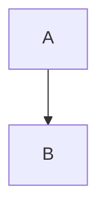

# M01 · G0: renderer, App 1 shell and Quick Look — Implementation Plan

> **For agentic workers:** REQUIRED SUB-SKILL: Use superpowers:subagent-driven-development (recommended) or superpowers:executing-plans to implement this plan task-by-task. Steps use checkbox (`- [ ]`) syntax for tracking.

**Goal:** Pass gate G0 by Mon 2 Nov 2026. A ≈1 MB Markdown file with Mermaid and RTL text must render in < 1 s in the App 1 window **and** in Quick Look, on macOS 15 (Intel, local) and on macOS 27 (arm64, Scaleway). The proof is measured numbers recorded in `docs/gates/G0.md`.

**Architecture:**
- **Renderer:** one JS renderer built by bun. `markdown.js` is pure and turns Markdown into an HTML string. `page.js` sanitises that HTML with DOMPurify, inserts it, lazy-loads Mermaid and posts `rendered`. The bundle is committed into the `TegelKit` SwiftPM resources.
- **TegelKit:** `RendererWebView` wraps one `WKWebView` holding that page, with navigation blocked and a timeout. `TextFileLoader` decodes untrusted bytes with a 5 MB cap.
- **App 1 and its Quick Look extension** both link TegelKit statically. A `--benchmark` flag gives headless numbers on remote Macs.

**Tech Stack:**
- Swift 6 language mode. SwiftUI `DocumentGroup(viewing:)`, AppKit, WebKit, QuickLookUI, `os.Logger`/`OSSignposter`.
- XCTest under `swift test`. XcodeGen 2.46.0.
- bun 1.4.0 (runtime, bundler, test runner).
- Exact npm pins, each checked with `npm view <pkg> time` on 27 Oct 2026: markdown-it 14.3.3, highlight.js 11.12.0, dompurify 3.4.17, mermaid 11.17.2.
- GitHub Actions; Scaleway M1 [F9].

**Spec:**
- `BUSINESS-PLAN.md` §5, §6.1, §6.3, §7.1–7.2, §11 W1, §12 G0 and §15.
- `docs/superpowers/plans/2026-10-27-00-master-roadmap.md` (§2 decisions, §3 contract, §3.4 fixtures, §5 checkpoints).
- `docs/research/2026-10-27-technical-facts.md` ([F#]). `CLAUDE.md` (product rules 1–9, the pipeline, the hardware constraint).

**Branch:** `m01-g0-renderer`, cut from `main` (Task 1, Step 0). The pipeline base is `git merge-base HEAD main`.

## Global Constraints

**Platform and build**
- macOS deployment target **14.0**. Universal binary (`arm64 x86_64`). Swift 6 language mode; `swift-tools-version: 6.0`.
- The build Mac is an Intel iMac19,1 on macOS 15.7.7 with Xcode 26.3 and Swift 6.2.4. It has bun 1.4.0 and xcodegen 2.46.0 in `~/.local/bin`, which is on PATH.
- It can't run arm64, macOS 26 or macOS 27 [F1]. Every result names the machine that produced it.

**Identifiers**
- Bundle ids: `com.tegelapps.markdown` and `com.tegelapps.markdown.quicklook`, via `options.bundleIdPrefix: com.tegelapps` (D7).
- UTType `net.daringfireball.markdown`, **imported**, with extensions `md, markdown, mdown, mkd, mkdn`, conforming to `public.plain-text` [F10].

**Entitlements, exactly per D5**
- App: `com.apple.security.app-sandbox`, `com.apple.security.files.user-selected.read-write`, `com.apple.security.files.bookmarks.app-scope`, `com.apple.security.network.client`, and `com.apple.security.temporary-exception.mach-lookup.global-name = [$(PRODUCT_BUNDLE_IDENTIFIER)-spks, $(PRODUCT_BUNDLE_IDENTIFIER)-spki]` [F4].
- Quick Look extension: `app-sandbox`, `network.client`, and `temporary-exception.files.absolute-path.read-only = ["/"]` [F5].

**Content security**
- CSP, verbatim: `default-src 'none'; script-src 'self'; style-src 'self' 'unsafe-inline'; img-src 'self' file: data:; font-src 'self'`.
- DOMPurify forbids `script, iframe, object, embed, form, base, meta`, every `on*` attribute, `javascript:` and `file:` URLs, and `data:` URLs other than `data:image/*`. The config and hooks live in `Renderer/src/sanitize.js`, the one sanitiser that `page.js`, plan 08's site tool and plan 07's KaTeX all import. Plan 02 re-allows `file:` on `img[src]` only.
- Mermaid runs with `securityLevel: 'strict'` and `startOnLoad: false`, and is loaded only when a `[data-mermaid]` block exists.
- No navigation away from `index.html`.

**Limits**
- Files over **5 MB** (`maxBytes = 5_000_000`) render truncated with a banner.
- Quick Look **never takes more than 2 s**.

**Product rules**
- Read-only (product rule 1): no writes to user files.
- No network except licence checks and Sparkle (neither exists in M01). No telemetry.
- Arabic sample text is neutral technical prose, **never Qur'an or hadith** (rule 3). No faces or figures in screenshots.

**Design**
- The window and Quick Look UI stay **unstyled scaffolding**: no colour, type, spacing or theme values. `DESIGN.md` arrives with plan 09 Drop A, which merges on Mon 2 Nov after this plan, and plan 09 Task 6 supplies every theme value from `DESIGN.md` §7.

**Process**
- Outward actions need the user's yes first: any Scaleway order (it costs money), and any trademark filing. Pushing to this private repo is authorised (D14).
- Secrets go in `.env` by key **name** only. Never print a value.
- Budget for this plan: one Scaleway M1 day (lease L1), €3.19 incl. 21 % VAT (€2.64 before tax) [F9].
- Every commit message ends with the line `Co-Authored-By: Claude Opus 5.5 <noreply@anthropic.com>`.

## Review Focus

Each line names an input class the spec implies, the expected behaviour, and the test that pins it.

1. **Hostile Markdown.** `<script>`, `onerror=`, `javascript:` links, SVG with script, `<iframe>`, remote ``, Mermaid `click`, `file://` links, `<meta refresh>`, `<base>`, `@import`.
   - Expected: no script runs, no network request, no navigation; the surrounding text still renders.
   - Pinned by: Task 3 `link syntax never yields…` (string level); Task 5 `testHostileFixtureRunsNoScriptAndMakesNoRequest` and `testClickingHostileLinksNeverNavigates` (WebKit level).
2. **Odd encodings and sizes.** UTF-16 with BOM, Windows-1252, a NUL byte, an empty file, a 50 MB file, a cut through a multibyte character.
   - Expected: the text decodes, or a banner shows; Quick Look stays under 2 s.
   - Pinned by: Task 4 tests and Task 8 Step 7.
3. **Mixed bidi.** An Arabic paragraph with inline English and code; RTL list, table and blockquote; a Hebrew heading followed by English.
   - Expected: each block takes the direction of its first strong character; code stays LTR.
   - Pinned by: Task 3 `block elements get dir=auto…` and Task 5 `testMixedBidiDirections` (WebKit `:dir()`).
4. **Broken or huge Mermaid.** A syntax error, a 500-node graph, 30 diagrams.
   - Expected: an error box for that one diagram only, the rest renders, and the renderer never hangs.
   - Pinned by: Task 5 `testBrokenMermaidShowsOneErrorAndRendersTheRest` and `testThirtyDiagramsAndFiveHundredNodeGraphFinish`.
5. **Pathological structure.** 10,000 nested `>`, a 5,000-deep list, a 5 MB single line.
   - Expected: renders without throwing, in < 1.5 s (markdown-it's `maxNesting` caps the depth).
   - Pinned by: Task 3 `pathological structure renders quickly without throwing`.
   - The master's fifth line, licence edge cases, belongs to plan 03.

---

## File map

| Path | Task | Responsibility |
|---|---|---|
| `Makefile`, `Config/{Debug,Release}.xcconfig`, `Packages/TegelKit/Package.swift` | 1 | build entry points, signing, package |
| `Packages/TegelKit/Sources/TegelKit/RendererTypes.swift` | 1 | contract value types |
| `Fixtures/markdown/*.md` (12 committed), `Fixtures/generate.js`, `.gitattributes` | 2 | shared test inputs |
| `Renderer/package.json`, `bun.lock`, `src/markdown.js`, `test/markdown.test.js` | 3 | pure Markdown → HTML |
| `Packages/TegelKit/Sources/TegelKit/TextFileLoader.swift` | 4 | bytes → text, 5 MB cap |
| `Renderer/src/{page.js,sanitize.js,index.html,css/*.css}`, `Renderer/build.js`, `Resources/Renderer/*` | 5 | DOM side, shared sanitiser, CSP, bundle |
| `Packages/TegelKit/Sources/TegelKit/RendererWebView.swift`, `Tests/TegelKitTests/WebView/*` | 5, 6 | WKWebView host + integration/perf tests |
| `project.yml`, `Apps/Markdown/App/{MarkdownApp,DocumentView}.swift` | 7 | App 1 shell, `--benchmark` |
| `Apps/Markdown/QuickLook/PreviewViewController.swift` | 8 | Quick Look (view-based) |
| `.github/workflows/ci.yml` | 10 | CI |
| `docs/gates/{G0,trademark}.md`, `docs/reviews/{m01,design-m01}.md` | 6, 9, 11–14 | evidence and decisions |

## W1 schedule

| Day | Work |
|---|---|
| Tue 27 Oct | Tasks 1–3. Task 11 (trademark), which must finish by Thu 29 because H4 buys the domain on Fri 30 |
| Wed 28 Oct | Tasks 4–5. Task 12 Steps 1–2 (Scaleway account; the user adds a card for H6) |
| Thu 29 Oct | Tasks 6–8 |
| Fri 30 Oct | Tasks 9–10. Lease L1 may be ordered this evening (Task 12 Steps 3–4), once the user's yes is in |
| Sat 31 Oct | Task 12 Steps 3–9: if L1 wasn't ordered on Friday evening, order it in the morning (the non-default macOS adds about 1 h), then the remote G0 run |
| Sun 1 Nov | Task 12 Step 10: delete the server 24 h after the order (Sat 31 Oct evening if ordered on Friday evening) |
| Mon 2 Nov | Task 13 (G0 decision), Task 14 (pipeline, merge, push) |

---

### Task 1: Scaffolding — Makefile, xcconfigs, TegelKit package, contract value types

**Files:**
- Create: `Makefile`, `Config/Debug.xcconfig`, `Config/Release.xcconfig`, `Packages/TegelKit/Package.swift`, `Packages/TegelKit/Sources/TegelKit/RendererTypes.swift`
- Modify: `.gitignore` (append)
- Test: `Packages/TegelKit/Tests/TegelKitTests/RendererTypesTests.swift`

**Interfaces:**
- Consumes: nothing.
- Produces (contract §3.3, verbatim):
  - `public enum RendererTheme: String, CaseIterable, Sendable { case paper, ink, studio }`
  - `public enum RenderMode: String, Sendable { case window, quicklook, print }`
  - `public struct RenderOptions: Sendable { public var mode: RenderMode; public var theme: RendererTheme; public var baseURL: URL? }`
  - `public struct Heading: Sendable, Hashable, Decodable { public let level: Int; public let text: String; public let id: String }`
  - `public struct RenderResult: Sendable, Decodable { public let ms: Double; public let headings: [Heading]; public let mermaidCount: Int; public let errors: [String] }`
- Produces (addition; the synthesised memberwise init is internal): `public init(mode: RenderMode = .window, theme: RendererTheme = .paper, baseURL: URL? = nil)` on `RenderOptions`.
- Produces: Make targets `check renderer test-js test-swift build fixtures clean` (master §3.1).

- [ ] **Step 0: Cut the branch**

Run: `git checkout main && git pull --ff-only && git checkout -b m01-g0-renderer && git rev-parse --short HEAD`
Expected: `Switched to a new branch 'm01-g0-renderer'`, then the base SHA (today `68f3bf5`).

- [ ] **Step 1: Write `Package.swift` and the failing test**

```swift
// Packages/TegelKit/Package.swift
// swift-tools-version: 6.0
import PackageDescription
let package = Package(
    name: "TegelKit",
    platforms: [.macOS(.v14)],
    products: [.library(name: "TegelKit", targets: ["TegelKit"])],   // plan 03 adds TegelStore
    targets: [
        .target(name: "TegelKit"),                                    // Task 5 adds resources
        .testTarget(name: "TegelKitTests", dependencies: ["TegelKit"]),
    ]
)
```

```swift
// Packages/TegelKit/Tests/TegelKitTests/RendererTypesTests.swift
import XCTest
@testable import TegelKit

final class RendererTypesTests: XCTestCase {
    func testRenderResultDecodesTheRenderedMessage() throws {
        let json = #"{"type":"rendered","ms":12.5,"headings":[{"level":2,"text":"مرحبا","id":"مرحبا"}],"mermaidCount":1,"errors":["Parse error on line 2"]}"#
        let r = try JSONDecoder().decode(RenderResult.self, from: Data(json.utf8))
        XCTAssertEqual(r.ms, 12.5)
        XCTAssertEqual(r.headings, [Heading(level: 2, text: "مرحبا", id: "مرحبا")])
        XCTAssertEqual(r.mermaidCount, 1)
        XCTAssertEqual(r.errors, ["Parse error on line 2"])
    }
    func testThemeRawValuesAreTheJSThemeNames() {
        XCTAssertEqual(RendererTheme.allCases.map(\.rawValue), ["paper", "ink", "studio"])
        XCTAssertEqual(RenderMode.quicklook.rawValue, "quicklook")
    }
    func testRenderOptionsDefaultToFreeWindowRendering() {
        let o = RenderOptions()
        XCTAssertEqual(o.mode, .window); XCTAssertEqual(o.theme, .paper); XCTAssertNil(o.baseURL)
    }
}
```

- [ ] **Step 2: Run it and watch it fail**

Run: `swift test --package-path Packages/TegelKit --filter RendererTypesTests`
Expected: FAIL. The build errors with `cannot find 'RenderResult' in scope`, or with missing `Sources/TegelKit`.

- [ ] **Step 3: Implement the types in `RendererTypes.swift`**

Write the contract types exactly as in Interfaces, plus the `RenderOptions` init.

- [ ] **Step 4: Run it and watch it pass**

Run: `swift test --package-path Packages/TegelKit --filter RendererTypesTests`
Expected: `Executed 3 tests, with 0 failures`.

- [ ] **Step 5: Write the Makefile, xcconfigs and ignores**

```make
# Makefile — recipes are indented with a TAB. GNU Make 3.81 (macOS) compatible.
BUN      ?= bun
XCODEGEN ?= xcodegen
PKG      := Packages/TegelKit
G0       := Fixtures/markdown/g0-1mb.md

.PHONY: check renderer test-js test-swift build fixtures clean
check: test-js test-swift build
renderer:
	cd Renderer && $(BUN) install --frozen-lockfile && $(BUN) build.js
test-js:
	cd Renderer && $(BUN) install --frozen-lockfile && $(BUN) test && $(BUN) build.js --check
test-swift: $(G0)
	swift test --package-path $(PKG)
build:
	$(XCODEGEN) generate
	xcodebuild -project Tegel.xcodeproj -scheme markdown -configuration Debug -derivedDataPath build ONLY_ACTIVE_ARCH=NO build
fixtures:
	$(BUN) Fixtures/generate.js
$(G0): Fixtures/generate.js
	$(BUN) Fixtures/generate.js
clean:
	rm -rf build Tegel.xcodeproj $(PKG)/.build Fixtures/markdown/g0-1mb.md Fixtures/markdown/huge-50mb.md
```

`Config/Debug.xcconfig`. Ad-hoc signing ("sign to run locally"), because no Developer ID exists until H2:
```
CODE_SIGN_IDENTITY = -
CODE_SIGN_STYLE = Manual
DEVELOPMENT_TEAM =
MARKETING_VERSION = 0.1.0
CURRENT_PROJECT_VERSION = 1
```
`Config/Release.xcconfig`. Placeholders that plan 03 fills:
```
// plan 03 (H2): DEVELOPMENT_TEAM from .env APPLE_TEAM_ID; TG* Polar keys (D16)
CODE_SIGN_IDENTITY = Developer ID Application
CODE_SIGN_STYLE = Manual
DEVELOPMENT_TEAM =
ENABLE_HARDENED_RUNTIME = YES
ONLY_ACTIVE_ARCH = NO
MARKETING_VERSION = 0.1.0
CURRENT_PROJECT_VERSION = 1
```
Append to `.gitignore`. XcodeGen writes these files from `project.yml`, which stays the source of truth:
```
Apps/*/*/Info.plist
Apps/*/*/*.entitlements
Packages/TegelKit/TestHost/Info.plist
```

Run: `make -n check | head -3`
Expected: the `cd Renderer && bun install --frozen-lockfile && bun test && bun build.js --check` line prints. Nothing runs yet.

- [ ] **Step 6: Commit**

```bash
git add Makefile Config .gitignore Packages/TegelKit/Package.swift Packages/TegelKit/Sources Packages/TegelKit/Tests
git commit -m "chore: scaffold Makefile, xcconfigs and TegelKit contract types" -m "Co-Authored-By: Claude Opus 5.5 <noreply@anthropic.com>"
```

---

### Task 2: Fixtures and the generator

**Files:**
- Create:
  - committed fixtures under `Fixtures/markdown/`: `gfm-kitchen-sink.md`, `rtl-arabic.md`, `rtl-hebrew.md`, `rtl-persian-urdu.md`, `mixed-bidi.md`, `mermaid-basic.md`, `mermaid-broken.md`, `hostile.md`, `frontmatter.md`, `utf16le-bom.md`, `cp1252.md`, `empty.md`;
  - `Fixtures/generate.js`;
  - `.gitattributes`.
- Modify: `.gitignore`.

**Interfaces:**
- Produces: the fixture invariants later tests rely on.
  - `hostile.md` contains `SENTINEL-TOP` and `SENTINEL-BOTTOM`, and its network bait points only at `http://127.0.0.1:47123/`.
  - `mermaid-basic.md` has 2 valid diagrams.
  - `mermaid-broken.md` has 3 diagrams, the 2nd invalid, followed by `SENTINEL-AFTER-BROKEN`.
  - `g0-1mb.md` is 1,000,000–1,050,000 bytes, with exactly 5 ` ```mermaid ` fences, 60 other fences, 8 tables, and Arabic and Hebrew paragraphs.
  - `huge-50mb.md` is ≥ 50,000,000 bytes.
- Produces: CLI `bun Fixtures/generate.js`, which writes both generated files and **throws before writing** if any count above is off.

- [ ] **Step 1: Run the missing generator and watch it fail**

Run: `make fixtures`
Expected: FAIL with `Module not found "Fixtures/generate.js"`.

- [ ] **Step 2: Write the committed fixtures**

Required content per file:

| File | Must contain |
|---|---|
| `gfm-kitchen-sink.md` | h1–h6; emphasis and strike; nested ordered and unordered lists; an aligned table; a blockquote; fences in swift/js/json/bash/yaml; an indented code block; inline code; `---`; a bare `www.example.com`; `<kbd>` and `<details>` |
| `rtl-arabic.md` | Arabic heading, paragraphs, list, table, blockquote and a code fence, using the sentences below |
| `rtl-hebrew.md` | `# מדריך קצר`, a Hebrew paragraph, then an English paragraph, a list and a table |
| `rtl-persian-urdu.md` | `# راهنمای کوتاه`, `این یک فایل آزمایشی برای نمایش متن راست‌به‌چپ است.`, `## مختصر رہنما`, `یہ دائیں سے بائیں متن دکھانے کے لیے ایک آزمائشی فائل ہے۔` |
| `mixed-bidi.md` | exactly the block below |
| `mermaid-basic.md` | one `graph TD` and one `sequenceDiagram`, each valid, with prose between |
| `mermaid-broken.md` | valid `graph LR`; then ` ```mermaid ` / `graph TD` / `  A -->> -->` (invalid); then valid `pie`; then the paragraph `SENTINEL-AFTER-BROKEN` |
| `hostile.md` | the block below |
| `frontmatter.md` | `---` / `title: "<script>alert(1)</script>"` / `tags: [a, b]` / `---`, then `# Body` |
| `utf16le-bom.md` | `printf '\377\376' > F; printf '# UTF-16 مرحبا\n\nNeutral technical text.\n' \| iconv -f UTF-8 -t UTF-16LE >> F` |
| `cp1252.md` | `printf '# Caf\351 \223quotes\224 \200 5\n' > F` (octal escapes are portable to BSD `printf`; raw CP1252 bytes) |
| `empty.md` | 0 bytes (`: > F`) |

The only Arabic sentences to use. Each is neutral technical prose, reviewed against product rule 3:
`دليل القارئ` · `هذا ملف تجريبي لاختبار عرض النص العربي من اليمين إلى اليسار.` · `يدعم البرنامج الجداول والقوائم والمقاطع البرمجية.` · `الخطوة الأولى: افتح الملف.` · `الخطوة الثانية: اقرأ المحتوى.` · `ملاحظة: هذا النص للاختبار فقط.` · table `| الاسم | الحجم |` / `| ملف.md | 2 KB |`. Hebrew: `זהו קובץ בדיקה להצגת טקסט מימין לשמאל.`

`mixed-bidi.md`:
~~~markdown
# اختبار الاتجاه المختلط

يعرض هذا المستند نصًا عربيًا مع كلمة English وأمر `git status` داخل السطر.

## כותרת בעברית

This English paragraph follows a Hebrew heading and must stay left-to-right.

- عنصر أول في القائمة
- عنصر ثانٍ مع `code`

> اقتباس باللغة العربية.

| العمود | القيمة |
|---|---|
| حجم الملف | 1 MB |

```js
const x = 1; // code stays LTR
```
~~~

`hostile.md`:
~~~markdown
# Hostile input

SENTINEL-TOP

<script>window.__pwned = 'script'</script>

<svg><script>window.__pwned = 'svg'</script><circle r="5"/></svg>
<svg onload="window.__pwned = 'svg-onload'"></svg>
<iframe src="http://127.0.0.1:47123/iframe"></iframe>
<object data="file:///etc/passwd"></object>
<embed src="file:///etc/passwd">
<form action="http://127.0.0.1:47123/form"><button>go</button></form>
<meta http-equiv="refresh" content="0;url=http://127.0.0.1:47123/refresh">
<base href="http://127.0.0.1:47123/">
<link rel="stylesheet" href="http://127.0.0.1:47123/link.css">
<style>@import url("http://127.0.0.1:47123/import.css"); #doc { background: url("http://127.0.0.1:47123/bg.png") }</style>


[js link](javascript:window.__pwned='js-link') · <a href="javascript:window.__pwned='raw-js'">raw js</a>
[file link](file:///Users/Shared/secret.txt) · <a href="file:///etc/passwd">passwd</a>
<a href="http://127.0.0.1:47123/nav" id="http-link">http link</a>




SENTINEL-BOTTOM
~~~

- [ ] **Step 3: Write `Fixtures/generate.js`**

It has no dependencies, and its output is deterministic (no randomness).
- **g0:** loop over sections. Each section has a heading cycling EN/AR/HE, an Arabic paragraph, a Hebrew paragraph, an English paragraph, and one code fence, rotating swift/js/python/json/bash/yaml up to 60. Insert 5 Mermaid diagrams (flowchart, sequenceDiagram, classDiagram, stateDiagram-v2, erDiagram) and 8 tables at even intervals. Append English paragraphs until the byte length is ≥ 1,000,000.
- **Self-check:** assert 5 and 60 fences, 8 `|---|` separator lines, the size range, `/\p{Script=Arabic}/u` and `/\p{Script=Hebrew}/u`. Throw on any mismatch.
- **huge:** `await Bun.write(path, chunk.repeat(n))`, where `chunk` is a ≈10 KB Markdown section and `n = Math.ceil(50_000_000 / chunk.length)`.
- Append `Fixtures/markdown/g0-1mb.md` and `Fixtures/markdown/huge-50mb.md` to `.gitignore`.
- Write `.gitattributes` containing `Fixtures/markdown/utf16le-bom.md binary` and `Fixtures/markdown/cp1252.md binary`.

- [ ] **Step 4: Run the generator and verify the invariants**

Run: `make fixtures && wc -c Fixtures/markdown/g0-1mb.md Fixtures/markdown/huge-50mb.md && grep -c '^```mermaid$' Fixtures/markdown/g0-1mb.md && xxd -l 4 Fixtures/markdown/utf16le-bom.md && (iconv -f UTF-8 -t UTF-8 Fixtures/markdown/cp1252.md >/dev/null 2>&1 && echo valid-utf8 || echo invalid-utf8)`
Expected:
- g0 is between 1000000 and 1050000 bytes; huge is ≥ 50000000.
- The Mermaid fence count is `5`.
- `xxd` shows `fffe 2300`.
- The last line is `invalid-utf8`.

- [ ] **Step 5: Check the religious-text guard (product rule 3)**

Run: `perl -CSD -ne 'print "$ARGV:$.: $_" if /[\x{FDFA}\x{FDFB}\x{06DD}\x{06DE}\x{06E9}\x{FD3E}\x{FD3F}]|بسم|قال رسول|سورة|آية/' Fixtures/markdown/*.md Fixtures/generate.js; echo "exit=$?"`
Expected: no matched lines, then `exit=0`. Then read every Arabic, Persian and Urdu line by eye: only the sentences listed in Step 2 appear.

- [ ] **Step 6: Commit**

```bash
git add Fixtures .gitattributes .gitignore
git commit -m "test: add shared Markdown fixtures and the g0/huge generator" -m "Co-Authored-By: Claude Opus 5.5 <noreply@anthropic.com>"
```

---

### Task 3: `renderToHTML` (pure renderer)

**Files:**
- Create: `Renderer/package.json`, `Renderer/bun.lock` (written by `bun install`), `Renderer/src/markdown.js`
- Test: `Renderer/test/markdown.test.js`

**Interfaces:**
- Consumes: `Fixtures/markdown/hostile.md` (Task 2).
- Produces: `export function renderToHTML(markdown: string, opts: { mode: 'window'|'quicklook'|'print', baseHref?: string }): string`. It is pure, with no DOM.
  - `baseHref` is accepted and ignored in M01. Local images belong to plan 02 (P4).
  - Mermaid fence output: `<pre class="mermaid-src" data-mermaid="N" dir="ltr">escaped source</pre>`, with N counting from 0 within each call.

- [ ] **Step 1: Write `package.json` with exact pins and install**

```json
{
  "name": "tegel-renderer",
  "private": true,
  "type": "module",
  "dependencies": {
    "dompurify": "3.4.17",
    "highlight.js": "11.12.0",
    "markdown-it": "14.3.3",
    "mermaid": "11.17.2"
  }
}
```
Run: `cd Renderer && bun install && grep -c '"markdown-it@14.3.3"' bun.lock`
Expected: the install completes and the grep prints `1`.

markdown-it 15.0.3 and mermaid 12.2.0 also exist. The master pins majors 14 and 11, so this plan stays on them (see the open question in Contract change requests).

- [ ] **Step 2: Write the failing tests**

```js
// Renderer/test/markdown.test.js
import { test, expect } from 'bun:test';
import { renderToHTML } from '../src/markdown.js';
const r = (md) => renderToHTML(md, { mode: 'window' });
const FIX = import.meta.dir + '/../../Fixtures/markdown/';

test('block elements get dir=auto, code gets dir=ltr', () => {
  const html = r('# T\n\npara\n\n- a\n  1. b\n\n> q\n\n| h |\n|---|\n| c |\n\n```js\nx\n```\n\n    indented\n\ninline `c`\n');
  const blocks = html.match(/<(p|h[1-6]|li|ul|ol|blockquote|table|th|td)(\s[^>]*)?>/g);
  expect(blocks.length).toBeGreaterThanOrEqual(12);
  for (const tag of blocks) expect(tag).toContain('dir="auto"');
  const code = html.match(/<(pre|code)(\s[^>]*)?>/g);
  expect(code.length).toBe(5);                       // fence pre+code, indented pre+code, inline code
  for (const tag of code) expect(tag).toContain('dir="ltr"');
});

test('heading ids keep Arabic, Hebrew, Persian letters and marks; duplicates get -2, -3', () => {
  const md = ['مرحبا بالعالم', 'שלום עולם', 'Hello, World!', 'Intro', 'Intro', 'Intro', 'A', 'A 2', 'A', '!!!', 'سلام دنیا', 'مُقَدِّمَة']
    .map((h) => `# ${h}`).join('\n');
  const ids = [...r(md).matchAll(/<h1 [^>]*id="([^"]*)"/g)].map((m) => m[1]);
  expect(ids).toEqual(['مرحبا-بالعالم', 'שלום-עולם', 'hello-world', 'intro', 'intro-2', 'intro-3',
    'a', 'a-2', 'a-3', 'heading', 'سلام-دنیا', 'مُقَدِّمَة']);
});

test('slug state resets per call', () => {
  expect(r('# Intro')).toBe(r('# Intro'));
});

test('front matter renders as a collapsed, escaped details block', () => {
  const html = r('---\ntitle: "<script>x</script>"\ntags: [a, b]\n---\n# Body\n');
  expect(html.startsWith('<details class="frontmatter">')).toBe(true);
  expect(html).not.toMatch(/<details[^>]*\sopen/);
  expect(html).toContain('&lt;script&gt;');
  expect(html).not.toContain('<script>');
  expect(html).not.toContain('<hr');
  expect(html).toMatch(/<h1 [^>]*id="body"/);
});

test('a later thematic break is not front matter', () => {
  const html = r('# A\n\n---\n\ntext\n');
  expect(html).not.toContain('frontmatter');
  expect(html).toContain('<hr');
});

test('mermaid fences become numbered, escaped, unhighlighted source blocks', () => {
  const html = r('```mermaid\ngraph TD\n  A-->B["</pre><script>x</script>"]\n```\n\n```mermaid\nsequenceDiagram\n  A->>B: hi\n```\n');
  expect(html).toMatch(/<pre [^>]*class="mermaid-src"[^>]*data-mermaid="0"/);
  expect(html).toMatch(/<pre [^>]*class="mermaid-src"[^>]*data-mermaid="1"/);
  expect(html).toContain('A--&gt;B');
  expect(html).not.toContain('<script>');
  expect(html).not.toContain('hljs');
});

test('fenced code is highlighted; unknown languages stay escaped plain text', () => {
  expect(r('```swift\nlet x = 1\n```')).toContain('<span class="hljs-keyword">let</span>');
  const plain = r('```nosuchlang\n<b>x</b>\n```');
  expect(plain).toContain('&lt;b&gt;x&lt;/b&gt;');
  expect(plain).not.toContain('<b>');
});

test('markdown-it settings: linkify on, typographer off, raw HTML passed to the sanitiser', () => {
  expect(r('see www.example.com')).toContain('href="http://www.example.com"');
  expect(r('"quotes" -- (c)')).toContain('&quot;quotes&quot; -- (c)');
  expect(r('<kbd>x</kbd>')).toContain('<kbd>x</kbd>');
});

test('link syntax never yields javascript:, file: or non-image data: URLs', () => {
  const html = r('[a](javascript:alert(1)) [b](JAVASCRIPT:alert(1)) [c](file:///etc/passwd) ' +
    ' ');
  expect(html).not.toMatch(/(href|src)="\s*(javascript:|file:|data:text)/i);
  expect(html).toContain('src="data:image/png;base64,iVBORw0KGgo="');
});

test('heading text cannot inject attributes', () => {
  expect(r('# a" onmouseover="x')).not.toMatch(/<h1[^>]*\sonmouseover=/);
});

test('hostile.md renders to a string and keeps its sentinels', async () => {
  const html = r(await Bun.file(FIX + 'hostile.md').text());
  expect(html).toContain('SENTINEL-TOP');
  expect(html).toContain('SENTINEL-BOTTOM');
});

test('pathological structure renders quickly without throwing', () => {
  const t0 = performance.now();
  r('>'.repeat(10_000) + ' deep\n');
  r('- '.repeat(5_000) + 'x\n');
  r('a'.repeat(5_000_000));
  expect(performance.now() - t0).toBeLessThan(1500);
});
```

- [ ] **Step 3: Run the tests and watch them fail**

Run: `cd Renderer && bun test test/markdown.test.js`
Expected: FAIL with `Cannot find module '../src/markdown.js'`.

- [ ] **Step 4: Implement `renderToHTML` in `Renderer/src/markdown.js`**

**Setup.** Use one module-level `markdownit({ html: true, linkify: true, typographer: false, highlight })`. `highlight` calls `hljs.highlight(str, { language, ignoreIllegals: true }).value` from `highlight.js/lib/common` when `hljs.getLanguage(lang)` is truthy, and otherwise returns `''`, which makes markdown-it escape the code.

**Per-call state** lives in the markdown-it `env` (`md.render(body, env)`, with `env.slugs = new Set()` and `env.mermaid = 0`). The module keeps no globals.

**Front matter.** `/^---\r?\n([\s\S]*?)\r?\n---\r?\n?/` matches at offset 0 only. It is removed from the body and prepended as `<details class="frontmatter"><summary>Front matter</summary><pre dir="ltr"><code dir="ltr" class="language-yaml">…</code></pre></details>`, with the YAML highlighted, or escaped if hljs fails.

**Core rule after `inline`.**
- Every opening token whose tag is in `p h1–h6 li ul ol blockquote table th td dt dd` gets `dir="auto"`.
- `code_inline` children get `dir="ltr"`.
- `heading_open` gets `id` from the slug of its inline children's `text` and `code_inline` content.

**Renderer rules.**
- `fence`, if `info.trim().split(/\s+/)[0] === 'mermaid'`, emits the mermaid `pre` with `md.utils.escapeHtml(content)` and `env.mermaid++`.
- Otherwise `fence` and `code_block` emit `<pre dir="ltr"><code dir="ltr" class="language-x">…</code></pre>`.

Slug algorithm. The tests pin its outputs, but not the uniqueness loop:
```js
function slug(text, used) {
  const base = text.trim().toLowerCase().replace(/[^\p{L}\p{M}\p{N}\s-]/gu, '').replace(/\s+/g, '-') || 'heading';
  let id = base, n = 1;
  while (used.has(id)) id = `${base}-${++n}`;
  used.add(id);
  return id;
}
```

- [ ] **Step 5: Run the tests and watch them pass**

Run: `cd Renderer && bun test test/markdown.test.js`
Expected: `12 pass`, `0 fail`.

- [ ] **Step 6: Commit**

```bash
git add Renderer/package.json Renderer/bun.lock Renderer/src/markdown.js Renderer/test/markdown.test.js
git commit -m "feat(renderer): pure renderToHTML with RTL dirs, stable bidi slugs, front matter and mermaid fences" -m "Co-Authored-By: Claude Opus 5.5 <noreply@anthropic.com>"
```

---

### Task 4: `TextFileLoader`

**Files:**
- Create: `Packages/TegelKit/Sources/TegelKit/TextFileLoader.swift`, `Packages/TegelKit/Tests/TegelKitTests/TestSupport.swift`
- Test: `Packages/TegelKit/Tests/TegelKitTests/TextFileLoaderTests.swift`

**Interfaces:**
- Consumes: the Task 2 fixtures.
- Produces (contract):
  - `public struct LoadedText: Sendable { public let text: String; public let encoding: String.Encoding; public let truncated: Bool; public let byteCount: Int }`
  - `public enum TextFileLoader { public static func load(_ url: URL, maxBytes: Int = 5_000_000) throws -> LoadedText }`
- Produces (additions):
  - `public static func decode(_ data: Data, maxBytes: Int = 5_000_000) -> LoadedText`, for the app's `FileDocument`, which receives `Data`, not a URL.
  - `extension LoadedText { public var displayMarkdown: String }`: the text itself, or, when truncated, the banner `> **Large file:** showing the first <shown> of <total>.` and a blank line, followed by the text. Sizes come from `ByteCountFormatter` `.file`. The banner is English in M01; plan 02 localises it.
- Encoding report: `.utf8` (with or without a BOM), `.utf16LittleEndian` or `.utf16BigEndian` (BOM only), `.windowsCP1252`.
- Test helper: `func fixtureURL(_ name: String) -> URL`. It resolves `Fixtures/markdown/<name>` from `#filePath`, five directories up.

- [ ] **Step 1: Write the failing tests**

```swift
import XCTest
@testable import TegelKit

final class TextFileLoaderTests: XCTestCase {
    func testPlainUTF8() {
        let t = TextFileLoader.decode(Data("# Hi\n".utf8))
        XCTAssertEqual(t.text, "# Hi\n"); XCTAssertEqual(t.encoding, .utf8)
        XCTAssertFalse(t.truncated); XCTAssertEqual(t.byteCount, 5)
    }
    func testUTF8BOMIsStripped() {
        let t = TextFileLoader.decode(Data([0xEF, 0xBB, 0xBF]) + Data("x".utf8))
        XCTAssertEqual(t.text, "x"); XCTAssertEqual(t.encoding, .utf8)
    }
    func testUTF16LEWithBOMFixture() throws {
        let t = try TextFileLoader.load(fixtureURL("utf16le-bom.md"))
        XCTAssertEqual(t.encoding, .utf16LittleEndian)
        XCTAssertTrue(t.text.hasPrefix("# UTF-16 مرحبا")); XCTAssertFalse(t.text.hasPrefix("\u{FEFF}"))
    }
    func testUTF16BEWithBOM() {
        let t = TextFileLoader.decode(Data([0xFE, 0xFF, 0x00, 0x41]))
        XCTAssertEqual(t.text, "A"); XCTAssertEqual(t.encoding, .utf16BigEndian)
    }
    func testWindows1252Fixture() throws {
        let t = try TextFileLoader.load(fixtureURL("cp1252.md"))
        XCTAssertEqual(t.encoding, .windowsCP1252)
        XCTAssertEqual(t.text, "# Café “quotes” € 5\n")
    }
    func testNULByteStillDecodesAsUTF8() {
        let t = TextFileLoader.decode(Data("a\u{0}b".utf8))
        XCTAssertEqual(t.text.unicodeScalars.count, 3); XCTAssertEqual(t.encoding, .utf8)
    }
    func testEmptyFile() throws {
        let t = try TextFileLoader.load(fixtureURL("empty.md"))
        XCTAssertEqual(t.text, ""); XCTAssertEqual(t.byteCount, 0); XCTAssertFalse(t.truncated)
        XCTAssertEqual(t.displayMarkdown, "")
    }
    func testTruncationNeverSplitsAMultibyteScalar() {
        let t = TextFileLoader.decode(Data("aعع".utf8), maxBytes: 4)        // 1 + 2 + 2 bytes; cut lands mid-scalar
        XCTAssertEqual(t.text, "aع"); XCTAssertEqual(t.encoding, .utf8)
        XCTAssertTrue(t.truncated); XCTAssertEqual(t.byteCount, 5)
    }
    func testUTF16TruncationKeepsWholeCodeUnits() {
        let t = TextFileLoader.decode(Data([0xFF, 0xFE, 0x61, 0x00, 0x62, 0x00]), maxBytes: 5)
        XCTAssertEqual(t.text, "a"); XCTAssertEqual(t.encoding, .utf16LittleEndian)
    }
    func testFiftyMegabyteFileLoadsTruncatedAndFast() throws {
        let url = FileManager.default.temporaryDirectory.appending(path: "tegel-50mb-\(UUID()).md")
        try Data(repeating: UInt8(ascii: "a"), count: 50_000_000).write(to: url)
        defer { try? FileManager.default.removeItem(at: url) }
        let start = ContinuousClock.now
        let t = try TextFileLoader.load(url)
        XCTAssertLessThan(ContinuousClock.now - start, .milliseconds(500))     // Quick Look budget is 2 s in total
        XCTAssertTrue(t.truncated); XCTAssertEqual(t.byteCount, 50_000_000)
        XCTAssertLessThanOrEqual(t.text.utf8.count, 5_000_000)
        XCTAssertTrue(t.displayMarkdown.hasPrefix("> ")); XCTAssertTrue(t.displayMarkdown.hasSuffix(t.text))
    }
    func testMissingFileThrows() {
        XCTAssertThrowsError(try TextFileLoader.load(URL(fileURLWithPath: "/nonexistent/tegel.md")))
    }
}
```

- [ ] **Step 2: Run the tests and watch them fail**

Run: `swift test --package-path Packages/TegelKit --filter TextFileLoaderTests`
Expected: FAIL with `cannot find 'TextFileLoader' in scope`.

- [ ] **Step 3: Implement `TextFileLoader.swift`**

**`load`** opens a `FileHandle`. It takes `byteCount` from `seekToEnd()`, reads at most `maxBytes` from offset 0, and decodes that prefix with the real `byteCount`. It never maps or reads the whole 50 MB.

**Decode order:**
1. A UTF-8 BOM is stripped and the encoding is `.utf8`.
2. `FF FE` or `FE FF` selects UTF-16 LE or BE; the prefix is cut to an even length.
3. Strict UTF-8 via `String(data:encoding: .utf8)`. When truncated, first back off at most 3 trailing continuation bytes (`0b10xxxxxx`) and the lead byte they belong to.
4. `.windowsCP1252`.
5. A lossy `String(decoding:as: UTF8.self)`, reported as `.utf8`.

- [ ] **Step 4: Run the tests and watch them pass**

Run: `swift test --package-path Packages/TegelKit --filter TextFileLoaderTests`
Expected: `Executed 11 tests, with 0 failures` (on the build Mac, x86_64).

- [ ] **Step 5: Commit**

```bash
git add Packages/TegelKit/Sources/TegelKit/TextFileLoader.swift Packages/TegelKit/Tests/TegelKitTests/TextFileLoaderTests.swift Packages/TegelKit/Tests/TegelKitTests/TestSupport.swift
git commit -m "feat(tegelkit): TextFileLoader with BOM/UTF-8/CP1252 detection and 5 MB truncation" -m "Co-Authored-By: Claude Opus 5.5 <noreply@anthropic.com>"
```

---

### Task 5: Renderer page, bundle and `RendererWebView`

**Files:**
- Create:
  - `Renderer/src/page.js`, `Renderer/src/sanitize.js`, `Renderer/src/index.html`;
  - `Renderer/src/css/base.css`, `paper.css`, `print.css`;
  - `Renderer/build.js`, `Renderer/test/page.test.js`, `Renderer/test/sanitize.test.js`.
- Create (generated, committed): `Packages/TegelKit/Sources/TegelKit/Resources/Renderer/` containing `index.html page.js mermaid.min.js base.css paper.css print.css`.
- Create: `Packages/TegelKit/Sources/TegelKit/RendererWebView.swift`.
- Modify: `Packages/TegelKit/Package.swift` (`.target(name: "TegelKit", resources: [.copy("Resources/Renderer")])`), `Packages/TegelKit/Tests/TegelKitTests/TestSupport.swift`.
- Test: `Packages/TegelKit/Tests/TegelKitTests/WebView/RendererWebViewTests.swift`, `HostileInputTests.swift`, `BeaconServer.swift`.
- Branch B only: `project.yml`, `Packages/TegelKit/TestHost/TestHostApp.swift`, `Makefile`.

**Interfaces:**
- Consumes: `renderToHTML` (Task 3), `RenderOptions`/`RenderResult` (Task 1), `TextFileLoader`/`fixtureURL` (Task 4).
- Produces (JS, contract):
  - `window.tegel.render(markdown: string, opts: { mode, theme: 'paper'|'ink'|'studio', baseHref?: string }): Promise<RenderResult>`.
  - It posts `webkit.messageHandlers.tegel.postMessage({ type: 'rendered', ms, headings: [{ level, text, id }], mermaidCount, errors })`.
  - `mermaidCount` is the number of `[data-mermaid]` blocks found. `errors` holds one message per diagram that failed.
- Produces (JS, `Renderer/src/sanitize.js`, contract §3.2):
  - `export const SANITIZE_CONFIG = { FORBID_TAGS: ['script','iframe','object','embed','form','base','meta'] }`, with no `RETURN_DOM_FRAGMENT`, so each caller picks its own return type;
  - `export function addHooks(purify, { fileImages = false } = {})`, which installs the `data:` hook. `fileImages` is accepted now; plan 02 adds its branch (`file:` kept only on `img[src]`).
  - Consumers: `page.js` here; plan 08's site tool calls `addHooks(DOMPurify)`; plan 07's KaTeX imports `SANITIZE_CONFIG`.
- Produces (Swift, contract): `@MainActor public final class RendererWebView { public let webView: WKWebView; public init(); public func render(_ markdown: String, options: RenderOptions) async throws -> RenderResult }`. `scroll(toHeading:)` comes from plan 02, with the outline.
- Produces (additions):
  - `public var timeout: Duration`, defaulting to `.seconds(10)`. It covers the page load plus the render.
  - `public enum RendererError: Error, Equatable { case timeout }`.
  - For tests only: `internal let indexURL: URL` and `internal private(set) var blockedNavigations: Int`.
- Produces (build): `bun build.js` writes the resource folder; `bun build.js --check` exits 1 and lists differing files when the committed output ≠ a fresh build.
- Test helper: `@MainActor func js(_ r: RendererWebView, _ body: String) async throws -> Any?`, implemented as `try await r.webView.callAsyncJavaScript(body, contentWorld: .page)`.

- [ ] **Step 1: Write the failing page and sanitiser tests**

```js
// Renderer/test/page.test.js
import { test, expect } from 'bun:test';
const html = await Bun.file(import.meta.dir + '/../src/index.html').text();
test('index.html carries the exact contract CSP', () => {
  const csp = html.match(/<meta http-equiv="Content-Security-Policy" content="([^"]+)">/)?.[1];
  expect(csp).toBe("default-src 'none'; script-src 'self'; style-src 'self' 'unsafe-inline'; img-src 'self' file: data:; font-src 'self'");
});
test('index.html has no inline script', () => {
  const tags = html.match(/<script[^>]*>/g) ?? [];
  expect(tags.length).toBeGreaterThan(0);
  for (const tag of tags) expect(tag).toContain('src=');
});
```

```js
// Renderer/test/sanitize.test.js
import { test, expect } from 'bun:test';
import { SANITIZE_CONFIG, addHooks } from '../src/sanitize.js';

// Stands in for DOMPurify's hook API; the real sanitiser runs in WebKit (HostileInputTests).
function hooked(opts) {
  const hooks = [];
  addHooks({ addHook: (name, fn) => hooks.push([name, fn]) }, opts);
  return (attrName, attrValue) => {
    const data = { attrName, attrValue, keepAttr: true };
    for (const [name, fn] of hooks) if (name === 'uponSanitizeAttribute') fn({ nodeName: 'IMG' }, data);
    return data.keepAttr;
  };
}

test('SANITIZE_CONFIG forbids the contract tags and leaves the return type to the caller', () => {
  expect(SANITIZE_CONFIG.FORBID_TAGS).toEqual(['script', 'iframe', 'object', 'embed', 'form', 'base', 'meta']);
  expect(SANITIZE_CONFIG).not.toHaveProperty('RETURN_DOM_FRAGMENT');
});

test('the data: hook keeps data:image/* and drops every other data: URL', () => {
  const keep = hooked();
  expect(keep('src', 'data:image/png;base64,iVBORw0KGgo=')).toBe(true);
  expect(keep('src', ' DATA:text/html;base64,PHNjcmlwdD4=')).toBe(false);
  expect(keep('href', 'data:application/pdf,x')).toBe(false);
  expect(keep('href', 'https://example.com/')).toBe(true);
});
```
Run: `cd Renderer && bun test test/page.test.js test/sanitize.test.js`
Expected: FAIL with `ENOENT … src/index.html` and `Cannot find module '../src/sanitize.js'`.

- [ ] **Step 2: Write `index.html` and the CSS, then run the test**

- **`index.html`:** the CSP meta, `<link rel="stylesheet" href="base.css">`, `paper.css`, `<link rel="stylesheet" href="print.css" media="print">`, `<main id="doc"></main>` and `<script src="page.js"></script>` at the end of the body.
- **`base.css`:** the bidi rules only, `[dir=auto] { unicode-bidi: plaintext }` and `pre, code { direction: ltr; unicode-bidi: isolate }`. No visual styling (Global Constraints, Design): `.mermaid-error` and `details.frontmatter` get theirs from plan 09 Task 6.
- **`paper.css`:** the empty selector `:root[data-theme="paper"] {}`, with no values. Plan 09 Task 6 fills it.
- **`print.css`:** `@page { size: A4; margin: 18mm }`; `pre, table, .mermaid { break-inside: avoid }`; `pre { white-space: pre-wrap }`.

Plan 09 Task 6 (Drop B) writes the theme CSS (paper, ink, studio and dark mode) from `DESIGN.md` §7. Tokens go under `:root[data-theme="<name>"]`, and dark values only under `@media screen and (prefers-color-scheme: dark) { :root[data-theme="<name>"]:not([data-mode="print"]) }`, so PDFs stay light. Plan 02 wires the theme picker.

Run: `cd Renderer && bun test test/page.test.js`
Expected: `2 pass`.

- [ ] **Step 3: Write `build.js`, build, and watch the freshness guard fail and recover**

- **Bundle:** `Bun.build({ entrypoints: ['src/page.js'], outdir, target: 'browser', format: 'iife', minify: true })`. `format: "iife"` is documented, experimental: https://bun.com/docs/bundler.
- **Copy:** `src/index.html` and `src/css/{base,paper,print}.css` (flat), plus `node_modules/mermaid/dist/mermaid.min.js` (3.57 MB per https://app.unpkg.com/mermaid@11.17.2/files/dist).
- **`--check`:** build into `fs.mkdtempSync(os.tmpdir())`, compare file sets and bytes with the committed folder, print each differing name and `process.exit(1)` on any difference.

Package.swift: `.target(name: "TegelKit", resources: [.copy("Resources/Renderer")])`.

Run (`page.js` can be a stub that sets `window.tegel = {}` until Step 7):
`make renderer && ls Packages/TegelKit/Sources/TegelKit/Resources/Renderer && echo x >> Packages/TegelKit/Sources/TegelKit/Resources/Renderer/base.css && (cd Renderer && bun build.js --check); echo "exit=$?"; make renderer && (cd Renderer && bun build.js --check); echo "exit=$?"`
Expected:
- Six files listed.
- The first check prints `base.css` and `exit=1`.
- The second prints `exit=0`.

- [ ] **Step 4: Check that WKWebView works inside the `swift test` process**

Add to `RendererWebViewTests.swift`:
```swift
@MainActor func testWebKitRunsInsideSwiftTest() async throws {
    let config = WKWebViewConfiguration()
    config.preferences.inactiveSchedulingPolicy = .none      // default .suspend freezes windowless views
    let web = WKWebView(frame: CGRect(x: 0, y: 0, width: 400, height: 300), configuration: config)
    web.loadHTMLString("<p id=p>ok</p>", baseURL: nil)
    var text: String?
    let deadline = ContinuousClock.now + .seconds(5)
    while text == nil, ContinuousClock.now < deadline {
        try await Task.sleep(for: .milliseconds(50))
        text = try? await web.callAsyncJavaScript("return document.getElementById('p')?.textContent ?? null", contentWorld: .page) as? String
    }
    XCTAssertEqual(text, "ok")
}
```
`inactiveSchedulingPolicy` is macOS 14+, with cases `none`, `suspend` and `throttle`; the default is `suspend`. Source: https://developer.apple.com/documentation/webkit/wkpreferences/inactiveschedulingpolicy-swift.property.

Run: `swift test --package-path Packages/TegelKit --filter testWebKitRunsInsideSwiftTest`
- **Branch A.** Expected `Executed 1 test, with 0 failures`. Keep every WebKit test under `swift test` and go to Step 5.
- **Branch B.** The test hangs, crashes, or reads `nil`, for example with `Could not connect to the window server` or a WebContent crash. Then do all of the following:
  1. Add `Packages/TegelKit/TestHost/TestHostApp.swift`: `@main struct TestHost: App { var body: some Scene { WindowGroup { EmptyView() } } }`.
  2. Add `exclude: ["WebView"]` to the SwiftPM test target.
  3. Create `project.yml` with the Task 7 header, plus two targets.
     - `TegelKitTestHost`: `type: application`, `platform: macOS`, `sources: [Packages/TegelKit/TestHost]`, a `TegelKit` package dependency, and `info.path: Packages/TegelKit/TestHost/Info.plist`.
     - `TegelKitHostTests`: `type: bundle.unit-test`, `sources: [Packages/TegelKit/Tests/TegelKitTests/WebView, Packages/TegelKit/Tests/TegelKitTests/TestSupport.swift]`, dependencies `[{target: TegelKitTestHost}, {package: TegelKit, product: TegelKit}]`, and `scheme: { testTargets: [TegelKitHostTests] }`.
     - XcodeGen sets `TEST_HOST` automatically "for unit tests that target an application": https://github.com/yonaskolb/XcodeGen/blob/2.46.0/Docs/ProjectSpec.md.
  4. Append to the Makefile's `test-swift` recipe: `$(XCODEGEN) generate && xcodebuild test -project Tegel.xcodeproj -scheme TegelKitHostTests -derivedDataPath build`.
  5. Re-run this probe there. Expected: `** TEST SUCCEEDED **`. Every later "Run: `swift test … --filter X`" in Tasks 5–6 becomes `xcodebuild test … -only-testing:TegelKitHostTests/<Class>/<test>`.
  6. Record the branch taken, with the error text, in the commit message.

- [ ] **Step 5: Write the failing RendererWebView tests**

```swift
@MainActor func testRenderPostsRenderedResultAndAppliesThemeAndMode() async throws {
    let r = RendererWebView()
    let res = try await r.render("# Hello\n\n## مرحبا\n\n# Hello\n", options: RenderOptions(mode: .quicklook))
    XCTAssertEqual(res.headings, [Heading(level: 1, text: "Hello", id: "hello"),
                                  Heading(level: 2, text: "مرحبا", id: "مرحبا"),
                                  Heading(level: 1, text: "Hello", id: "hello-2")])
    XCTAssertEqual(res.mermaidCount, 0); XCTAssertEqual(res.errors, [])
    XCTAssertEqual(try await js(r, "return document.documentElement.dataset.theme") as? String, "paper")
    XCTAssertEqual(try await js(r, "return document.documentElement.dataset.mode") as? String, "quicklook")
    XCTAssertEqual(try await js(r, "return typeof window.mermaid") as? String, "undefined")   // lazy: not loaded
}

@MainActor func testMixedBidiDirections() async throws {
    let r = RendererWebView()
    _ = try await r.render(try TextFileLoader.load(fixtureURL("mixed-bidi.md")).text, options: RenderOptions())
    let dirs = try await js(r, """
      const q = (s) => document.querySelector('#doc ' + s);
      const d = (el) => el.matches(':dir(rtl)') ? 'rtl' : 'ltr';
      return [d(q('h1')), d(q('p')), d(q('p code')), d(q('h2')), d(document.querySelectorAll('#doc p')[1]),
              d(q('li')), d(q('blockquote p')), d(q('td')), d(q('pre')), d(q('pre code'))].join(',')
      """) as? String
    XCTAssertEqual(dirs, "rtl,rtl,ltr,rtl,ltr,rtl,rtl,rtl,ltr,ltr")
}

@MainActor func testMermaidBasicRendersTwoDiagrams() async throws {
    let r = RendererWebView()
    let res = try await r.render(try TextFileLoader.load(fixtureURL("mermaid-basic.md")).text, options: RenderOptions())
    XCTAssertEqual(res.mermaidCount, 2); XCTAssertEqual(res.errors, [])
    XCTAssertEqual(try await js(r, "return document.querySelectorAll('#doc .mermaid svg').length") as? Int, 2)
    XCTAssertEqual(try await js(r, "return typeof window.mermaid") as? String, "object")
}

@MainActor func testBrokenMermaidShowsOneErrorAndRendersTheRest() async throws {
    let r = RendererWebView()
    let res = try await r.render(try TextFileLoader.load(fixtureURL("mermaid-broken.md")).text, options: RenderOptions())
    XCTAssertEqual(res.mermaidCount, 3); XCTAssertEqual(res.errors.count, 1)
    XCTAssertEqual(try await js(r, "return document.querySelectorAll('#doc .mermaid-error').length") as? Int, 1)
    XCTAssertEqual(try await js(r, "return document.querySelectorAll('#doc .mermaid svg').length") as? Int, 2)
    XCTAssertEqual(try await js(r, "return document.body.innerText.includes('SENTINEL-AFTER-BROKEN')") as? Bool, true)
}

@MainActor func testThirtyDiagramsAndFiveHundredNodeGraphFinish() async throws {
    let thirty = (1...30).map { "```mermaid\ngraph LR\n  A\($0)-->B\($0)\n```" }.joined(separator: "\n\n")
    let big = "```mermaid\ngraph TD\n" + (0..<499).map { "  n\($0)-->n\($0 + 1)" }.joined(separator: "\n") + "\n```"
    let r = RendererWebView()
    let res = try await r.render(thirty + "\n\n" + big + "\n\nSENTINEL-END\n", options: RenderOptions())
    XCTAssertEqual(res.mermaidCount, 31)
    XCTAssertLessThanOrEqual(res.errors.count, 1)                 // 499 edges < maxEdges 500; an error box is also acceptable
    XCTAssertEqual(try await js(r, "return document.body.innerText.includes('SENTINEL-END')") as? Bool, true)
}

@MainActor func testTimeoutThrowsAndRendererStaysUsable() async throws {
    let r = RendererWebView()
    _ = try await r.render("warm", options: RenderOptions())
    r.timeout = .milliseconds(1)
    do { _ = try await r.render(try TextFileLoader.load(fixtureURL("mermaid-basic.md")).text, options: RenderOptions()); XCTFail("expected timeout") }
    catch RendererError.timeout {}
    r.timeout = .seconds(10)
    XCTAssertEqual(try await r.render("# Again", options: RenderOptions()).headings.map(\.id), ["again"])
}

@MainActor func testSecondRenderSupersedesFirst() async throws {
    let r = RendererWebView()
    let md = try TextFileLoader.load(fixtureURL("mermaid-basic.md")).text
    let first = Task { try await r.render(md, options: RenderOptions()) }
    await Task.yield()                                   // first is now pending (waiting for the page load)
    let s = try await r.render("# Second", options: RenderOptions())
    XCTAssertEqual(s.headings.map(\.id), ["second"])
    do { _ = try await first.value; XCTFail("expected cancellation") } catch is CancellationError {}
}
```

Run: `swift test --package-path Packages/TegelKit --filter RendererWebViewTests`
Expected: FAIL to compile with `cannot find 'RendererWebView' in scope`.

- [ ] **Step 6: Write the hostile-input tests and the beacon**

`BeaconServer`: `final class BeaconServer: @unchecked Sendable { init(port: UInt16) throws; func start() async throws; var connectionCount: Int { get }; func stop() }`. It wraps an `NWListener` bound to `127.0.0.1:<port>` with `allowLocalEndpointReuse = true`, so consecutive tests can rebind 47123. It counts every accepted connection in an `OSAllocatedUnfairLock<Int>` and never replies. `start()` returns once the state is `.ready`.

```swift
@MainActor final class HostileInputTests: XCTestCase {
    func testBeaconServerCountsConnections() async throws {      // positive control: the beacon can see a request
        let beacon = try BeaconServer(port: 47124); try await beacon.start(); defer { beacon.stop() }
        var req = URLRequest(url: URL(string: "http://127.0.0.1:47124/ping")!); req.timeoutInterval = 1
        _ = try? await URLSession.shared.data(for: req)
        XCTAssertGreaterThanOrEqual(beacon.connectionCount, 1)
    }
    func testHostileFixtureRunsNoScriptAndMakesNoRequest() async throws {
        let beacon = try BeaconServer(port: 47123); try await beacon.start(); defer { beacon.stop() }
        let r = RendererWebView()
        _ = try await r.render("", options: RenderOptions())       // page loaded; install the CSP listener
        _ = try await js(r, "window.__csp = []; document.addEventListener('securitypolicyviolation', e => window.__csp.push(e.violatedDirective)); return 0")
        _ = try await r.render(try TextFileLoader.load(fixtureURL("hostile.md")).text, options: RenderOptions())
        try await Task.sleep(for: .milliseconds(500))
        XCTAssertEqual(try await js(r, "return typeof window.__pwned") as? String, "undefined")
        XCTAssertEqual(beacon.connectionCount, 0)
        XCTAssertEqual(r.webView.url, r.indexURL)
        let text = try await js(r, "return document.body.innerText") as? String ?? ""
        XCTAssertTrue(text.contains("SENTINEL-TOP")); XCTAssertTrue(text.contains("SENTINEL-BOTTOM"))
        XCTAssertEqual(try await js(r, "return document.querySelectorAll('#doc script,#doc iframe,#doc object,#doc embed,#doc form,#doc base,#doc meta,#doc link').length") as? Int, 0)
        XCTAssertEqual(try await js(r, "return [...document.querySelectorAll('#doc *')].filter(e => [...e.attributes].some(a => a.name.startsWith('on'))).length") as? Int, 0)
        XCTAssertEqual(try await js(r, #"return [...document.querySelectorAll('#doc [href],#doc [src]')].map(e => e.getAttribute('href') ?? e.getAttribute('src')).filter(u => /^\s*(javascript:|file:|data:(?!image\/))/i.test(u)).length"#) as? Int, 0)
        let csp = try await js(r, "return window.__csp") as? [String] ?? []
        XCTAssertTrue(csp.contains { $0.hasPrefix("img-src") }, "CSP must be active and blocking: \(csp)")
    }
    func testClickingHostileLinksNeverNavigates() async throws {
        let beacon = try BeaconServer(port: 47123); try await beacon.start(); defer { beacon.stop() }
        let r = RendererWebView()
        _ = try await r.render(try TextFileLoader.load(fixtureURL("hostile.md")).text, options: RenderOptions())
        _ = try await js(r, "document.querySelectorAll('#doc a').forEach(a => a.click()); return 0")
        try await Task.sleep(for: .milliseconds(500))
        XCTAssertEqual(r.webView.url, r.indexURL)
        XCTAssertEqual(beacon.connectionCount, 0)
        XCTAssertGreaterThanOrEqual(r.blockedNavigations, 1)     // #http-link survives the sanitiser, so the guard must fire
    }
}
```

- [ ] **Step 7: Implement `sanitize.js`, `page.js` and `RendererWebView.swift`**

**`sanitize.js`** (plain ES module, no DOM access):
- `SANITIZE_CONFIG` exactly as in Interfaces. DOMPurify's defaults already drop `on*` handlers and `javascript:` and `file:` URLs.
- `addHooks(purify, { fileImages = false } = {})` calls `purify.addHook('uponSanitizeAttribute', (node, data) => …)`. That sets `data.keepAttr = false` when `data.attrValue` matches `/^\s*data:/i` and not `/^\s*data:image\//i`. `fileImages` has no branch yet; plan 02 adds it.

Run: `cd Renderer && bun test test/sanitize.test.js`
Expected: `2 pass`, `0 fail`.

**`page.js`** (bundled IIFE; imports `renderToHTML`, `dompurify` and `sanitize.js`):
- At load, call `addHooks(DOMPurify, { fileImages: true })` once. Hooks are global DOMPurify state, so they're never installed per render.
- `render` runs these steps:
  1. Set `<html data-theme data-mode>`.
  2. Sanitise with `DOMPurify.sanitize(renderToHTML(markdown, opts), { ...SANITIZE_CONFIG, RETURN_DOM_FRAGMENT: true })` and call `#doc.replaceChildren(fragment)`.
  3. `await new Promise(r => setTimeout(r, 0))`, so the text paints before Mermaid. Don't use `requestAnimationFrame`, which doesn't fire in windowless views.
  4. If `#doc pre[data-mermaid]` exists:
     - inject `<script src="mermaid.min.js">` once and await its `load`;
     - call `mermaid.initialize({ startOnLoad: false, securityLevel: 'strict', suppressErrorRendering: true })`;
     - for each block, `await mermaid.render('tegel-mermaid-' + n, pre.textContent)`. On success, replace the block with `div.mermaid` holding the SVG. On failure, use `div.mermaid-error`, set its text with `textContent`, and push the message to `errors`.
  5. Collect headings from `#doc h1…h6`.
  6. Post the `rendered` message and return the same object.
- Mermaid reference: `securityLevel: 'strict'` and `maxEdges` default 500, per https://mermaid.js.org/config/schema-docs/config.html.
- Plan 09 Task 7 later adds `theme: 'base'` with `themeVariables` from the `--tg-*` tokens, the source in each `div.mermaid`'s `dataset.src`, and the redraw on an appearance change (master §3.2). Plan 01 uses Mermaid's default theme.

**`RendererWebView`:**
- **`init`** builds a `WKWebViewConfiguration`:
  - `websiteDataStore = .nonPersistent()`;
  - `preferences.inactiveSchedulingPolicy = .none`;
  - a `"tegel"` script-message handler;
  - a navigation delegate. Both the handler and the delegate are one private `NSObject` proxy that holds the renderer `weak`.
- It uses a 1024×768 frame, then calls `loadFileURL(indexURL, allowingReadAccessTo: indexURL.deletingLastPathComponent())`. `indexURL` is `Bundle.module.url(forResource: "index", withExtension: "html", subdirectory: "Renderer")!`.
- **Navigation policy:** allow only when the request URL, with its fragment dropped, equals `indexURL`. Otherwise `.cancel` and `blockedNavigations += 1`.
- **`render` steps:**
  1. If a render is pending, resume it with `CancellationError()` and mark the page dirty. "Pending" includes still waiting for the page load. A timed-out render also marks the page dirty.
  2. If the page is dirty, reload `indexURL` and await `didFinish`. A reload kills any in-flight JS, so a stale `rendered` can't be misattributed.
  3. Install a continuation tagged with a token.
  4. Call `callAsyncJavaScript("await window.tegel.render(markdown, opts)", arguments: ["markdown": md, "opts": ["mode": …, "theme": …, "baseHref": …]], in: nil, in: .page)`. A JS error resumes with that error.
  5. Resume with the decoded `rendered` message body (`JSONSerialization` → `JSONDecoder`) only while that token is awaiting. Ignore every other message.
  6. A `Task.sleep(for: timeout)` resumes with `.timeout` if the token is still pending.

If Step 8 fails because `page.js` never loads (a `script-src` CSP violation on a `file:` page, so WebKit's `'self'` doesn't match `file:`), serve the folder through a `WKURLSchemeHandler` on `tegel-renderer://renderer/`. The CSP string stays the same, and nothing in the contract changes. Record this in the commit.

- [ ] **Step 8: Run the tests and watch them pass**

Run: `make renderer && swift test --package-path Packages/TegelKit --filter 'RendererWebViewTests|HostileInputTests'`
Expected: `Executed 11 tests, with 0 failures`.

- [ ] **Step 9: Watch both guards fail, then restore them**

Run:
```
sed -i '' '/Content-Security-Policy/d' Packages/TegelKit/Sources/TegelKit/Resources/Renderer/index.html
swift test --package-path Packages/TegelKit --filter testHostileFixtureRunsNoScriptAndMakesNoRequest
make renderer
```
Expected: FAIL, with `connectionCount` ≥ 1 and/or "CSP must be active". After `make renderer`, `git status --short Packages/TegelKit/Sources/TegelKit/Resources` is empty.

Then temporarily make the policy return `.allow` for every navigation and run `--filter testClickingHostileLinksNeverNavigates`.
Expected: FAIL, because `webView.url` changed or the beacon was hit. Revert, and the test passes again.

- [ ] **Step 10: Run the full JS suite**

Run: `make test-js`
Expected: `16 pass`, `0 fail` (12 markdown, 2 page, 2 sanitize), and `build.js --check` exits 0.

- [ ] **Step 11: Commit**

```bash
git add Renderer/src Renderer/build.js Renderer/test/page.test.js Renderer/test/sanitize.test.js Packages/TegelKit
git commit -m "feat(tegelkit): sandboxed renderer page (CSP, DOMPurify, lazy strict Mermaid) and RendererWebView with nav block and timeout" -m "Co-Authored-By: Claude Opus 5.5 <noreply@anthropic.com>"
```
In Branch B, also `git add project.yml Makefile`.

---

### Task 6: G0 performance test and the G0 record

**Files:**
- Create: `Packages/TegelKit/Tests/TegelKitTests/WebView/PerformanceTests.swift`, `docs/gates/G0.md`

**Interfaces:**
- Consumes: `RendererWebView`, `TextFileLoader`, and `g0-1mb.md` (generated by `make test-swift`).
- Produces: the `docs/gates/G0.md` skeleton that Tasks 7–13 append rows to.

- [ ] **Step 1: Write the test**

```swift
@MainActor final class PerformanceTests: XCTestCase {
    func testG0OneMegabyteRendersUnderOneSecondCold() async throws {
        var runs: [Double] = []
        for _ in 0..<3 {
            let start = ContinuousClock.now
            let r = RendererWebView()                                   // cold: new web view + page load each run
            let res = try await r.render(try TextFileLoader.load(fixtureURL("g0-1mb.md")).displayMarkdown, options: RenderOptions())
            let d = ContinuousClock.now - start
            runs.append(Double(d.components.seconds) * 1000 + Double(d.components.attoseconds) / 1e15)
            XCTAssertEqual(res.mermaidCount, 5); XCTAssertEqual(res.errors, [])
        }
        print("G0 swift-test ms=\(runs.map { Int($0) })")
        for ms in runs { XCTAssertLessThan(ms, 1000) }
    }
}
```

- [ ] **Step 2: Run it**

Run: `make test-swift 2>&1 | grep -E 'G0 swift-test|Executed'`
Expected on the build Mac: `G0 swift-test ms=[…]` and 0 failures.

If the test fails **only on the < 1000 ms assertion**, don't change the threshold. Record the numbers and continue. The test stays red until G0 is decided (Task 13), and the pipeline baseline notes it.

- [ ] **Step 3: Create `docs/gates/G0.md`**

Give it these sections:
- **Rule:** BUSINESS-PLAN §12 G0, quoted.
- **Fixture:** `shasum -a 256 Fixtures/markdown/g0-1mb.md` and `wc -c`.
- **Method:** cold runs; the median of 5 for app and Quick Look; 3 for `swift test`.
- **Results table**, columns: `Machine | macOS | Arch | Evidence (local / run URL / lease) | swift test ms | --benchmark median ms | Window median ms | Quick Look median ms | QL blank or failed (of 5) | mermaidCount | Pass?`.
- **Quick Look variant**, filled by Task 9.
- **Decision**, filled by Task 13.

Fill the first row's `swift test` cell from Step 2 (`iMac19,1 · 15.7.7 · x86_64 · local`).

- [ ] **Step 4: Commit**

```bash
git add Packages/TegelKit/Tests/TegelKitTests/WebView/PerformanceTests.swift docs/gates/G0.md
git commit -m "test(g0): cold 1 MB render budget and G0 evidence record" -m "Co-Authored-By: Claude Opus 5.5 <noreply@anthropic.com>"
```

---

### Task 7: App 1 shell, `DocumentGroup(viewing:)` and `--benchmark`

**Files:**
- Create: `project.yml`, `Apps/Markdown/App/MarkdownApp.swift`, `Apps/Markdown/App/DocumentView.swift`
- Generated, gitignored: `Apps/Markdown/App/Info.plist`, `Apps/Markdown/App/Markdown.entitlements`

**Interfaces:**
- Consumes: `RendererWebView`, `RenderOptions`, `TextFileLoader.decode`, `LoadedText.displayMarkdown`.
- Produces:
  - `@main struct MarkdownApp: App`, containing `DocumentGroup(viewing: MarkdownFile.self) { DocumentView(file: $0.document, fileURL: $0.fileURL) }` and an `@NSApplicationDelegateAdaptor(AppDelegate.self)`.
  - `struct MarkdownFile: FileDocument`:
    - `static let readableContentTypes = [UTType(importedAs: "net.daringfireball.markdown")]`;
    - `let loaded: LoadedText` (from `TextFileLoader.decode(configuration.file.regularFileContents ?? Data())`);
    - `let openedAt: ContinuousClock.Instant`;
    - `fileWrapper` throws `CocoaError(.featureUnsupported)` (read-only, rule 1).
  - `struct DocumentView: View`, which hosts `renderer.webView` through `NSViewRepresentable`, renders in `.task`, and logs `window ms=<n> mermaid=<n>` at `.notice` to `Logger(subsystem: Bundle.main.bundleIdentifier!, category: "g0")`. The time runs from `openedAt`.
  - `enum Benchmark { @MainActor static func run() async -> Int32 }`. CLI: `"Tegel Markdown" --benchmark < file.md`.
    - It prints exactly one JSON line `{"ms":<number>,"mermaidCount":<int>}` to stdout.
    - The time covers stdin decode, `RendererWebView()`, load and render.
    - Exit 0 on success; 2 if `errors` is non-empty; 1 on timeout. If stdin is a TTY it prints usage and exits 64.
    - stdin is used, not a path, because the sandboxed binary can't read an arbitrary path given on the command line.
  - `AppDelegate.applicationDidFinishLaunching` runs `Benchmark` when `CommandLine.arguments.contains("--benchmark")`, then `exit(code)`.

- [ ] **Step 1: Write the failing check**

Run:
```
APP="build/Build/Products/Debug/Tegel Markdown.app"
"$APP/Contents/MacOS/Tegel Markdown" --benchmark < Fixtures/markdown/g0-1mb.md | python3 -c 'import json,sys; d=json.loads(sys.stdin.readline()); assert set(d)=={"ms","mermaidCount"} and d["mermaidCount"]==5, d; print("ms", d["ms"])'
```
Expected: FAIL with `no such file or directory`.

- [ ] **Step 2: Write `project.yml`**

```yaml
name: Tegel
options:
  bundleIdPrefix: com.tegelapps          # D7: bundle id = prefix + "." + target name
  deploymentTarget: { macOS: "14.0" }
configFiles: { Debug: Config/Debug.xcconfig, Release: Config/Release.xcconfig }
settings: { base: { SWIFT_VERSION: "6.0" } }
packages: { TegelKit: { path: Packages/TegelKit } }
targets:
  markdown:                              # → com.tegelapps.markdown
    type: application
    platform: macOS
    sources: [Apps/Markdown/App]
    dependencies: [{ package: TegelKit, product: TegelKit }]
    settings: { base: { PRODUCT_NAME: Tegel Markdown } }
    scheme: {}
    info:
      path: Apps/Markdown/App/Info.plist
      properties:
        CFBundleDisplayName: Tegel Markdown
        CFBundleShortVersionString: $(MARKETING_VERSION)
        CFBundleVersion: $(CURRENT_PROJECT_VERSION)
        LSApplicationCategoryType: public.app-category.developer-tools
        CFBundleDocumentTypes:
          - { CFBundleTypeName: Markdown document, CFBundleTypeRole: Viewer, LSHandlerRank: Alternate,
              LSItemContentTypes: [net.daringfireball.markdown] }
        UTImportedTypeDeclarations:
          - UTTypeIdentifier: net.daringfireball.markdown
            UTTypeDescription: Markdown document
            UTTypeConformsTo: [public.plain-text]
            UTTypeTagSpecification:
              public.filename-extension: [md, markdown, mdown, mkd, mkdn]
              public.mime-type: [text/markdown]
    entitlements:
      path: Apps/Markdown/App/Markdown.entitlements
      properties:
        com.apple.security.app-sandbox: true
        com.apple.security.files.user-selected.read-write: true
        com.apple.security.files.bookmarks.app-scope: true
        com.apple.security.network.client: true
        com.apple.security.temporary-exception.mach-lookup.global-name:   # Sparkle, wired in plan 03 [F4]
          - $(PRODUCT_BUNDLE_IDENTIFIER)-spks
          - $(PRODUCT_BUNDLE_IDENTIFIER)-spki
```
In Branch B, keep the Task 5 targets in the same file.

`LSHandlerRank: Alternate` means the app doesn't take over `.md` from the user's editor. The user picks it with "Open With".

- [ ] **Step 3: Implement `MarkdownApp.swift` and `DocumentView.swift`**

Signatures as in Interfaces. Render with `RenderOptions(mode: .window, theme: .paper, baseURL: fileURL?.deletingLastPathComponent())`.

- [ ] **Step 4: Build and verify the bundle**

Run:
```
make build
APP="build/Build/Products/Debug/Tegel Markdown.app"
xcodebuild -project Tegel.xcodeproj -scheme markdown -showBuildSettings | grep ' PRODUCT_BUNDLE_IDENTIFIER '
lipo -archs "$APP/Contents/MacOS/Tegel Markdown"
plutil -extract CFBundleDocumentTypes.0.CFBundleTypeRole raw "$APP/Contents/Info.plist"
plutil -extract UTImportedTypeDeclarations.0.UTTypeIdentifier raw "$APP/Contents/Info.plist"
codesign -d --entitlements - --xml "$APP" | plutil -p -
find "$APP" -name TegelKit_TegelKit.bundle
```
Expected:
- `** BUILD SUCCEEDED **`.
- `PRODUCT_BUNDLE_IDENTIFIER = com.tegelapps.markdown`.
- `x86_64 arm64`, `Viewer`, `net.daringfireball.markdown`.
- Exactly the 5 entitlement keys from Global Constraints.
- One `Contents/Resources/TegelKit_TegelKit.bundle`.

- [ ] **Step 5: Run the Step 1 check again**

Expected: `ms <number>` and exit 0. Run it 5 times and put the median in the `--benchmark` cell of the iMac row in G0.md.

- [ ] **Step 6: Check the window path by hand on the build Mac**

Run: `open -a "$PWD/$APP" Fixtures/markdown/mixed-bidi.md`, then screenshot with `screencapture -x "$SCRATCH/win-bidi.png"` and read the image.
Expected: the Arabic blocks are right-aligned, the English paragraph after the Hebrew heading is left-aligned, and the code is LTR.

Then, 5 times: `open -a "$PWD/$APP" Fixtures/markdown/g0-1mb.md`, then `osascript -e 'quit app "Tegel Markdown"'`. Read the timings with `log show --last 5m --style compact --predicate 'subsystem BEGINSWITH "com.tegelapps.markdown" AND category == "g0"' | grep 'window ms='`.
Expected: 5 lines. Put the median in the Window cell of the iMac row.

- [ ] **Step 7: Commit**

```bash
git add project.yml Apps/Markdown/App/MarkdownApp.swift Apps/Markdown/App/DocumentView.swift docs/gates/G0.md
git commit -m "feat(app1): sandboxed DocumentGroup viewer with imported Markdown UTType and --benchmark" -m "Co-Authored-By: Claude Opus 5.5 <noreply@anthropic.com>"
```

---

### Task 8: Quick Look preview extension (view-based)

**Files:**
- Modify: `project.yml`
- Create: `Apps/Markdown/QuickLook/PreviewViewController.swift`
- Generated, gitignored: `Apps/Markdown/QuickLook/Info.plist`, `MarkdownQuickLook.entitlements`

**Interfaces:**
- Consumes: `RendererWebView` (with `timeout`), `TextFileLoader.load` (default `maxBytes` 5_000_000), `LoadedText.displayMarkdown`.
- Produces: `final class PreviewViewController: NSViewController, QLPreviewingController`.
  - `loadView()` sets `view = renderer.webView` and `preferredContentSize = NSSize(width: 820, height: 900)`.
  - Implement `func preparePreviewOfFile(at url: URL) async throws`, Swift's async import of the documented `preparePreviewOfFile(at:completionHandler:)` (https://developer.apple.com/documentation/quicklookui/qlpreviewingcontroller). If the compiler rejects the async form, implement the completion-handler form.
  - It loads with the 5 MB cap and sets `renderer.timeout = .milliseconds(1800)`. It renders with `mode: .quicklook`. On `RendererError.timeout` it still returns normally and shows whatever has rendered. Other errors propagate.
  - An `OSSignposter` interval `"preview"` wraps the work. One `.notice` line goes out: `preview ms=<n> bytes=<byteCount> truncated=<0|1> mermaid=<n|-1> timedOut=<0|1>`, via `Logger(subsystem: Bundle.main.bundleIdentifier!, category: "quicklook")`.

- [ ] **Step 1: Write the failing check**

Run: `pluginkit -m -v -p com.apple.quicklook.preview | grep -c com.tegelapps.markdown.quicklook`
Expected: `0`.

- [ ] **Step 2: Add the target to `project.yml`**

```yaml
  markdown.quicklook:                    # → com.tegelapps.markdown.quicklook
    type: app-extension
    platform: macOS
    sources: [Apps/Markdown/QuickLook]
    dependencies: [{ package: TegelKit, product: TegelKit }]
    settings: { base: { PRODUCT_NAME: MarkdownQuickLook } }
    info:
      path: Apps/Markdown/QuickLook/Info.plist
      properties:
        CFBundleDisplayName: Tegel Markdown Preview
        CFBundleShortVersionString: $(MARKETING_VERSION)
        CFBundleVersion: $(CURRENT_PROJECT_VERSION)
        NSExtension:
          NSExtensionPointIdentifier: com.apple.quicklook.preview
          NSExtensionPrincipalClass: $(PRODUCT_MODULE_NAME).PreviewViewController
          NSExtensionAttributes:
            QLSupportedContentTypes: [net.daringfireball.markdown]
            QLSupportsSearchableItems: false
    entitlements:
      path: Apps/Markdown/QuickLook/MarkdownQuickLook.entitlements
      properties:
        com.apple.security.app-sandbox: true
        com.apple.security.network.client: true                                   # WKWebView in a sandbox [F5]
        com.apple.security.temporary-exception.files.absolute-path.read-only: ["/"] # Developer ID build only (D5)
```
Also add `- target: markdown.quicklook` to the `markdown` target's `dependencies`. XcodeGen embeds it into `Contents/PlugIns`.

- [ ] **Step 3: Implement `PreviewViewController.swift`**

Signature and behaviour as in Interfaces.

- [ ] **Step 4: Build, install and register**

Run:
```
make build
APP="build/Build/Products/Debug/Tegel Markdown.app"; EXT="$APP/Contents/PlugIns/MarkdownQuickLook.appex"
codesign -d --entitlements - --xml "$EXT" | plutil -p -
find "$APP" -name TegelKit_TegelKit.bundle | wc -l
ditto "$APP" ~/Applications/"Tegel Markdown.app"
LSREG=/System/Library/Frameworks/CoreServices.framework/Frameworks/LaunchServices.framework/Support/lsregister
"$LSREG" -u "$APP"; "$LSREG" -f -R ~/Applications/"Tegel Markdown.app"
pluginkit -e use -i com.tegelapps.markdown.quicklook
pluginkit -m -v -p com.apple.quicklook.preview | grep com.tegelapps.markdown.quicklook
qlmanage -r && qlmanage -r cache
printf 'import UniformTypeIdentifiers\nprint(UTType(filenameExtension: "md")!.identifier)\n' | swift -
```
Expected:
- Exactly the 3 Quick Look entitlement keys, and `2` resource bundles (app and appex).
- One pluginkit line with `+` (enabled) and the `~/Applications` path.
- `net.daringfireball.markdown`.

If the ad-hoc-signed extension is **not** listed, record the output. Then re-sign Debug with the local `Apple Development` identity: `CODE_SIGN_IDENTITY = Apple Development` and `DEVELOPMENT_TEAM = W3Q9G8NSHG` in a gitignored `Config/Local.xcconfig`, included from `Debug.xcconfig` by `#include? "Local.xcconfig"`. Then repeat this step.

- [ ] **Step 5: Run the manual previews and screenshots (build Mac, macOS 15.7.7, x86_64)**

For each of `mermaid-basic.md`, `mixed-bidi.md`, `hostile.md` and `rtl-arabic.md`, run `qlmanage -p Fixtures/markdown/<f> >/dev/null 2>&1 & QL=$!; sleep 3; screencapture -x "$SCRATCH/ql-<f>.png"; kill $QL`, then read each PNG.
Expected:
- Diagrams are drawn.
- RTL is correct.
- `hostile.md` shows both sentinels, with no alert and no blank page.

- [ ] **Step 6: Time Quick Look for G0 (5 cold previews)**

Repeat 5 times: `qlmanage -p Fixtures/markdown/g0-1mb.md` (background), wait 3 s, kill. Then:
`log show --last 10m --style compact --predicate 'subsystem BEGINSWITH "com.tegelapps.markdown" AND category == "quicklook"' | grep 'preview ms='`
Expected: 5 lines with `mermaid=5 timedOut=0`. Put the median and the blank/failed count in the iMac row of G0.md.

- [ ] **Step 7: Check the 2 s cap and the 5 MB truncation**

Run `qlmanage -p Fixtures/markdown/huge-50mb.md` (background), wait 3 s, take a screenshot, kill. Then repeat the Step 6 `log show`.
Expected:
- The log line has `bytes=50…` and `truncated=1`, with `ms` < 2000.
- The screenshot shows the `Large file` banner.

- [ ] **Step 8: Commit**

```bash
git add project.yml Apps/Markdown/QuickLook/PreviewViewController.swift docs/gates/G0.md
git commit -m "feat(quicklook): view-based Markdown preview on RendererWebView with 5 MB cap, 1.8 s render budget and signposts" -m "Co-Authored-By: Claude Opus 5.5 <noreply@anthropic.com>"
```

---

### Task 9: Spike — data-based Quick Look (`QLIsDataBasedPreview`)

The question [F5]: does JS (and so Mermaid) run in a data-based HTML preview, and which variant do we ship? The spike code lives on `spike/ql-data` and is **not merged**. Only the finding lands, in `docs/gates/G0.md`.

**Files:**
- On `spike/ql-data` only: `Apps/Markdown/QuickLook/PreviewProvider.swift` and `project.yml`.
- On `m01-g0-renderer`: modify `docs/gates/G0.md`.

**Interfaces:**
- Consumes: Task 8's target.
- Uses the verified API https://developer.apple.com/documentation/quicklookui/qlpreviewreply:
  - `final class PreviewProvider: QLPreviewProvider, QLPreviewingController`;
  - `func providePreview(for request: QLFilePreviewRequest) async throws -> QLPreviewReply`;
  - which returns `QLPreviewReply(dataOfContentType: .html, contentSize: CGSize(width: 820, height: 900)) { _ in Data(html.utf8) }`;
  - with resources added through `reply.attachments["name"] = QLPreviewReplyAttachment(data:contentType:)` and referenced as `cid:name`.
- Produces: the "Quick Look variant" section of G0.md.

- [ ] **Step 1: Branch and switch the extension to data-based**

Run: `git checkout -b spike/ql-data`. In `project.yml`, set `NSExtensionAttributes.QLIsDataBasedPreview: true` and `NSExtensionPrincipalClass: $(PRODUCT_MODULE_NAME).PreviewProvider`.

- [ ] **Step 2: Probe whether JS runs**

The reply HTML is `<p id="s">JS: no</p><script>document.getElementById('s').textContent='JS: inline yes'</script><script src="cid:probe.js"></script>`. `probe.js` is an attachment that appends ` + cid yes`. The probe HTML has no CSP; it is a probe only.

Run: `make build`, re-register as in Task 8 Step 4, then `qlmanage -p Fixtures/markdown/mermaid-basic.md` and take a screenshot.
Expected: one of `JS: no`, `JS: inline yes`, or `JS: inline yes + cid yes`. Record which, and the macOS version.

- [ ] **Step 3: Only if JS runs, probe Mermaid**

Attach `mermaid.min.js` as `cid:mermaid.min.js`, plus an inline `mermaid.render` of one `graph TD`. Take a screenshot. Record whether an SVG appears.

- [ ] **Step 4: Only if view-based failed G0 anywhere (Tasks 8 and 12)**

Try a snapshot variant. Inside `providePreview`, render with an off-screen `RendererWebView`. Return `document.documentElement.outerHTML`, with the CSS inlined and the `<script>` tags removed, as HTML data. Time 5 runs with the Task 8 log line and record them.

- [ ] **Step 5: Record and choose**

Add to G0.md: the probe results (macOS 15.7.7 Intel; macOS 27 too if Task 12 ran the spike build) and the snapshot timings, if any. Then apply this rule:
- **Ship view-based** if it passed G0 on 15 and 27.
- Otherwise ship data-based **only if** it runs Mermaid (natively or by snapshot) inside the budget.
- Otherwise the G0 kill branch applies (Task 13).

Then: `git checkout m01-g0-renderer`. The spike branch stays local; delete it after Task 13.

- [ ] **Step 6: Commit (on `m01-g0-renderer`)**

```bash
git add docs/gates/G0.md
git commit -m "docs(g0): record data-based vs view-based Quick Look spike result" -m "Co-Authored-By: Claude Opus 5.5 <noreply@anthropic.com>"
```

---

### Task 10: CI workflow

**Files:**
- Create: `.github/workflows/ci.yml`

**Interfaces:**
- Consumes: Make targets `test-js`, `test-swift`, `build`; `--benchmark`.
- Produces:
  - job `js`, on every push (Linux);
  - job `macos`, a matrix of `macos-15` and `macos-26` (both arm64 [F7]) on `workflow_dispatch` only. Plan 03 adds tags.
  - The benchmark JSON goes to the run summary.

- [ ] **Step 1: Write the workflow**

```yaml
name: ci
on: { push: {}, workflow_dispatch: {} }
permissions: { contents: read }
jobs:
  js:
    runs-on: ubuntu-latest
    steps:
      - uses: actions/checkout@v7          # README usage, https://github.com/actions/checkout
      - uses: oven-sh/setup-bun@v2         # https://github.com/oven-sh/setup-bun
        with: { bun-version: 1.4.0 }
      - run: make test-js                  # bun test + build freshness (build.js --check)
  macos:
    if: github.event_name == 'workflow_dispatch'
    strategy: { fail-fast: false, matrix: { os: [macos-15, macos-26] } }
    runs-on: ${{ matrix.os }}
    timeout-minutes: 45
    env: { OS_LABEL: "${{ matrix.os }}" }
    steps:
      - uses: actions/checkout@v7
      - uses: oven-sh/setup-bun@v2
        with: { bun-version: 1.4.0 }
      - run: brew install xcodegen
      - run: sw_vers && uname -m && xcodebuild -version
      - run: make test-swift
      - run: make build
      - name: G0 benchmark (5 cold runs)
        run: |
          BIN="build/Build/Products/Debug/Tegel Markdown.app/Contents/MacOS/Tegel Markdown"
          for i in 1 2 3 4 5; do "$BIN" --benchmark < Fixtures/markdown/g0-1mb.md; done | tee bench.jsonl
          { echo "### $OS_LABEL · $(sw_vers -productVersion) · $(uname -m)"; echo '```'; cat bench.jsonl; echo '```'; } >> "$GITHUB_STEP_SUMMARY"
```

- [ ] **Step 2: Push and watch the JS job**

Run: `git add .github/workflows/ci.yml && git commit -m "ci: js job on push, on-demand macOS 15/26 arm64 matrix with G0 benchmark" -m "Co-Authored-By: Claude Opus 5.5 <noreply@anthropic.com>" && git push -u origin m01-g0-renderer`

Git pushes over the SSH alias `github-mus`.

Then: `gh auth status`.
- If it isn't logged in, **ask the user to run `gh auth login`**, or to open the repo's Actions tab and check the run there.
- When logged in: `gh run list --workflow ci.yml --branch m01-g0-renderer -L 1 --json conclusion,url`.

Expected: `"conclusion":"success"` for the push run (job `js`).

If `build.js --check` fails only on Linux, compare `bun build.js` output between the two OSes. Fix the non-determinism; don't skip the check.

- [ ] **Step 3: Dispatch the macOS matrix**

Run: `gh workflow run ci.yml --ref m01-g0-renderer`, then `gh run watch $(gh run list --workflow ci.yml --branch m01-g0-renderer -L 1 --json databaseId -q '.[0].databaseId')`, then `gh run view <id> --log | grep -E '"mermaidCount"|G0 swift-test'`.
Expected: both matrix legs succeed, each printing 5 JSON lines. Add two G0.md rows: `GitHub macos-15 · arm64` and `GitHub macos-26 · arm64`, each with the run URL as evidence. These rows are supporting evidence; the G0 legs are the Intel 15 and Scaleway 27 rows.

- [ ] **Step 4: Commit the G0 rows**

```bash
git add docs/gates/G0.md
git commit -m "docs(g0): CI arm64 macOS 15/26 benchmark results" -m "Co-Authored-By: Claude Opus 5.5 <noreply@anthropic.com>"
```

---

### Task 11: Trademark check for "Tegel" (W1, H4 depends on it)

Run this by **Thu 29 Oct**. It is independent of the code tasks.

**Files:**
- Create: `docs/gates/trademark.md`

**Interfaces:**
- Consumes: the Playwright MCP browser tools (`browser_navigate`, `browser_snapshot`, `browser_type`, `browser_click`). Never `claude-in-chrome`.
- Produces: a verdict for D7 as the file's last line, exactly one of `Decision: GO`, `Decision: NO-GO (<reason>)` or `Decision: ASK`, plus the fallback outcome. Plan 04 Task 3 greps `^Decision: GO` before buying the domain.

- [ ] **Step 1: Search the registers**

These URLs returned HTTP 200 on 27 Oct (eSearch plus timed out from the build Mac and may need the browser):

| Register | URL | Query |
|---|---|---|
| TMview (EUIPO + BOIP + national + USPTO data) | https://www.tmdn.org/tmview/ | word `TEGEL`; Nice classes 9 and 42; live marks |
| EUIPO eSearch plus | https://euipo.europa.eu/eSearch/ | `TEGEL`, classes 9 and 42. If it's unreachable, write "unreachable; covered by TMview office EM" |
| BOIP | https://www.boip.int/en/trademarks-register | `tegel`, classes 9 and 42 |
| USPTO | https://tmsearch.uspto.gov/search/search-information | wordmark `TEGEL`, live, classes 009 and 042 |

Also query `TEGEL APPS`, `TEGELAPPS` and `TEGELWERK`. For each live hit, record the mark, number, owner, classes, status and URL.

- [ ] **Step 2: Write `docs/gates/trademark.md` with the verdict**

**Rule:**
- `NO-GO` if any live mark is identical to `TEGEL`, or `TEGEL` plus a descriptive word, in class 9 or 42 in the EU, Benelux or US.
- `ASK` if there are similar marks or hits in related classes (35, 41).
- `GO` otherwise.

On `NO-GO`, repeat Step 1 for **Kadeworks** and **Netjes** (§15) and recommend one. Add the line "Desk search, not legal clearance".

End the file with the verdict line: `Decision: GO`, `Decision: NO-GO (<reason>)` or `Decision: ASK`, unformatted.

Check: `grep -E '^Decision: (GO|NO-GO|ASK)' docs/gates/trademark.md`
Expected: one line.

- [ ] **Step 3: Tell the user**

The `Decision:` line decides H4 (plan 04 Task 3):
- `GO`: buy `tegelapps.com` on Fri 30 Oct.
- `ASK`: the user decides before the purchase.
- `NO-GO`: stop and ask.

Then commit:

```bash
git add docs/gates/trademark.md
git commit -m "docs(gates): trademark desk search for Tegel (EUIPO/TMview, BOIP, USPTO)" -m "Co-Authored-By: Claude Opus 5.5 <noreply@anthropic.com>"
```

---

### Task 12: Scaleway M1 on macOS 27 — the remote G0 leg (H6)

**Files:**
- Modify: `.env` (values, gitignored), `.env.example` (key names: `SCALEWAY_EMAIL=`, `SCALEWAY_PASSWORD=`, `REMOTE_MAC_VNC_PORT=`), `docs/gates/G0.md`

**Interfaces:**
- Consumes:
  - H3 (studio email). If it's unanswered, ask the user first.
  - The universal `Tegel Markdown.app` from `make build` (Task 8).
  - The fixtures.
- Produces:
  - `.env` keys `SCALEWAY_EMAIL`, `SCALEWAY_PASSWORD`, `REMOTE_MAC_HOST`, `REMOTE_MAC_USER`, `REMOTE_MAC_PASSWORD`, `REMOTE_MAC_VNC_PORT`;
  - the `Scaleway M1 · 27.x · arm64` row in G0.md;
  - a deleted server.
- Facts:
  - M1 €0.11/h before tax, 24 h minimum [F9]: €2.64 before tax, **€3.19 incl. 21 % VAT** per lease. The M1 is offered only in PARIS 3.
  - A non-default macOS adds about 1 h.
  - The server can't be deleted until 24 h after the lease starts.
  - SSH is `ssh <user>@<ip>`; VNC uses the port shown on the Overview page, not 5900.
  - Sources: https://www.scaleway.com/en/docs/apple-silicon/quickstart/ and https://www.scaleway.com/en/docs/apple-silicon/how-to/access-remote-desktop-mac-mini/.

- [ ] **Step 1: Create the account (Wed 28 Oct)**

With Playwright, sign up at https://console.scaleway.com/register with `STUDIO_EMAIL`. Generate a password with `openssl rand -base64 24` and write it straight into `.env` as `SCALEWAY_PASSWORD`, never echoed. Add the three key names to `.env.example`.

Check: `grep -cE '^(SCALEWAY_EMAIL|SCALEWAY_PASSWORD)=.+' .env`
Expected: `2`.

- [ ] **Step 2: H6 — the user adds the card and 2FA**

Ask the user. Then check the console billing page with `browser_snapshot`.
Expected: a payment method is listed.

- [ ] **Step 3: Ask before ordering (lease L1: Fri 30 Oct evening or Sat 31 Oct morning)**

Ask in this week's question round, so the yes is in by Fri 30 Oct. Ask the user exactly: "Order 1 × Scaleway Mac mini M1, PARIS 3, macOS 27, 24 h minimum, €3.19 incl. VAT, on Fri 30 Oct evening or Sat 31 Oct morning, deleted 24 h after the order? (yes/no)". Wait for `yes`.

- [ ] **Step 4: Order and save access**

In the console: Bare Metal → Apple silicon → Create → M1 → PARIS 3 → macOS 27. Record the order time in G0.md. When the server is ready, write the host, user, password and VNC port from the Overview page into `.env`.

Install a key without printing the password:
```
ssh-keygen -t ed25519 -N '' -f ~/.ssh/id_ed25519_scaleway
printf '#!/bin/sh\nprintf "%%s\\n" "$REMOTE_MAC_PASSWORD"\n' > "$SCRATCH/askpass" && chmod 700 "$SCRATCH/askpass"
set -a; . ./.env; set +a
SSH_ASKPASS="$SCRATCH/askpass" SSH_ASKPASS_REQUIRE=force ssh-copy-id -i ~/.ssh/id_ed25519_scaleway.pub "$REMOTE_MAC_USER@$REMOTE_MAC_HOST"
R="ssh -i ~/.ssh/id_ed25519_scaleway $REMOTE_MAC_USER@$REMOTE_MAC_HOST"
$R 'sw_vers -productVersion; uname -m; who'
```
Expected: `27.x`, `arm64`, and a `console` line in `who`, meaning a GUI session exists. If `console` is missing, ask the user to log in once through `open "vnc://$REMOTE_MAC_USER@$REMOTE_MAC_HOST:$REMOTE_MAC_VNC_PORT"`.

- [ ] **Step 5: Copy the app and register Quick Look**

```
rsync -a -e "ssh -i ~/.ssh/id_ed25519_scaleway" "build/Build/Products/Debug/Tegel Markdown.app" "$REMOTE_MAC_USER@$REMOTE_MAC_HOST:Applications/"
rsync -a -e "ssh -i ~/.ssh/id_ed25519_scaleway" Fixtures/markdown/ "$REMOTE_MAC_USER@$REMOTE_MAC_HOST:g0/"
$R 'L=/System/Library/Frameworks/CoreServices.framework/Frameworks/LaunchServices.framework/Support/lsregister; $L -f -R ~/Applications/"Tegel Markdown.app"; pluginkit -e use -i com.tegelapps.markdown.quicklook; pluginkit -m -v -p com.apple.quicklook.preview | grep tegel; qlmanage -r; lipo -archs ~/Applications/"Tegel Markdown.app/Contents/MacOS/Tegel Markdown"; mdls -name kMDItemContentType ~/g0/g0-1mb.md'
```
Expected:
- One enabled pluginkit line.
- `x86_64 arm64`.
- `net.daringfireball.markdown`. If `mdls` returns `(null)` because Spotlight hasn't indexed yet, note it.

- [ ] **Step 6: Run the benchmark 5 times**

Try plain SSH first:
`$R 'for i in 1 2 3 4 5; do ~/Applications/"Tegel Markdown.app/Contents/MacOS/Tegel Markdown" --benchmark < ~/g0/g0-1mb.md; done'`
- Expected: 5 JSON lines with `"mermaidCount":5`.
- If it fails with a WindowServer or WebContent error, run it inside the GUI session, with the password on stdin and never in argv:
  `$R 'sudo -S -p "" launchctl asuser "$(id -u)" sudo -u "$USER" /bin/sh -c "for i in 1 2 3 4 5; do \"$HOME/Applications/Tegel Markdown.app/Contents/MacOS/Tegel Markdown\" --benchmark < $HOME/g0/g0-1mb.md; done"' <<< "$REMOTE_MAC_PASSWORD"`
- Last resort: the user runs the same loop in Terminal over VNC and pastes the output into `$SCRATCH/bench-27.jsonl`.

Record which path was used.

- [ ] **Step 7: Time the window and Quick Look on macOS 27**

Inside the GUI session (the same `launchctl asuser` wrapper):
- 5× `open -a ~/Applications/"Tegel Markdown.app" ~/g0/g0-1mb.md; sleep 4; osascript -e 'quit app "Tegel Markdown"'`;
- 5× `qlmanage -p ~/g0/g0-1mb.md & sleep 3; kill $!`;
- once each for `mermaid-basic.md`, `mixed-bidi.md`, `hostile.md` and `huge-50mb.md`, with `screencapture -x ~/g0/ql-<f>.png`.

Then:
`$R "log show --last 20m --style compact --predicate 'subsystem BEGINSWITH \"com.tegelapps.markdown\"' | grep -E 'window ms=|preview ms='"`
and `rsync` `~/g0/*.png` back to `$SCRATCH/` and read them.

Expected:
- 5 `window ms=` lines and ≥ 9 `preview ms=` lines.
- The huge file shows `truncated=1` with `ms` < 2000.
- The screenshots show rendered diagrams, correct RTL and both hostile sentinels.

Fill the Scaleway row in G0.md. If Task 9 Step 4 applies, run the spike build here the same way.

- [ ] **Step 8: Commit the evidence**

```bash
git add docs/gates/G0.md .env.example
git commit -m "docs(g0): macOS 27 arm64 results from Scaleway M1" -m "Co-Authored-By: Claude Opus 5.5 <noreply@anthropic.com>"
```

- [ ] **Step 9: Leave the server idle**

The console won't allow deletion before 24 h have passed. Note the earliest deletion time in G0.md.

- [ ] **Step 10: Delete the server (≥ 24 h after the order: Sat 31 Oct evening or Sun 1 Nov)**

With Playwright: Bare Metal → Apple silicon → ⋯ → Delete → type `DELETE`. Check with `browser_snapshot` of the Apple silicon list.
Expected: no servers listed. Add "deleted <date time>, billed <€ from the console>" to G0.md and remove `~/.ssh/id_ed25519_scaleway*` from the build Mac.

The second lease (W5) is plan 05's.

---

### Task 13: G0 decision (Mon 2 Nov)

**Files:**
- Modify: `docs/gates/G0.md`

**Interfaces:**
- Consumes: the rows from Tasks 6, 7, 8, 10 and 12, and the Task 9 variant.
- Produces: `**Decision:** PASS | FAIL-QL | FAIL-SPEED`, with the chosen Quick Look variant.

- [ ] **Step 1: Apply the rule**

- **PASS:** on the **iMac 15.7.7** row and the **Scaleway 27** row, Window median < 1000 ms, Quick Look median < 1000 ms, 0 of 5 blank or failed, `mermaidCount` 5.
- **FAIL-QL:** Quick Look is blank or failed in any run, or > 2 s, on either machine. BUSINESS-PLAN §12 then says "drop Quick Look from both apps and re-scope App 1 to window-only (or backlog #1)".
- **FAIL-SPEED:** every run works but a median is ≥ 1000 ms.

The CI rows are reported, not decisive.

Check: `grep -E '^\*\*Decision:\*\* (PASS|FAIL-QL|FAIL-SPEED)' docs/gates/G0.md`
Expected: one line.

- [ ] **Step 2: On FAIL-QL or FAIL-SPEED, stop and ask the user**

A kill/change gate changes product scope. Present:
- the numbers;
- the failing machine;
- the options: re-scope per §12; a data-based snapshot (Task 9 Step 4); for FAIL-SPEED only, render the text first and leave Mermaid out of the < 1 s budget.

Record the user's choice under Decision. Plan 02 starts only after that.

- [ ] **Step 3: Commit**

```bash
git add docs/gates/G0.md
git commit -m "docs(g0): gate decision" -m "Co-Authored-By: Claude Opus 5.5 <noreply@anthropic.com>"
```

---

### Task 14: 9-stage review pipeline, merge and push

**Files:**
- Create: `docs/reviews/m01.md`, `docs/reviews/design-m01.md`, `docs/reviews/design-m01/*.png`
- Modify: whatever the P0/P1 fixes touch.

**Interfaces:**
- Consumes: the whole branch.
- Produces: `docs/reviews/m01.md` (stages, findings P0/P1/P2, fixes, cubic rounds), `docs/reviews/design-m01.md` (the design-review gate), and `main` with M01 merged and pushed.

`/cso` applies, because this milestone touches renderer HTML/JS, the CSP, the DOMPurify config, Markdown parsing, entitlements and sandbox exceptions.

- [ ] **Step 1: Stage 1 — bloat audit (pre)**

Run: `BASE=$(git merge-base HEAD main); git diff --stat $BASE...HEAD`. Then invoke the `code-upgrade` skill's Bloat Audit (`~/.claude/skills/code-upgrade/bloat-audit.md`) on that diff and the files it touches. Strip any bloat this milestone introduced. Pre-existing findings become questions for the user.

- [ ] **Step 2: Stage 2 — baseline**

Run: `git status --short && make check 2>&1 | tee "$SCRATCH/m01-baseline.log" | grep -E ' pass$| fail$|Executed .* tests|BUILD (SUCCEEDED|FAILED)'`
Expected: a clean tree; the JS `pass`/`fail` counts; the Swift `Executed N tests, with K failures`; `BUILD SUCCEEDED`. Record the counts in m01.md as the baseline. A red G0 perf test (Task 6) is listed as known.

- [ ] **Step 3: Stage 3 — cold code review**

Run gstack `/review` on `git diff $BASE...HEAD`, or dispatch a code-review subagent given only the diff and the contract §3, not this plan's conclusions. Priorities: bugs, security, correctness.

- [ ] **Step 4: Stage 4 — `/cso`**

Scope:
- `Renderer/src/{index.html,page.js,sanitize.js,markdown.js}` and `build.js`;
- the committed `Resources/Renderer/`;
- `RendererWebView.swift`'s navigation policy and message handling;
- `TextFileLoader.swift`;
- the `project.yml` entitlements (app and QL, including the `/` read-only exception and the unused-until-plan-03 Sparkle mach-lookup);
- `.github/workflows/ci.yml` (action pinning, permissions).

- [ ] **Step 5: Stage 5 — adversarial challenge**

Run `/codex` in challenge mode (the codex CLI is logged in). Hand it `hostile.md`, the CSP and the DOMPurify config (`sanitize.js`), and ask for a working script, network or navigation escape. If codex can't run, use an adversarial subagent, and say so in m01.md.

- [ ] **Step 6: Design review (gate m01)**

First `make build`, then install and re-register as in Task 8 Step 4, so the shots show the branch tip. Screenshot the Quick Look preview on the build Mac (macOS 15.7.7, x86_64) in light and dark, with `rtl-arabic.md` as the Arabic case. The preview has no app chrome of ours to localise. Restore the user's appearance afterwards:
```
ORIG=$(osascript -e 'tell application "System Events" to tell appearance preferences to get dark mode')
mkdir -p docs/reviews/design-m01
for MODE in false true; do
  osascript -e "tell application \"System Events\" to tell appearance preferences to set dark mode to $MODE"
  S=$([ $MODE = true ] && echo dark || echo light)
  for f in rtl-arabic mixed-bidi mermaid-basic; do
    qlmanage -p Fixtures/markdown/$f.md >/dev/null 2>&1 & QL=$!; sleep 3
    screencapture -x "docs/reviews/design-m01/ql-$f-$S.png"; kill $QL
  done
done
osascript -e "tell application \"System Events\" to tell appearance preferences to set dark mode to $ORIG"
ls docs/reviews/design-m01/*.png | wc -l
```
Expected: `6`. If `osascript` is refused (Automation permission), ask the user to switch System Settings › Appearance, and run the inner loop once per mode.

Read each PNG, then run gstack `/design-review` on the six. Write `docs/reviews/design-m01.md` with these sections:
- **Inputs:** the paths and the machine.
- **Findings:** P0/P1/P2.
- **Guard output:** "none yet: plan 09's `design.test.js` arrives with Drop A, after this merge".
- **Verdict.**

The review covers structure only: RTL alignment, LTR code, diagrams drawn, no horizontal overflow, text legible in both appearances. Colour, type and spacing findings are recorded as deferred to plan 09 Task 6 and not fixed here (Global Constraints, Design). Findings at P1 or above go into Step 7.

- [ ] **Step 7: Stage 6 — consolidate**

Dedupe the findings from stages 1, 3, 4 and 5 and the design review (Step 6) into an m01.md table `ID | Source | Severity P0/P1/P2 | Finding | Decision | Fix commit`.

- [ ] **Step 8: Stage 7 — patch and re-review**

Fix every P0/P1 and the actionable P2s, each with a test that fails first where the fix is code. Re-run `make check`. Expected: no regression from the stage 2 baseline. Re-run the stage that found each fixed item until it's closed.

- [ ] **Step 9: Stage 8 — bloat audit (post)**

Repeat Step 1 over `git diff $BASE...HEAD`.

- [ ] **Step 10: Stage 9 — `/review` + cubic until two clean rounds**

Run `/review`, then:
`cubic review -b $BASE -j > "$SCRATCH/cubic-r1.json" && python3 -c 'import json,sys; d=json.load(open(sys.argv[1])); print(len(d["issues"])); [print(i.get("severity"), i.get("title") or i.get("message")) for i in d["issues"]]' "$SCRATCH/cubic-r1.json"`
Fix any P0/P1 and repeat (r2, r3, …) until **two consecutive rounds show no new P0/P1**. No agent may write to the tree during a round. Log each round in m01.md.

- [ ] **Step 11: Graph update, commit the review, merge and push**

```bash
graphify update .
git add docs/reviews/m01.md docs/reviews/design-m01.md docs/reviews/design-m01
git commit -m "docs(review): m01 nine-stage pipeline record" -m "Co-Authored-By: Claude Opus 5.5 <noreply@anthropic.com>"
git checkout main && git pull --ff-only
git merge --no-ff m01-g0-renderer -m "Merge m01-g0-renderer: G0 renderer, App 1 shell, Quick Look" -m "Co-Authored-By: Claude Opus 5.5 <noreply@anthropic.com>"
make check
git push origin main
```
Expected: `make check` matches the final stage 7 counts, and the push succeeds over `github-mus`. Then `git branch -d spike/ql-data`.

If any stage couldn't run, m01.md names the stage, the reason and what ran instead.

---

## Self-review (done while writing)

**Spec coverage:**

| Requirement | Task |
|---|---|
| Scaffolding: Makefile, xcconfigs, `Package.swift` with TegelKit only | 1 |
| `project.yml` (app, QL, prefix, macOS 14, Swift 6, universal, D5 entitlements, imported UTType, Viewer) | 7, 8 |
| Pinned `package.json`; `markdown.js` and its tests | 3 |
| `page.js` (DOMPurify, strict lazy Mermaid, `rendered`); `sanitize.js` (shared config and hooks); `index.html` CSP; base/print/paper CSS | 5 |
| `build.js` plus the freshness check | 5, 10 |
| Fixtures and generator | 2 |
| `RendererWebView`, `TextFileLoader` | 4, 5 |
| WKWebView-in-`swift test` check, both branches | 5 Step 4 |
| Hostile test (no script, no navigation, no network) | 5 |
| Perf test < 1000 ms | 6 |
| App shell and `--benchmark` | 7 |
| View-based QL with signposts, 5 MB cap, 2 s | 8 |
| Data-based spike | 9 |
| Registration commands | 8, 12 |
| CI | 10 |
| Trademark | 11 |
| Scaleway (H6, ask before ordering) | 12 |
| `G0.md` | 6–13 |
| Pipeline (with the m01 design review), merge, push | 14 |

**Type consistency:** `RenderOptions(mode:theme:baseURL:)`, `RendererWebView.timeout`, `RendererError.timeout`, `TextFileLoader.decode`, `LoadedText.displayMarkdown`, `fixtureURL`, `js(_:_:)`, `BeaconServer`, `SANITIZE_CONFIG` and `addHooks` are each defined once, in the task that produces them, and used with the same names afterwards.

**Not in this plan:**
- `scroll(toHeading:)`, local images (with the `fileImages` hook branch), i18n of the banner and the summary string (plan 02).
- Every theme value, the ink and studio themes, dark mode and Mermaid theming (plan 09 Tasks 6–7).
- TegelStore and Release signing (plan 03).
- Third-party notices file (plan 03 release).
- W1 items with no owner here: the Google Trends check, and the Cloudflare and Polar sandbox accounts.

## Contract change requests

1. **§3.2 sanitiser — `file:` URLs (affects plan 02).**
   - The contract's CSP allows `img-src file:`, but its DOMPurify line doesn't mention `file:`.
   - DOMPurify's default URI allow-list drops `file:`. Plan 01 keeps that default, so hostile `file://` links are stripped before the navigation block is even needed.
   - Local images (plan 02, P4) therefore need an explicit rule. Request: add "`file:` allowed only on `img[src]`" to the §3.2 sanitiser line, so plan 02 doesn't widen it to every attribute.
   - **Accepted 27 Oct.** Master §3.2 records it; plan 02 adds the `fileImages` branch to `addHooks` in `sanitize.js` (Task 5).
2. **Tech-stack versions (question, not a change).**
   - markdown-it 15.0.3 and mermaid 12.2.0 are current; the master pins majors 14 and 11.
   - This plan pins 14.3.3 and 11.17.2 as written.
   - Request: confirm staying on 14 and 11 for v1.0, or schedule a bump after launch.
3. **Recorded choices.** `--benchmark` reads stdin (Task 7); bundle id = prefix + "." + target name (Task 7); `inactiveSchedulingPolicy = .none` (Task 5).
   - **Accepted 27 Oct.** Master §3.1 records the bundle-id rule; nothing changes here.
