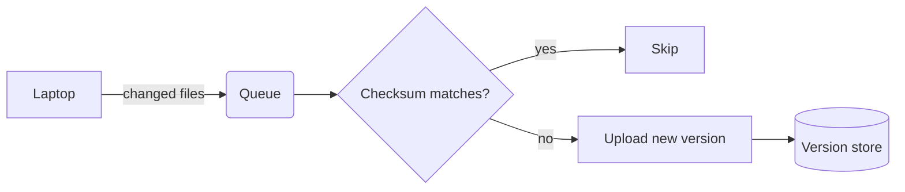
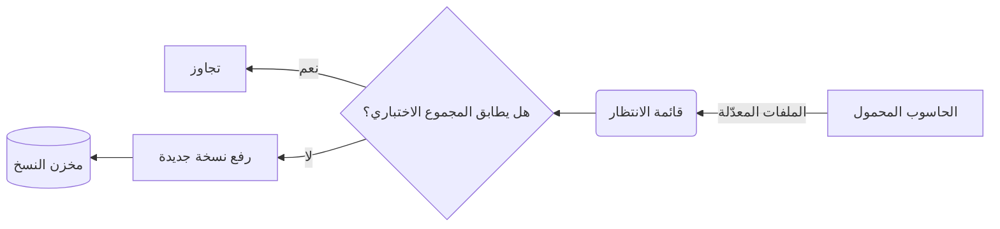

# Milestone 09: Design System & Brand, implementation plan

> **For agentic workers:** REQUIRED SUB-SKILL: Use superpowers:subagent-driven-development (recommended) or superpowers:executing-plans to implement this plan task-by-task. Steps use checkbox (`- [ ]`) syntax for tracking.

**Goal:** Give Tegel one design source of truth, `DESIGN.md`, before any UI work starts. Then build what follows from it: the three renderer themes, both app icons and the studio mark, the app UI and site specs, the screenshot/demo/OG system, and the automated guards that keep all of it honest.

**Architecture:** Two drops on one branch, `m09-design`.
- **Drop A** (W1, merged **Mon 2 Nov**) is what plan 02's UI work (from Tue 3 Nov) and plan 04's site skeleton (W2) consume: `DESIGN.md`, the app UI spec, the site spec, `site/static/css/tokens.css`, the OG template, and the first design guards.
- **Drop B** (W2, merged **Mon 9 Nov**, before plan 02's theme task in W3) builds:
  - the renderer theme CSS and Mermaid theming;
  - the sample documents and prototypes, with the founder's taste decisions;
  - the `.icon` app icon with its actool guard;
  - the screenshot, caption and gallery templates;
  - the design-review gate runbook.
- **Tooling:** system fonts only, no bundled font files. HTML is rendered to PNG with gstack `browse`, WebKit renders through the existing `RendererWebView`, and icons compile with `xcrun actool`.

**Tech Stack:**
- CSS custom properties and `@font-face local()` aliases, under the existing renderer CSP;
- bun test for the guards; XCTest + WebKit for render checks;
- Icon Composer `.icon` + `xcrun actool` (Xcode 26.3), XcodeGen 2.46;
- gstack `browse` (headless Chromium) for HTML→PNG; `screencapture`; `sips`; ffmpeg `overlay`/`pad`.

**Spec:**
- Inputs: `CLAUDE.md` ("Design standard", product rules 1–9); `BUSINESS-PLAN.md` §4 (gap 3: design quality; visit→sale ≥ 1 %), §5 and §6.
- Contract: `docs/superpowers/plans/2026-10-27-00-master-roadmap.md` §3.
- Consumers: plan 01 (renderer files), plan 02 Tasks 6, 7 and 9–15 (app UI), plan 03 Tasks 9–10 (Licence and Updates), plan 04 Tasks 6–7 (site), plan 05 Task 5 (demo, gallery), plan 06 (App 2 icon).
- Skills applied, cited by rule ID throughout:
  - `macos-design-guidelines` (MDG);
  - `apple-design` (typography, sf-symbols, ux-writing, liquid-glass, ui-prototyping, animation-patterns);
  - `hig-foundations`, `hig-components-layout`, `hig-components-menus`, `hig-patterns`;
  - `web-design-guidelines` (WDG);
  - `frontend-design`, `design-consultation`, `plan-design-review`.

## Global Constraints

Master §2/§3 and CLAUDE.md apply (build Mac and evidence rules, product rules 1–9 including imagery, audio and holiday theming, approvals, Procedure P). This plan's deltas:

- **Branch:** `m09-design`. Both review bases are `$DA` from Task 5 Step 1, the merge-base right after `main` (with plan 01) is merged in, so plan 01's reviewed diff stays out of scope.
- **Commits:** a step written "Commit `<paths>`: `<msg>`" means `git add <paths> && git commit -m "<msg>" -m "Co-Authored-By: Claude Opus 5.5 <noreply@anthropic.com>"`. Never `git add -A`.
- **Build Mac tools:** Xcode 26.3 (17C529), bun at `~/.local/bin/bun`.
- **Liquid Glass evidence** comes only from the GitHub `macos-26` runner (arm64) [V16]. No Scaleway lease is booked for it; the only pre-launch leases are L1 (G0) and L2 (Thu 26 Nov).
- **Renderer CSP:** master §3's, verbatim (`default-src 'none'; script-src 'self'; style-src 'self' 'unsafe-inline'; img-src 'self' data: tegel-doc:; font-src 'self'`); this plan never changes it. Fonts come only from the system, through generic families or `local()` [V3].
- **Document direction (plan 01, CR-P1-2):** `dir="auto"` sits on top-level blocks only; nested `li`, `th`, `td` and `p` inherit their container's direction. Theme CSS reads direction with `:dir()`, never with a `[dir="rtl"]` or `[dir="ltr"]` selector, which misses every block whose direction comes from `dir="auto"` (guarded in Task 6).
- **No bundled font files and no web fonts** on the site or in the apps. A face would have to earn its place in a recorded decision, and none has.
- **Letter-spacing:** every shipped CSS file has zero non-zero `letter-spacing` (guarded). Tracking comes from the system's optical sizes (apple-design typography Rule 2), and Arabic must never be tracked.
- **Colour tokens** are 6-digit hex, so Mermaid can consume them [V17].
- **Contrast floors:** body text ≥ 7:1; muted text, links and syntax ≥ 4.5:1; non-text UI and focus ≥ 3:1. These are computed by the guards, never asserted by hand.
- **Copy:**
  - British "Licence", per plans 03 and 04.
  - Title Case for menu items, buttons and window titles; sentence case for tooltips, descriptions and informative text (hig-components-menus "menus"; hig-patterns "offering-help").
  - Use the real ellipsis "…" (U+2026) when a command needs more input.
- **Browsers:** use HTML→PNG through gstack `browse` only. **Never** use the Playwright MCP browser tools (the main session shares that browser). If Chrome headless is ever used, give it `--user-data-dir="$(mktemp -d)"`.
- **Taste calls are user checkpoints** (Task 10). If there is no answer within 24 h, the recommendation stands as *provisional* in `docs/design/decisions.md` and can be changed until the release build (W6).

## Review Focus

1. **PDF export while the Mac is in Dark Mode.** A reasonable person expects black text on white paper. Today the dark token block would print light text on white. Test: `testPrintModeStaysLightInDarkAppearance` (Task 6).
2. **Arabic or Hebrew inside a code block.** `ui-monospace` falls back to a stretched Courier New [V2]; people expect normal Arabic letterforms. Test: `testRTLScriptInCodeIsNotStretched` (Task 6).
3. **Persian or Urdu text in the Ink theme.** A font that lacks ک or ی switches faces mid-word and breaks the joining [V4]. Test: `testRTLAliasFacesCoverEveryArabicScriptLetter` (Task 6).
4. **Switching Light ↔ Dark with a diagram open.** People expect the diagram to recolour with the page, not keep stale colours. Test: `testMermaidFollowsAppearanceChange` (Task 7).
5. **The Finder preview column (≈260 px wide).** People expect wrapped text, not a horizontal scrollbar. Test: `testQuickLookNarrowWidthHasNoHorizontalOverflow` (Task 6).

---

## Verified facts (cite as [V#])

| # | Fact | Source |
|---|---|---|
| V1 | `.SF Arabic`, `.SF Hebrew`, `.New York`, `.SF NS Mono` are hidden system families. `NSFont(name:"SF Arabic")` returns nil, so `"SF Arabic"`, `"SF Hebrew"`, `"SF Mono"` and `"New York"` in a CSS stack do nothing. SF Arabic and SF Hebrew arrive only through the `system-ui` cascade. With `lang="ur"`, the cascade puts the Noto Nastaliq UI face first | Build Mac (macOS 15.7.7, 24G720), CoreText probe, 27 Oct |
| V2 | WKWebView, same Arabic string, 16 px:<br>• `system-ui` 373.32 px (SF Arabic)<br>• `"SF Arabic"` by name 353.52 px (not SF Arabic)<br>• `ui-serif` 373.44 px (SF Arabic through New York's cascade)<br>• Geeza Pro 360.33<br>• `ui-monospace, Menlo, system-ui` 530.07 (Courier New; the later `system-ui` is never reached)<br>Hebrew: `system-ui` gives SF Hebrew, `ui-serif` gives Times New Roman. Menlo has no Arabic or Hebrew | Build Mac, WKWebView probe, 27 Oct |
| V3 | Under the exact renderer CSP:<br>• `@font-face { src: local(...); unicode-range }` aliases load, and `document.fonts` reports them as `loaded`.<br>• `"TG RTL Code", ui-monospace` sets Arabic in Geeza Pro and Hebrew in Arial Hebrew.<br>• `size-adjust` works: Al Nile goes from 221.5 px to 270.5 px at 125 %. Damascus is 233.1 px against SF Arabic's 283.7 px, so it needs 122 % | Build Mac, WKWebView probe, 27 Oct |
| V4 | Glyph coverage:<br>• Al Nile lacks ک U+06A9 and ی U+06CC;<br>• Damascus and Geeza Pro cover پ چ ژ گ ک ی ے ٹ ٥ ۵;<br>• none of those three has Hebrew; Arial Hebrew has Hebrew only.<br>PostScript names: `GeezaPro`, `GeezaPro-Bold`, `Damascus`, `DamascusSemiBold`, `DamascusBold`, `ArialHebrew`, `ArialHebrew-Bold`, `NotoNastaliqUrdu` | Build Mac, `CTFontGetGlyphsForCharacters` and `NSFontManager.availableMembers` |
| V5 | The `ch` unit misleads in SF Pro. At 16 px, 1ch = 9.77 px but the average English prose character is 7.26 px, so plan 02's `68ch` sets ≈ 91 characters per line. Average character: ui-serif 18 px = 8.24 px; system-ui 15 px = 6.87 px | Build Mac, WKWebView measurement |
| V6 | Safari support:<br>• `widows`/`orphans` 7+<br>• `hanging-punctuation` 17.4+<br>• `ui-serif`/`ui-monospace` 13.1+ (**not** Chrome or Firefox)<br>• `text-wrap: balance` 17.5+<br>• `:dir()` 16.4+<br>• `font-size-adjust` 17.0+<br>• `unicode-range` 10+ | github.com/Fyrd/caniuse `features-json/*.json`, fetched 27 Oct |
| V7 | The generic families `ui-serif`, `ui-sans-serif`, `ui-monospace` and `ui-rounded` arrived in Safari 13.1 | webkit.org/blog/10247 |
| V8 | Al Nile, Damascus, Geeza Pro, Noto Nastaliq Urdu, Arial Hebrew and Charter are listed as macOS fonts. Iowan Old Style is a "document-support" font in Sequoia, so avoid it. The pages don't separate installed fonts from downloadable ones, so Task 13's runner probe checks | support.apple.com/en-us/120414 (Sequoia), /en-us/108939 (Sonoma) |
| V9 | macOS semantic colours (sRGB):<br>• `textBackgroundColor` #FFFFFF / dark #1E1E1E<br>• `linkColor` #0068DA / dark #419CFF<br>• `windowBackgroundColor` #ECECEC / dark #323232 | Build Mac, `NSAppearance.performAsCurrentDrawingAppearance` |
| V10 | Xcode's "Default (Light)" syntax colours: keyword #9B2393, string #C41A16, number #1C00CF, comment #5D6C79, declaration #0F68A0, type #0B4F79, attribute #815F03. "Default (Dark)": keyword #FC5FA3, string #FC6A5D, number #D0BF69, comment #6C7986 (**3.13–3.41:1** on our dark code backgrounds, so it is raised), declaration #41A1C0, type #5DD8FF, preprocessor #FD8F3F | `/Applications/Xcode.app/Contents/SharedFrameworks/DVTUserInterfaceKit.framework/Versions/A/Resources/FontAndColorThemes/Default (Light|Dark).xccolortheme` |
| V11 | Every SF Symbol named in DESIGN.md §9 exists on macOS 14 or earlier. `doc.questionmark` is 14.0; the rest are ≤ 11.0 | `/System/Library/CoreServices/CoreGlyphs.bundle/Contents/Resources/name_availability.plist` |
| V12 | Icon Composer:<br>• opened from Xcode › Open Developer Tool;<br>• 1024×1024 macOS canvas; layers in SVG or PNG; up to 4 groups; default/dark/mono appearances;<br>• "Xcode automatically generates app icon images at build time for those [previous] releases";<br>• a `.icon` file replaces the AppIcon asset catalog, and its name must match the App Icon setting.<br>On the build Mac it lives at `/Applications/Xcode.app/Contents/Applications/Icon Composer.app` | developer.apple.com/documentation/xcode/creating-your-app-icon-using-icon-composer |
| V13 | A hand-authored `AppIcon.icon` compiles with `xcrun actool … --app-icon AppIcon --standalone-icon-behavior all` into `AppIcon.icns` (10 sizes, 16→512@2x), `Assets.car` and `CFBundleIconName = AppIcon`. The `.icon` has `icon.json` with `"fill": {"solid": "srgb:…"}` and two groups of SVG layers, one with `"opacity": 0.7`; it renders glass layers inside the macOS shape. At 16 px, strokes of 136/1024 with 168/1024 gaps stay legible; 112 with 68 gaps blur into one shape | Build Mac, Xcode 26.3, `iconutil -c iconset`, 27 Oct |
| V14 | XcodeGen 2.46.0 is installed; its CHANGELOG says "Added built in `.icon` folder support for IconComposer #1600" | `xcodegen --version`; github.com/yonaskolb/XcodeGen CHANGELOG |
| V15 | macOS availability:<br>• `glassEffect`, `GlassEffectContainer`, `.glass` button style, `backgroundExtensionEffect`, `ToolbarSpacer`: 26.0<br>• `toolbarBackgroundVisibility`: 15.0<br>• `inspector`, `InspectorCommands`, `ContentUnavailableView`, `SettingsLink`, `openSettings`: 14.0<br>• `NavigationSplitView`, `navigationDocument`, `searchable`, `Window`, `defaultSize`, `windowResizability`: 13.0<br>• `windowToolbarStyle`, `SidebarCommands`: 11.0<br>• `accessibilityReduceMotion`: 10.15 | Apple docs JSON (`developer.apple.com/tutorials/data/documentation/swiftui/*.json`) |
| V16 | Runner labels: `macos-26` (arm64); `macos-14` (arm64, deprecated) | github.com/actions/runner-images README |
| V17 | Only Mermaid's `base` theme is customisable through `themeVariables`, and only hex colours are recognised. The variable names are listed in Task 7 | mermaid.js.org/config/theming.html |
| V18 | `/usr/local/bin/ffmpeg` 9.0.2 has `overlay`, `pad`, `scale` and `xfade`, but **no** `drawtext` or `subtitles` (no freetype/libass) | Build Mac, `ffmpeg -filters` |
| V19 | gstack browse commands:<br>• `$B viewport WxH [--scale 2]`<br>• `$B goto file://<abs>`<br>• `$B screenshot <path> [--clip x,y,w,h]`<br>`$B` is `~/.claude/skills/gstack/browse/dist/browse` | `~/.claude/skills/gstack/browse/SKILL.md` |
| V20 | Adopting Liquid Glass:<br>• standard components adopt it automatically with the latest SDK;<br>• reduce custom backgrounds; split views for sidebar + inspector;<br>• don't mix text and icons in one toolbar group, and label every icon;<br>• `UIDesignRequiresCompatibility` is temporary and ignored from 27 | developer.apple.com/documentation/technologyoverviews/adopting-liquid-glass |

## Design direction (the decisions every task argues from)

- **The memorable thing** (design-consultation): an English spec and its Arabic counterpart, set side by side and mirrored, both well typeset. The site reads like a typeset document because part of it *is* rendered by the product's own `renderToHTML`.
- **Brand:**
  - Delft **cobalt #1F4E9C**: white on it 7.99:1. It is the site accent and the Markdown icon ground.
  - **Manganese #5A3757**: white on it 9.91:1. It is the Data icon ground.
  - Cobalt and manganese are the two historical glazes of Dutch tiles. A *tegel* is a tile, and the macOS icon shape is the tile, so no picture of a tile is needed.
  - Grounds are neutral white or graphite, never cream (frontend-design calibration trait 1).
- **The app UI** carries no brand colour: system accent, system materials, system type (MDG 9.1, 9.3; hig-foundations branding: "branding defers to content").
- **The themes differ in type, not decoration.** paper is the Mac's own page (SF Pro, `linkColor`); ink is the book (New York + Damascus); studio is the workbench (SF Pro body, SF Mono structure).
- **SAFE vs RISK** (design-consultation):
  - SAFE: system stacks, macOS semantic colours, Xcode's syntax palette ("code looks like code in Xcode"), HIG layouts.
  - RISK, spent in one place: the mirrored bilingual hero, plus the icon's glass `#` and grid built from overlapping opaque and 70 % layers.
- **Where CLAUDE.md wins over a skill:**
  - plan-design-review's landing rules ask for gradients, 2–3 motions and no system stack, and design-consultation flags `system-ui` as a slop signal;
  - CLAUDE.md and Apple-native positioning win: no gradients, no non-user-triggered motion, and system fonts justified in DESIGN.md §6;
  - this is recorded as decision D-0 in `docs/design/decisions.md`.

## File structure

| Path | Responsibility | Task |
|---|---|---|
| `DESIGN.md` | Single source of truth: principles, voice, spacing, grids, colour, type, themes, motion, icons, accessibility, banned list, review gates | 1 |
| `site/static/css/tokens.css` | Site colour, space and type tokens (light + dark) | 2 |
| `Renderer/test/design.test.js` | bun design guards: contrast, letter-spacing, banned CSS, emoji, theme tokens, icon sizes | 2, 6, 11 |
| `docs/design/app-ui-spec.md` | Windows, toolbar, menus, Settings, Welcome, Pro window, states, RTL, accessibility, Liquid Glass, Quick Look (wireframes + measurements) | 3 |
| `docs/design/site-spec.md`, `docs/design/templates/og.html` | Site grid, type, sections, pricing, compare, download, RTL, dark, focus, budget, OG | 4 |
| `docs/design/decisions.md` | Every taste or policy decision: variants, image paths, recommendation, decider, date | 1, 10 |
| `Renderer/src/css/{base,paper,ink,studio,print}.css`, `Renderer/src/index.html` | Theme implementation (`base`, `paper` and `print` modified; `ink` and `studio` created) | 6 |
| `Renderer/src/page.js` | Mermaid `base` theme from tokens; re-render on appearance change | 7 |
| `Packages/TegelKit/Tests/TegelKitTests/WebView/DesignRenderTests.swift` | WebKit render checks: measure, RTL code, print-light, Urdu, Quick Look narrow, Mermaid, opt-in snapshots | 6, 7, 10 |
| `Packages/TegelKit/Tests/TegelKitTests/FontCoverageTests.swift` | Every `local()` alias face covers the Arabic-script letters it claims | 6 |
| `docs/design/samples/{en-spec,ar-spec,mixed}.md` | Sample documents for screenshots, demo, Welcome and prototypes | 8 |
| `docs/design/icons/` | Concept SVGs, the legibility sheet | 9 |
| `docs/design/proto/` | Prototype renders (PNG) and hero variants (HTML) | 4, 10 |
| `Apps/Markdown/App/AppIcon.icon/` | `icon.json` + `Assets/*.svg` | 11 |
| `project.yml` | `ASSETCATALOG_COMPILER_APPICON_NAME: AppIcon` on the Markdown app target | 11 |
| `.github/workflows/design-shots.yml` | `workflow_dispatch` only: one build on `macos-26` with Xcode 26.3, then font probe, icon render and app screenshots on `macos-14` and `macos-26` from that artefact | 11 |
| `scripts/window-shot.sh` | Capture one app window by owner name, with or without the native shadow | 12 |
| `docs/design/templates/{gallery,caption}.html` | PH gallery 1270×760 frame; demo caption band 1920×120 | 12 |
| `docs/reviews/design-m09.md`, `docs/reviews/m09.md` | Design review and 9-stage pipeline results | 5, 13, 14 |

---

## Drop A: W1 (Tue 27 Oct – Mon 2 Nov)

### Task 0: Branch and baseline (Tue 27 Oct)

**Files:** none.

- [ ] **Step 1:** Run `git switch -c m09-design main`.
- [ ] **Step 2:** Run `git status --short` (expected: empty). If `Renderer/` exists, also run `make check`, and record the pass/fail counts as the baseline.

### Task 1: `DESIGN.md` (Tue 27 – Wed 28 Oct)

**Files:**
- Create: `DESIGN.md`
- Create: `docs/design/decisions.md`

**Interfaces:**
- Produces (every later task and plans 02, 04, 05 and 06 cite these by section): §1 Principles, §2 Voice, §3 Spacing, §4 Grids, §5 Colour, §6 Typography, §7 Renderer themes, §8 Motion, §9 Iconography, §10 Accessibility, §11 Banned patterns, §12 Review gates, §13 Changing this file.
- Token names: site `--bg --text --muted --rule --surface --accent --on-accent`; renderer `--tg-*` (§7); syntax `--tg-syn-{keyword,string,number,comment,title,type,meta,add,del}`.

- [ ] **Step 1: Write §1 Principles** (exactly these five, each with one "so that" line and one example of what it forbids):
  1. **The document is the interface.** Chrome recedes: system toolbar, system accent, no brand colour in the app UI (MDG 9.3; hig-foundations branding).
  2. **Typeset, not styled.** Themes differ in face, scale, measure and leading. No gradients, drawn shadows or ornament.
  3. **Both directions are first-class.** RTL gets its own leading, faces and mirrored structure; code, URLs and numbers stay LTR islands. Every screenshot set includes an RTL frame.
  4. **Native or nothing.** System fonts, SF Symbols, standard menus, controls and materials. A custom control needs a written reason in `decisions.md`.
  5. **Say it once, plainly.** Price, limits and refund are stated where they matter, with no selling adjectives.
- [ ] **Step 2: Write §2 Voice and tone** (apple-design ux-writing: PACE, the four small edits, alert anatomy; hig-foundations writing).
  - **Rules:**
    - Title Case for menu items, buttons and window titles; sentence case elsewhere.
    - "…" only when more input follows (hig-components-menus "menus").
    - No articles in menu items. Use "window", not "screen" (hig-components-layout "windows").
  - **Cut list:** easily, quickly, simply, just, seamless, effortless, supercharge, unleash, powerful, magic, beautiful, blazing.
  - **Errors:** say what happened, then what to do. No apology, no blame. Example: "Tegel Markdown can't read “notes.md”. It may have been moved or deleted. Choose File › Open… to find it."
  - **Empty states** never dead-end; each names an action.
  - **Word list:** Licence (noun) / license (US verb, never used), Settings (never Preferences), Quick Look, PDF, Pro, folder, file, window, Mermaid diagram.
  - **Locale notes:**

    | Locale | Register | Quotes | Terms and other rules |
    |---|---|---|---|
    | EN | British spelling | “…” ‘…’ | — |
    | NL | informal "je" | ‘…’ in UI copy | Settings → "Instellingen" |
    | FR | "vous" | « … » with U+202F narrow no-break spaces | Settings → "Réglages" (Apple FR) |
    | AR | Modern Standard Arabic; nouns and masdar forms in menus (e.g. "فتح…" for Open…) | « … » | Use ، and ؟; Settings → "الإعدادات"; numbers via `formatted()`, never hard-coded digits; no gendered imperatives where a noun works |

    Every term matches macOS's own localisation of that term (check the system-provided menu items in the app running under `-AppleLanguages "(ar)"`).
- [ ] **Step 3: Write §3 Spacing and §4 Grids.**
  - **Spacing scale:** base 4. App points: 4, 8, 12, 16, 20, 24, 32, 40. Site: rem multiples of 0.25 up to 6rem (`--space-1` 0.25rem … `--space-8` 6rem: 0.25, 0.5, 0.75, 1, 1.5, 2, 3, 6).
  - **App grid** (MDG 9.6: 20 pt window margins, 8 pt between related controls; 16–24 pt between groups):
    - reader column = theme measure, centred, text start-aligned;
    - padding block 40 px top / 64 px bottom, inline ≥ 32 px (window); 24 px all round in Quick Look;
    - sidebar 240 pt (min 200, max 360); inspector 220 pt (min 180, max 320).
  - **Site grid:** a breakout grid with named lines `full | wide | text`:
    - text track `min(34rem, 100% − 2rem)`; wide track `min(68rem, 100% − 2rem)`; side gutters `minmax(1rem, 1fr)`;
    - breakpoints at 40rem and 64rem (content-based, WDG 2.4); section rhythm 6rem desktop, 4rem below 40rem.
- [ ] **Step 4: Write §5 Colour.**
  - **Token tables** with the measured ratios below. Task 2's guard recomputes them; if a guard ever disagrees with this table, the guard wins and the table is corrected.
  - **Accent policy** (hig-foundations color "avoid hard-coding system colors"; MDG 9.3):
    - App UI uses the user's system accent (`Color.accentColor`, never `.tint(...)`).
    - Brand cobalt and manganese appear only on the site, icons, OG/PH frames and the ink theme's link.
    - Renderer themes fix their link colours so exported PDFs are reproducible.
  - **No app-specific light/dark setting** (hig-foundations dark-mode "Avoid offering an app-specific appearance setting").
  - **Increase Contrast** (`@media (prefers-contrast: more)` in the renderer and site; `colorSchemeContrast` in SwiftUI):
    - `--tg-muted` becomes `--tg-fg`;
    - `--tg-rule` becomes #8E8E93 (light, 3.26:1) / #6E6E73 (dark, 3.29:1);
    - link underlines go to 100 % opacity.

  | Site token | Light | Dark | Measured |
  |---|---|---|---|
  | `--bg` | #FFFFFF | #1E1E1E (= `textBackgroundColor` dark [V9]) | — |
  | `--text` | #1D1D1F | #F5F5F7 | 16.83 / 15.31 |
  | `--muted` | #6E6E73 | #A1A1A6 | 5.07 / 6.48 |
  | `--rule` | #D2D2D7 | #3A3A3C | decorative (1.51 / 1.47) |
  | `--surface` | #F5F5F7 | #2C2C2E | text 15.46 / 12.80; muted 4.66 / 5.42 |
  | `--accent` | #1F4E9C | #8FB0F0 | 7.99 / 7.65 (link, focus ring) |
  | `--on-accent` | #FFFFFF | #0E1A2E | 7.99 / 7.99 |

  The plan 04 dark values `#111113` / `#f2f2f4` are replaced: a tinted near-black is frontend-design trait 5, and the replacement matches the app's dark page.
- [ ] **Step 5: Write §6 Typography.**
  - **App UI:** SwiftUI text styles only (`.title2`, `.headline`, `.body`, `.callout`, `.subheadline`, `.footnote`), with no fixed point sizes (apple-design typography Rule 1). Use weights from the style; tracking stays with the system (Rule 2).
  - **Site:** `system-ui, -apple-system, sans-serif` for everything; `ui-monospace, Menlo, monospace` only for literal code and filenames.
    - Scale: 17 px body (1.0625rem) / 1.6; h1 2.5rem/1.1 weight 700; h2 1.75rem/1.2 600; h3 1.25rem/1.3 600; small 0.875rem/1.5.
    - `:lang(ar)`: 18 px body / 1.9, headings line-height 1.5.
  - **Why no display face (D-1):**
    - the brand is Apple-native;
    - a web font costs bytes, a CSP `font-src` change and a licence check;
    - `ui-serif` is Safari-only [V6];
    - nothing shows a face would raise visit→sale.
    - Task 10 tests `ui-serif, Charter, Georgia, serif` headlines as variant B, so the decision is made on evidence.
  - **Details:**
    - curly quotes and real dashes in all copy;
    - `font-variant-numeric: tabular-nums` in tables and prices (WDG 4.5);
    - `text-wrap: balance` on headings [V6];
    - `hanging-punctuation: first last` on prose [V6].
- [ ] **Step 6: Write §7 Renderer themes.** It names `Renderer/src/css/{base,paper,ink,studio,print}.css` (Task 6) as the only home of every theme value, lists the required `--tg-*` token names and the three theme characters from Design direction, and states the rules the CSS follows: dark blocks are `screen and` + `:not([data-mode="print"])`, direction is read with `:dir()`, and Urdu needs `lang="ur"` for Nastaliq. It copies no table: plan 02 reads the CSS.
- [ ] **Step 7: Write §8 Motion** (hig-foundations motion "make motion optional"; apple-design animation-patterns review checklist).
  - **App:** system animations only. No custom animation longer than 0.25 s; none on document load. Outline jumps use `scroll-behavior: smooth` only under `prefers-reduced-motion: no-preference`.
  - **Site:** no motion that the user didn't trigger, and no scroll reveals. Hover/focus colour transitions are ≤ 150 ms and removed under reduced motion (WDG 6.1).
  - **Demo video:** cuts and 300 ms cross-fades only.
- [ ] **Step 8: Write §9 Iconography.**
  - App icons follow Task 9's concept and Task 11's build rules.
  - SF Symbols (hierarchical rendering in toolbars; keep conventional symbols conventional; availability [V11]):

  | Action | Symbol | Where |
  |---|---|---|
  | Show/Hide Outline (inspector) | `sidebar.trailing` (mirrors in RTL) | toolbar, trailing edge |
  | Theme | `textformat` | toolbar menu |
  | Find | `magnifyingglass` | toolbar |
  | Export as PDF | `arrow.up.doc` (not `square.and.arrow.up`, which means Share) | toolbar |
  | Open Folder | `folder` | Welcome, Pro window |
  | Settings tabs | `gearshape` General, `textformat.size` Appearance, `key` Licence (plan 03), `arrow.triangle.2.circlepath` Updates | Settings |
  | Quick Look step | `eye` | Welcome |
  | Open a file | `doc.text` | Welcome |
  | Error / unreadable file | `doc.questionmark` (macOS 14.0) | ContentUnavailableView |
  | Mermaid error | `exclamationmark.triangle` | inline, in HTML (text label, not a symbol) |
  | Folder empty | `folder` | ContentUnavailableView |
  | Pro features | `folder`, `arrow.up.doc`, `textformat` | Pro window |

- [ ] **Step 9: Write §10 Accessibility.**
  - VoiceOver: every toolbar item has a text label (MDG 3.5; [V20]). Outline rows read "Heading level N, <text>".
  - Respect Increase Contrast, Reduce Motion and Reduce Transparency (MDG 9.5, 11.1–11.7).
  - Keyboard: every command has a menu item (hig-components-menus "every toolbar item also in the menu bar").
  - Site: WDG 1.4 focus ring 2 px accent, ≥ 3:1; 1.5 skip link; 2.7 reflow at 320 px; 10.1 `lang`/`dir`; 10.4 logical properties.
- [ ] **Step 10: Write §11 Banned patterns** (each guarded item names its test):
  - **From CLAUDE.md:** the full banned list.
  - **frontend-design calibration traits:**
    - cream with serif and terracotta;
    - black with an acid accent;
    - broadsheet hairlines;
    - the SaaS card kit;
    - ALL-CAPS eyebrows;
    - middle-dot meta strings;
    - "WORD — fragment" labels;
    - mono for small labels;
    - "→" appended to links;
    - 01/02/03 markers on non-sequences.
  - **Ours:**
    - non-zero `letter-spacing` [guard];
    - gradients, `box-shadow` and `backdrop-filter` in site CSS [guard];
    - `Inter` anywhere [guard];
    - emoji in UI strings [guard];
    - italic or synthetic oblique on Arabic;
    - `text-align: justify` in the renderer;
    - brand colour in the app UI;
    - a splash screen (hig-patterns launching);
    - licensing copy in onboarding (hig-patterns onboarding).
- [ ] **Step 11: Write §12 Review gates:** the table in Task 13's Interfaces block. **§13 Changing this file:** a change lands with a `decisions.md` row and green guards.
- [ ] **Step 12: Create `docs/design/decisions.md`.**
  - Header row: `| ID | Question | Variants (image paths) | Recommendation | Decision | Decided by | Date |`.
  - Pre-fill D-0 (CLAUDE.md over plan-design-review's landing rules) and D-1 (no display face, pending the Task 10 evidence).
  - Pre-fill these, each with its evidence:
    - D-2: the Pro prompt is a `Window`, not a sheet;
    - D-3: plan 02's `68ch` becomes em measures [V5];
    - D-4: the ink Arabic face (open until Task 10).
- [ ] **Step 13: Check, then commit.** Run `grep -n -i -E 'lorem|TBD|TODO' DESIGN.md docs/design/decisions.md`. Expected: no output. Commit `DESIGN.md docs/design/decisions.md`: "docs(design): DESIGN.md single source of truth and decisions log"

### Task 2: Site tokens and the first design guards (TDD, Wed 28 Oct)

**Files:**
- Create: `Renderer/test/design.test.js`
- Create: `site/static/css/tokens.css`

**Interfaces:**
- Produces:
  - `ratio(a: string, b: string) -> number`, the WCAG 2.x contrast ratio for two `#RRGGBB` values;
  - `blocks(css: string) -> Array<{ media: string, selector: string, decls: Record<string,string> }>`, with brace-matching that handles one level of `@media` nesting and strips comments;
  - `files(dir: string, exts: string[]) -> string[]`, a recursive listing that skips `node_modules`, `build` and dot-folders;
  - `read(path: string) -> string`, UTF-8 file contents.
- All four live in `design.test.js`, which Tasks 6 and 11 extend. The test runs from `Renderer/`, but `read` and `files` take repo-relative paths (`site/…`, `Renderer/src/css`) and resolve them against `ROOT = join(import.meta.dir, '..', '..')`, the repo root. `files` returns repo-relative paths, so `read(f)` works on its output.
- `tokens.css` holds exactly two blocks: `:root { … }` and `@media (prefers-color-scheme: dark) { :root { … } }`. It sets the colour tokens from Task 1 Step 4, plus `--space-1…8`, `--measure: 34rem`, `--wide: 68rem`, `--font: system-ui, -apple-system, sans-serif` and `--font-mono: ui-monospace, Menlo, monospace`.

- [ ] **Step 1: Write the failing tests in `Renderer/test/design.test.js`.**

```js
const SITE_TOKENS = 'site/static/css/tokens.css';
const siteVars = dark => Object.assign({}, ...blocks(read(SITE_TOKENS))
  .filter(b => b.selector === ':root' && (dark ? /prefers-color-scheme:\s*dark/.test(b.media) : b.media === ''))
  .map(b => b.decls));

test('ratio matches WCAG reference values', () => {
  expect(ratio('#000000', '#FFFFFF')).toBeCloseTo(21, 1);
  expect(ratio('#777777', '#FFFFFF')).toBeCloseTo(4.48, 2);
});
for (const dark of [false, true]) test(`site tokens meet the floors (${dark ? 'dark' : 'light'})`, () => {
  const v = siteVars(dark);
  for (const k of ['--bg','--text','--muted','--rule','--surface','--accent','--on-accent']) expect(v[k]).toMatch(/^#[0-9A-F]{6}$/i);
  expect(ratio(v['--text'], v['--bg'])).toBeGreaterThanOrEqual(7);
  expect(ratio(v['--text'], v['--surface'])).toBeGreaterThanOrEqual(7);
  for (const [fg, bg] of [['--muted','--bg'],['--muted','--surface'],['--accent','--bg'],['--accent','--surface'],['--on-accent','--accent']])
    expect(ratio(v[fg], v[bg])).toBeGreaterThanOrEqual(4.5);
});
test('shipped CSS never sets a non-zero letter-spacing', () => {
  for (const f of [...files('site', ['.css']), ...files('Renderer/src/css', ['.css'])])
    for (const m of read(f).matchAll(/letter-spacing\s*:\s*([^;}]+)/g)) expect([f, m[1].trim()]).toEqual([f, expect.stringMatching(/^(0|normal|0(px|em|rem))$/)]);
});
test('site CSS has no gradients, Inter, box-shadow or backdrop-filter', () => {
  for (const f of files('site', ['.css'])) expect([f, read(f)]).not.toEqual([f, expect.stringMatching(/gradient\(|\bInter\b|box-shadow|backdrop-filter/)]);
});
test('UI strings and templates contain no emoji', () => {
  const src = [...files('Apps', ['.xcstrings', '.swift']), ...files('site/content', ['.md']), ...files('site/templates', ['.html']), ...files('docs/design/templates', ['.html'])];
  for (const f of src) expect([f, read(f)]).not.toEqual([f, expect.stringMatching(/\p{Emoji_Presentation}|️/u)]);
});
```

`\p{Emoji_Presentation}` deliberately leaves out ©, ®, ⌘ and arrows, which default to text presentation.

- [ ] **Step 2: Run.** `cd Renderer && ~/.local/bin/bun test test/design.test.js`. Expected: FAIL, with `ENOENT … site/static/css/tokens.css` in both token tests. The other tests pass (vacuous or already true).
- [ ] **Step 3: Implement** `ratio`, `blocks`, `files` and `read` in the test file (≤ 40 lines together). Write `tokens.css` with the Task 1 values.
- [ ] **Step 4: Run.** Same command. Expected: PASS, 6 tests, 0 fail.
- [ ] **Step 5: Watch each guard fail once, then restore** (CLAUDE.md coding rule 4: an unwatched guard isn't verified).
  - Temporarily set `--muted: #8E8E93` in light: the floor test fails (3.26).
  - Temporarily add `letter-spacing: .02em` to `tokens.css`: the letter-spacing test fails.
  - Temporarily add `background: linear-gradient(red, blue)`: the banned-pattern test fails.
  - Revert all three; PASS again. Note the three failure lines in the commit body.
- [ ] **Step 6: Commit** `Renderer/test/design.test.js site/static/css/tokens.css`: "test(design): contrast, letter-spacing, banned-pattern and emoji guards; site tokens"

### Task 3: App UI spec (Thu 29 – Fri 30 Oct)

**Files:** Create `docs/design/app-ui-spec.md`.

**Interfaces:**
- Consumes these plan 02 names, unchanged: `DocumentView` (plan 01's name), `ReaderController`, `AppCommands`, the find bar (`.safeAreaInset(edge: .top)`), the outline `.inspector`, `WindowGroup("Folder", id: "folder", for: URL.self)`, `WindowGroup("Tegel Markdown Pro", id: "pro", for: UpsellFeature.self)` with `ProUpsellView` (its own file), and `@AppStorage("TGTheme")` / `("TGPaperSize")`.
- Consumes these plan 03 names: `LicenceSettingsView` and "Check for Updates…".
- Consumes TegelKit `QuickLookSetup` (`settingsURL`, `settingsPath(macOSMajor:)`), which plan 02 builds to plan 08's interface and test.
- Produces the spec that plans 02 and 03 implement:
  - Settings tabs `General | Appearance | Licence | Updates`;
  - `Window("Welcome to Tegel Markdown", id: "welcome")` shown once via `@AppStorage("TGWelcomeShown")`;
  - View › Actual Size / Zoom In / Zoom Out on `WKWebView.pageZoom` (0.75…2.0, step 0.1, `@AppStorage("TGZoom")`).

- [ ] **Step 1: Single-file window.** Write the wireframe and measurements.
  - Behaviour:
    - `DocumentGroup(viewing:)` gives the title and proxy icon (MDG 2.4; hig-components-menus toolbars "don't title the window with the app name");
    - `.windowToolbarStyle(.unified)` (MDG 3.1);
    - `.defaultSize(width: 880, height: 800)`, minimum 520×400 (MDG 2.1);
    - state restored on relaunch (MDG 2.5; hig-patterns launching).
  - Toolbar, all icon-only with labels (MDG 3.5):
    - `ToolbarItemGroup(placement: .primaryAction)` holds Theme (menu) and Export as PDF;
    - Find is its own item;
    - Outline is the last trailing item (hig-components-menus toolbars: inspector toggle trailing; search trailing, MDG 3.4);
    - the toolbar is customisable (MDG 3.2).

```
┌──────────────────────────────────────────────────────────────────────────┐
│ ● ● ●  [▤] spec.md ⌄                     ( Aa ⌄  ⇪doc )  ( ⌕ )  ( ▥ )    │ unified toolbar, 52 pt
├──────────────────────────────────────────────────────────────────────────┤
│ ┌ find bar (only when open): [ Find…            ] 3 of 12  ‹ ›  Done ┐  │ safeAreaInset, .bar material, 36 pt
│                                                                          │
│        ← ≥32 px →┌──────── measure (paper 32em = 512 px) ────────┐       │ column centred,
│                  │ # Sync Service                                 │       │ text start-aligned,
│                  │ Body text…                                     │       │ 40 px top padding
│                  └────────────────────────────────────────────────┘       │
└──────────────────────────────────────────────────────────────────────────┘
 Outline open: an inspector column on the trailing side, 220 pt (180–320), rows indented (level−1)×12 pt.
```

- [ ] **Step 2: Folder window.**
  - Layout: a three-column `NavigationSplitView` of sidebar (file list, `.listStyle(.sidebar)`, `.searchable(placement: .sidebar, prompt: "Search in Folder")`), document, and outline inspector.
  - Sidebar rules (hig-components-layout sidebars; MDG 4.1–4.2):
    - leading and collapsible through the system toggle;
    - at most two levels: folders as disclosure groups, files as rows;
    - no fixed icon colour; a persistent selection highlight;
    - no critical information at the sidebar's bottom.
  - Draw the wireframe with column widths from DESIGN.md §4.
  - Notices use plan 02's exact copy inside `ContentUnavailableView` (empty folder) or as a footer note (the 5,000-file cap).
- [ ] **Step 3: Menu bar**, the full table (hig-components-menus "the menu bar"; MDG 1.1, 1.2, 1.5, 1.6):

| Menu | Items (shortcut) |
|---|---|
| Tegel Markdown | About Tegel Markdown · Check for Updates… (plan 03) · Tegel Markdown Pro… · — · Settings… ⌘, · — · Services · — · Hide Tegel Markdown ⌘H · Hide Others ⌥⌘H · Show All · — · Quit Tegel Markdown ⌘Q |
| File | Open… ⌘O · Open Folder… ⇧⌘O · Open Recent › · — · Close ⌘W · — · Export as PDF… ⇧⌘E |
| Edit | Undo/Redo/Cut/Paste (system, disabled) · Copy ⌘C · Select All ⌘A · — · Find… ⌘F · Find Next ⌘G · Find Previous ⇧⌘G |
| View | Show/Hide Sidebar ⌃⌘S (folder windows, `SidebarCommands`) · Show/Hide Outline (`InspectorCommands`) · — · Theme › Paper / Ink / Studio · — · Actual Size ⌘0 · Zoom In ⌘+ · Zoom Out ⌘− · — · Enter Full Screen ⌃⌘F (system) |
| Window | system items (always present) |
| Help | Tegel Markdown Help (opens the site docs in the browser) · Welcome to Tegel Markdown · Copy Diagnostics (plan 02 Task 13) |

  - The middle dots in the table only separate cells; they never appear in UI.
  - "Show/Hide" titles change with state (MDG 1.3).
  - In the free tier, Pro items stay enabled and open the Pro window. They are never greyed out without a reason.
  - InspectorCommands' shortcut is whatever the system provides; check it on the build Mac and record it.
- [ ] **Step 4: Settings** (hig-patterns settings; MDG Settings).
  - Built from the `Settings` scene with a `TabView`; each tab is a `.formStyle(.grouped)` Form, 480 pt wide. Window title = tab name; the last tab is restored; the toolbar isn't customisable.
  - **General:** "PDF paper size" (A4/Letter).
  - **Appearance:** "Theme" (Paper / Ink (Pro) / Studio (Pro), radio group) and "Text size" (Actual Size…Larger, mirrors `TGZoom`).
  - **Licence:** plan 03 Task 9 unchanged.
  - **Updates:** "Check for updates automatically" toggle, a "Check Now" button and "Last checked: <relative date>". This content moves out of plan 03's Licence section (Contract change request 6).
  - No light/dark option (hig-foundations dark-mode).
- [ ] **Step 5: Welcome** (hig-patterns onboarding: brief, teach by doing, no licensing; launching: no splash).
  - One window, 480 pt wide, 20 pt margins. Shown once at first launch, and again from Help › Welcome to Tegel Markdown. The Pro prompt never appears in the first session (hig-patterns onboarding "let people experience the app before purchase prompts").
  - It is the only first-run window and contains the Quick Look guide; plan 08 adds no guide window of its own.

```
┌──────────────────────────────────────────────┐
│  [app icon 64]                               │
│  Welcome to Tegel Markdown          .title2  │
│  Read Markdown on your Mac, in Finder and    │
│  in a window. Files you open stay unchanged. │  .body, secondary
│                                              │  24 pt
│  (eye)  Preview in Finder           .headline│
│         Select a Markdown file and press     │
│         Space. If Finder shows plain text,   │
│         turn on Tegel Markdown in System     │
│         Settings › General › Login Items &   │
│         Extensions › Quick Look.             │
│         [Open System Settings…]              │
│                                              │  24 pt
│  (doc.text)  Open a file or folder           │
│         [Open Sample]   [Open…]              │
│                                   [Done]     │  default button, Return (MDG 5.4)
└──────────────────────────────────────────────┘
```

  - **System Settings path:**
    - `QuickLookSetup.settingsPath(macOSMajor:)` chooses the copy: `.loginItemsExtensions` (15 and later) is the wireframe text; `.privacySecurityExtensions` (14) reads "… System Settings › Privacy & Security › Extensions › Quick Look."
    - "Open System Settings…" opens `QuickLookSetup.settingsURL`; if `NSWorkspace.open` returns false, it falls back to opening System Settings.
    - Deep-link verification on macOS 14, 15 and 27 belongs to plan 08 Task 11 Step 2. Add its results to the spec when they land.
    - There is no public API to read whether a Quick Look extension is enabled, so the copy teaches instead of checking.
  - **"Open Sample"** opens `docs/design/samples/en-spec.md`, bundled as `Welcome.md` (`ar-spec.md` when the UI language is Arabic), as a normal read-only document.
  - **Launch check:** on first launch, check that the document Open panel doesn't appear on top of Welcome. If it does, register `NSShowAppCentricOpenPanelInsteadOfUntitledFile = false` in `UserDefaults.register(defaults:)`, then verify again.
- [ ] **Step 6: Pro window** (D-2).
  - Keep plan 02's `Window` and its copy. A window is non-modal and works without a document; a sheet would block the document the person is reading (hig-patterns modality "minimise"; MDG anti-pattern "sheet overuse").
  - Layout: 440 pt wide; icon 64 pt; `.title2`; three feature rows with symbols from §9; the licence sentence in `.callout` secondary.
  - Buttons: "Enter Licence Key…" leading; "Not Now" (Esc, MDG 5.3) and "Buy Pro…" (default) trailing.
  - No price in the app (plan 03), no countdown, no badge colour.
- [ ] **Step 7: States table.**

  | State | Treatment |
  |---|---|
  | Loading | Nothing for 300 ms. Then a small indeterminate `ProgressView` labelled "Opening “<name>”…" centred in the column (hig-patterns loading) |
  | Empty document | The renderer shows "This file is empty." in muted text at the column start |
  | Unreadable file | `ContentUnavailableView("Can't Open “<name>”", systemImage: "doc.questionmark", description:)` with the reason and "Choose File › Open… to find it." |
  | Mermaid error | The inline `.mermaid-error` box (Task 6), with the message and source |
  | No headings | Plan 02's "No headings", centred in the inspector, `.secondary` |
  | Folder empty or lost access | Plan 02 copy in `ContentUnavailableView` with `folder` |

- [ ] **Step 8: Arabic UI mirror** (hig-foundations right-to-left).
  - SwiftUI mirrors layout under the `ar` locale: the sidebar moves to the right, the inspector to the left, and toolbar order reverses. `sidebar.trailing` flips automatically.
  - Don't flip the app icon, the logo or the `#` glyph. Shortcuts are unchanged.
  - Document direction is independent of UI direction: `dir="auto"` on each top-level block, inherited by the blocks nested in it (master §3.2, plan 01 CR-P1-2).
  - Screenshot list for review: the AR UI with an EN document, and the EN UI with an AR document.
- [ ] **Step 9: Accessibility and Liquid Glass.**
  - **Accessibility:** VoiceOver labels for every toolbar item and outline row, and a full keyboard path through Welcome, Settings and the Pro window.
  - **Liquid Glass rules** [V15, V20]; apple-design liquid-glass: navigation layer only, never glass on glass, tint only primary actions:
    - built with the Xcode 26.3 SDK, standard toolbar, sidebar, inspector, sheets and Settings adopt Liquid Glass on 26+ automatically; 14/15 render the classic look from the same code;
    - v1 uses **no** `.glassEffect`, `GlassEffectContainer`, `ToolbarSpacer` or `.toolbarBackground` overrides;
    - the find bar keeps `.background(.bar)` on every OS;
    - `backgroundExtensionEffect` isn't used, because the content is text;
    - `UIDesignRequiresCompatibility` is never set.
  - **Evidence:** screenshots from the `macos-26` runner (Task 11's workflow, run in the m02 gate), never from the build Mac.
- [ ] **Step 10: Quick Look look.**

  | | Window | Quick Look (`data-mode="quicklook"`) |
  |---|---|---|
  | Theme | user choice (Pro) | always paper (free tier; the extension holds no licence state) |
  | Padding | 40 px top, ≥ 32 px inline | 24 px all round; 12 px below 480 px wide |
  | Body size | theme size × zoom | theme size; 15 px below 480 px |
  | Measure | theme measure | the same, centred when the panel is wider |
  | Outline, find | yes | no |
  | Size | user | `preferredContentSize` 820×900 (plan 01) |

- [ ] **Step 11: Check.** Run `grep -n -i -E 'lorem|TBD|TODO' docs/design/app-ui-spec.md`. Expected: no output.
- [ ] **Step 12: Commit** `docs/design/app-ui-spec.md`: "docs(design): app UI spec: windows, menus, Settings, Welcome, Pro, states, RTL, Liquid Glass, Quick Look"

### Task 4: Site spec and the OG template (Fri 30 – Sat 31 Oct)

**Files:**
- Create: `docs/design/site-spec.md`
- Create: `docs/design/templates/og.html`
- Create: `docs/design/proto/og-v1.png`

**Interfaces:**
- Consumes: `tokens.css` (Task 2); plan 04's page register and copy, including the exact pricing sentence.
- Produces:
  - **Site CSS for plan 04 Task 6:**
    - `site.css` consumes the token names unchanged;
    - the class names `.wide` (breakout figure) and `.facts` (definition list);
    - `.price` (pricing block) and `.compare` (comparison table).
  - **`og.html`:** 1200×630, query parameters `?title=&line=&dir=`, system fonts, no external requests.

- [ ] **Step 1: Home page wireframe.** Section rhythm (frontend-design: avoid the hero + 3 cards + testimonials default; one bold element):

```
[skip link] [tile logo + "Tegel"]                      Markdown  Pricing  Download   ← start-aligned header
───────────────────────────────────────────────────────────────────────────────────
H1 (plan 04 copy), one sentence, [Download Free] (accent button)  See Pro (link)     ← text track
┌──────────── wide track: EN window │ AR window, real 2× screenshots ────────────┐  ← the one bold element
└──────────────────────────────────────────────────────────────────────────────┘
"Press Space in Finder" — 2 lines + one Quick Look screenshot (wide)
"Right to left, set properly" — a LIVE passage rendered by renderToHTML: EN ¶, AR ¶, code block (text track)
"Diagrams and paginated PDF" — one A4 page image from the export (wide)
Facts <dl class="facts">: Read-only · No account · No telemetry · macOS 14 or later · Universal   (2 columns ≥ 40rem)
Pricing block (shared) → footer (mailto only)
```

  The middle dots above are wireframe notation only. The real `<dl>` has no separators.
- [ ] **Step 2: Components.**
  - **Pricing:** a plain two-column `<table class="compare">` (Free | Pro) with feature rows.
    - "Included" is an inline 16 px SVG check with `aria-label="Included"`; "—" means not included.
    - Plan 04's exact price sentence and licence sentence go directly below, then one accent button "Buy Pro".
    - No card, no shadow, no highlighted column.
  - **Comparison page:** factual rows with the date each fact was checked, and no "winner" styling.
  - **Download page:**
    - one primary "Download Tegel Markdown <version> (DMG, <size>)";
    - requirements, the SHA-256 in `--font-mono`, "Notarised by Apple";
    - Quick Look enable steps that match the Welcome copy.
  - **RTL page** (`/ar/…`):
    - `<html lang="ar" dir="rtl">`; logical properties do the mirroring (WDG 10.4);
    - screenshots show the AR UI; the logo isn't flipped;
    - body 18 px / 1.9.
- [ ] **Step 3: Dark mode, focus and budget.**
  - Dark mode: tokens switch; screenshots swap through `<picture><source media="(prefers-color-scheme: dark)">`.
  - Focus: `:focus-visible { outline: 2px solid var(--accent); outline-offset: 2px }` (7.99 / 7.65:1).
  - Performance budget, per page:
    - HTML ≤ 30 KB, CSS ≤ 10 KB, our JS 0 KB, fonts 0 KB;
    - hero images ≤ 250 KB as `<picture>` WebP with a PNG fallback, with `width`/`height` set (WDG 5.2) and `fetchpriority="high"`; others `loading="lazy"`;
    - first view ≤ 400 KB; CLS 0; Lighthouse performance ≥ 95.
- [ ] **Step 4: Write `og.html`.**
  - Background `--bg` light. 64 px margins.
  - The tile logo at 56 px, then the title at 64 px weight 700 and a line at 32 px `--muted`, start-aligned. One 8 px cobalt bar runs along the bottom edge.
  - `dir` comes from the query, so AR OG images mirror.
  - Read the query with three lines of inline script; the template isn't shipped under a CSP.
- [ ] **Step 5: Render and check.**

```bash
B=~/.claude/skills/gstack/browse/dist/browse
$B viewport 1200x630 && $B goto "file://$PWD/docs/design/templates/og.html?title=Tegel%20Markdown&line=Markdown%20and%20Mermaid%2C%20right%20to%20left%2C%20on%20your%20Mac" \
 && $B screenshot docs/design/proto/og-v1.png --clip 0,0,1200,630
sips -g pixelWidth -g pixelHeight docs/design/proto/og-v1.png
```

  Expected: `pixelWidth: 1200`, `pixelHeight: 630`. Open the PNG with the Read tool and check that it shows the logo, the title and the line in SF Pro.
- [ ] **Step 6: Commit** `docs/design/site-spec.md docs/design/templates/og.html docs/design/proto/og-v1.png`: "docs(design): site spec, OG template"

### Task 5: Drop A gate and merge (Mon 2 Nov, after plan 01 merges)

**Files:** Create `docs/reviews/m09.md` (the Drop A section; Task 14 completes it).

Run **Procedure P (master §11)** stages 2, 3, 4 and 9 only: master §11 names this pre-merge subset for Drop A. Stages 1 and 5–8 run in Task 14 over `$DA...HEAD`, which covers Drop A again. Deltas:

- [ ] **Step 1: Merge `main` and set the base.** Run `git fetch && git merge main`, which brings in plan 01's `Renderer/`, Makefile and guards, and resolve conflicts. Then `DA=$(git merge-base HEAD main)`; record it in m09.md. Stage 2 runs `make check && (cd Renderer && ~/.local/bin/bun test test/design.test.js)`. The letter-spacing guard now also scans plan 01's CSS: if it finds a value, remove it in this task and say so in the commit.
- [ ] **Step 2: Stages 3, 4 and 9 on `git diff $DA...HEAD`.** Stage 9 runs `cubic review -b $DA -j`. The `/cso` scope:
  - `docs/design/templates/og.html`'s inline query script, which must set text through `textContent` only, make no external request and never ship under `site/public`;
  - `site/static/css/tokens.css`;
  - `Renderer/test/design.test.js`, which only reads files.
- [ ] **Step 3: Record and merge.** Write the Drop A section of m09.md: `$DA`, the counts and findings of stages 2, 3, 4 and 9, and the note that stages 1 and 5–8 run in Task 14. Commit `docs/reviews/m09.md`: "docs(review): m09 Drop A stages 2, 3, 4 and 9". Then merge and push as in P stage 11, with the message "merge: m09 Drop A", and `git switch m09-design`.

---

## Drop B: W2 (Tue 3 – Mon 9 Nov)

### Task 6: Renderer themes (TDD, Tue 3 – Wed 4 Nov)

**Files:**
- Modify: `Renderer/src/css/base.css`, `paper.css`, `print.css`, `Renderer/src/index.html`
- Create: `Renderer/src/css/ink.css`, `studio.css`
- Regenerate: `Packages/TegelKit/Sources/TegelKit/Resources/Renderer/`
- Test: `Renderer/test/design.test.js` (extend); create `Packages/TegelKit/Tests/TegelKitTests/WebView/DesignRenderTests.swift` and `Packages/TegelKit/Tests/TegelKitTests/FontCoverageTests.swift`

**Interfaces:**
- **Consumes:**
  - master §3.2 (`pre`/`code` LTR) and plan 01's direction rule: `dir="auto"` on top-level blocks only, so `li`, `td` and nested `p` take their direction by inheritance, and only `:dir()` sees it;
  - plan 01 `RendererWebView.render(_:options:)` and the `js(_:_:)` test helper;
  - plan 01's unstyled `base.css` (bidi rules only) and its empty `:root[data-theme="paper"] {}`.
- **Produces** (this plan owns every theme value and token name; plan 02 Task 10 then only wires the picker and ThemeTests):
  - each theme sets tokens under `:root[data-theme="<name>"]`;
  - the dark values live under `@media screen and (prefers-color-scheme: dark) { :root[data-theme="<name>"]:not([data-mode="print"]) { … } }`, so print and PDF are always light (Review Focus 1);
  - required tokens: `--tg-bg --tg-fg --tg-muted --tg-link --tg-code-bg --tg-rule --tg-font --tg-head-font --tg-mono --tg-size --tg-code-size --tg-lh --tg-lh-rtl --tg-head-lh --tg-measure --tg-radius`;
  - `base.css` defines `--tg-syn-*` on `:root` (light) and in the same screen+dark block (dark).

**Font stacks** (`"SF Arabic"`, `"SF Hebrew"`, `"SF Mono"` and `"New York"` are removed as no-ops [V1]):

| Token value | Stack | Result |
|---|---|---|
| sans | `system-ui, -apple-system, sans-serif` | SF Pro; Arabic → SF Arabic; Hebrew → SF Hebrew [V1, V2] |
| serif | `"TG Ink Arabic", ui-serif, Georgia, serif` | New York; Arabic → Damascus; Hebrew → New York's cascade [V2] |
| mono | `"TG RTL Code", ui-monospace, Menlo, monospace` | SF Mono; Arabic → Geeza Pro; Hebrew → Arial Hebrew [V3] |
| `:lang(ur)` | `"Noto Nastaliq Urdu", system-ui, sans-serif`, line-height 2.3 | Nastaliq. Without `lang`, Urdu renders in SF Arabic's Naskh. This is documented in DESIGN.md §7 |

At the top of `base.css` (the PostScript names come from [V4]; `R_AR` = `U+0600-06FF, U+0750-077F, U+08A0-08FF, U+FB50-FDFF, U+FE70-FEFF`; `R_HE` = `U+0590-05FF, U+FB1D-FB4F`):

```css
@font-face { font-family: "TG RTL Code"; font-weight: 400; src: local("GeezaPro"); unicode-range: R_AR; }
@font-face { font-family: "TG RTL Code"; font-weight: 700; src: local("GeezaPro-Bold"); unicode-range: R_AR; }
@font-face { font-family: "TG RTL Code"; font-weight: 400; src: local("ArialHebrew"); unicode-range: R_HE; }
@font-face { font-family: "TG RTL Code"; font-weight: 700; src: local("ArialHebrew-Bold"); unicode-range: R_HE; }
@font-face { font-family: "TG Ink Arabic"; font-weight: 400; src: local("Damascus"); size-adjust: 122%; unicode-range: R_AR; }
@font-face { font-family: "TG Ink Arabic"; font-weight: 600; src: local("DamascusSemiBold"); size-adjust: 122%; unicode-range: R_AR; }
@font-face { font-family: "TG Ink Arabic"; font-weight: 700; src: local("DamascusBold"); size-adjust: 122%; unicode-range: R_AR; }
```

**Theme tokens** (window mode; px; the ratios are measured; `lh` values give whole-pixel leading):

| Token | paper (free) | ink (Pro) | studio (Pro) |
|---|---|---|---|
| `--tg-font` / `--tg-head-font` | sans / sans | serif / serif | sans / mono |
| `--tg-size` / `--tg-lh` / `--tg-lh-rtl` | 16px / 1.625 / 1.875 | 18px / 1.667 / 1.889 | 15px / 1.533 / 1.8 |
| `--tg-measure` (≈ chars/line [V5]) | 32em (≈ 70) | 30em (≈ 66) | 34em (≈ 74) |
| Scale ratio; h1 … h6 (em) | 1.2: 2, 1.625, 1.3125, 1.125, 1, 0.875 | 1.25: 2, 1.556, 1.222, 1, 0.889, 0.833 | 1.125: 1.6, 1.333, 1.133, 1, 0.933, 0.867 |
| Heading weight / `--tg-head-lh` (RTL) | 600, h1 700 / 1.2 (1.5) | 600, h1 700 / 1.2 (1.5) | 600 / 1.25 (1.5) |
| `--tg-code-size` / `--tg-radius` | 0.875em / 6px | 0.833em / 6px | 0.867em / 4px |
| Light bg / fg / muted / link | #FFFFFF / #1D1D1F / #6E6E73 / #0068DA | #FFFFFF / #1D1D1F / #6E6E73 / #1F4E9C | #F7F8FA / #1B1F24 / #5A6370 / #0B5CAD |
| Light code-bg / rule | #F5F5F7 / #D2D2D7 | #F5F5F7 / #D2D2D7 | #ECEFF3 / #D4D9DF |
| Light measured fg, muted, link, fg/code, muted/code | 16.83, 5.07, 5.26, 15.46, 4.66 | 16.83, 5.07, 7.99, 15.46, 4.66 | 15.58, 5.72, 6.28, 14.36, 5.27 |
| Dark bg / fg / muted / link | #1E1E1E / #E3E3E5 / #A1A1A6 / #419CFF | #1C1C1E / #E8E8EA / #A1A1A6 / #8FB0F0 | #16181C / #D9DEE5 / #8F98A3 / #6FB1FF |
| Dark code-bg / rule | #2A2A2C / #3A3A3C | #2C2C2E / #3A3A3C | #22262C / #353B43 |
| Dark measured fg, muted, link, fg/code, muted/code | 13.01, 6.48, 5.89, 11.18, 5.57 | 13.91, 6.61, 7.81, 11.39, 5.42 | 13.14, 6.08, 7.96, 11.24, 5.20 |

- **paper** takes macOS's own page and link colours [V9]. This replaces plan 02's near-cream #FBFAF7 (frontend-design trait 1).
- **ink** replaces plan 02's terracotta link #8A3B12 (trait 1) with cobalt.
- Plan 02's studio `letter-spacing: -0.01em` is removed.

**Syntax tokens** (`base.css`; derived from Xcode [V10]; minimum measured ratio across all three code backgrounds: light 4.60, dark 4.70):

| Token | hljs classes | Light | Dark |
|---|---|---|---|
| keyword | `.hljs-keyword .hljs-literal .hljs-selector-tag .hljs-doctag` | #9B2393 | #FC5FA3 |
| string | `.hljs-string .hljs-regexp .hljs-char.escape_ .hljs-template-tag` | #C41A16 | #FC6A5D |
| number | `.hljs-number .hljs-symbol .hljs-bullet` | #1C00CF | #D0BF69 |
| comment | `.hljs-comment .hljs-quote` (upright, never italic) | #5D6C79 | #8A99A6 (Xcode's #6C7986 measures 3.13) |
| title | `.hljs-title .hljs-title.function_ .hljs-section .hljs-selector-id` | #0F68A0 | #41A1C0 |
| type | `.hljs-type .hljs-built_in .hljs-title.class_ .hljs-name` | #0B4F79 | #5DD8FF |
| meta | `.hljs-meta .hljs-attr .hljs-attribute .hljs-property .hljs-variable .hljs-template-variable .hljs-selector-class .hljs-selector-attr` | #815F03 | #FD8F3F |
| add / del | `.hljs-addition` / `.hljs-deletion` | #2B7A3D / #B42318 | #7BD88F / #FF8A80 |

**Element rules** (`base.css`; logical properties only, so RTL mirrors):

| Element | Rule |
|---|---|
| Column | `max-inline-size: var(--tg-measure); margin-inline: auto; padding: 40px 32px 64px` |
| Paragraphs | `margin-block: 0 1lh`; `hanging-punctuation: first last`; `widows: 2; orphans: 2` |
| RTL prose | `:dir(rtl)` p, li, td uses `--tg-lh-rtl`; RTL headings use 1.5 |
| Headings | `font-family: var(--tg-head-font)`; `margin-block: 1.6em 0.5em` (first child 0); `text-wrap: balance` |
| Lists | `padding-inline-start: 1.5em`; `li + li { margin-block-start: .25em }`; `::marker { color: var(--tg-muted) }`; `ol { font-variant-numeric: tabular-nums }` |
| Blockquote | `margin-inline: 0; padding-inline-start: 1em; border-inline-start: 3px solid var(--tg-rule)`; text stays `--tg-fg` |
| Tables | stay `display: table` (keeps VoiceOver table semantics); `border-collapse: collapse; font-variant-numeric: tabular-nums`. `th, td { padding: 6px 12px; text-align: start; vertical-align: top; border-block-end: 1px solid var(--tg-rule); overflow-wrap: anywhere }`; `thead th { border-block-end-color: var(--tg-muted); font-weight: 600 }`. No zebra stripes, no vertical rules |
| Code | `pre { background: var(--tg-code-bg); padding: 12px 16px; border-radius: var(--tg-radius); overflow-x: auto; font: var(--tg-code-size)/1.5 var(--tg-mono); tab-size: 4 }`; inline `code { padding: .1em .3em; border-radius: 3px; font-size: .9em }` |
| Links | `color: var(--tg-link)`; underline 1 px, `text-underline-offset: .18em`, decoration colour `color-mix(in srgb, var(--tg-link) 45%, transparent)`. The underline is required: link-to-text contrast is only 1.65–3.20 (WCAG 1.4.1) |
| Rules and images | `hr { border: 0; border-block-start: 1px solid var(--tg-rule); margin-block: 2lh }`; `img { max-inline-size: 100%; block-size: auto }` |
| Mermaid | `div.mermaid { display: flex; justify-content: center; margin-block: 0 1lh } div.mermaid svg { max-inline-size: 100%; height: auto }` |
| Mermaid error | `.mermaid-error`: `border-inline-start: 3px solid var(--tg-syn-del)`, padding 8px 12px, mono `--tg-code-size` |
| Front matter | `details.frontmatter` summary in `--tg-muted`, body in mono |
| Increase Contrast | the `prefers-contrast: more` overrides from DESIGN.md §5 |
| Reduce Motion | `@media (prefers-reduced-motion: no-preference) { html { scroll-behavior: smooth } }` |

**Quick Look:**
- `:root[data-mode="quicklook"] main { padding: 24px }`.
- `@media (max-width: 480px) { :root[data-mode="quicklook"] { --tg-size: 15px } :root[data-mode="quicklook"] main { padding: 12px } }`.

**Print** (`print.css`; keep the `@page` and break rules, which plan 01 creates and plan 02 Task 11 owns; colour in print is this plan's):
- In `@media print`, override `--tg-size`: paper 11pt, ink 11.5pt, studio 10pt. The em-based measure keeps 66–74 characters per line.
- `p, li, blockquote { widows: 2; orphans: 2 }`.
- No running headers or page numbers (master §8: v1.1).

- [ ] **Step 1: Write the failing bun guards** (append to `design.test.js`):

```js
const THEMES = ['paper', 'ink', 'studio'];
const REQUIRED = ['--tg-bg','--tg-fg','--tg-muted','--tg-link','--tg-code-bg','--tg-rule','--tg-font','--tg-head-font','--tg-mono','--tg-size','--tg-code-size','--tg-lh','--tg-lh-rtl','--tg-head-lh','--tg-measure','--tg-radius'];
const COLOURS = ['--tg-bg','--tg-fg','--tg-muted','--tg-link','--tg-code-bg','--tg-rule'];
const themeVars = (t, dark) => Object.assign({}, ...blocks(read(`Renderer/src/css/${t}.css`))
  .filter(b => b.selector.startsWith(`:root[data-theme="${t}"]`) && (dark ? /screen and \(prefers-color-scheme:\s*dark\)/.test(b.media) : b.media === ''))
  .map(b => b.decls));
const synVars = dark => Object.assign({}, ...blocks(read('Renderer/src/css/base.css'))
  .filter(b => b.selector.startsWith(':root') && (dark ? /prefers-color-scheme:\s*dark/.test(b.media) : b.media === '')).map(b => b.decls));

for (const t of THEMES) for (const dark of [false, true]) test(`${t} ${dark ? 'dark' : 'light'}: tokens, hex, contrast`, () => {
  const v = { ...themeVars(t, false), ...(dark ? themeVars(t, true) : {}) };
  for (const k of REQUIRED) expect([t, k, v[k]]).toEqual([t, k, expect.any(String)]);
  for (const k of COLOURS) expect(v[k]).toMatch(/^#[0-9A-F]{6}$/i);
  expect(ratio(v['--tg-fg'], v['--tg-bg'])).toBeGreaterThanOrEqual(7);
  expect(ratio(v['--tg-fg'], v['--tg-code-bg'])).toBeGreaterThanOrEqual(7);
  for (const [a, b] of [['--tg-muted','--tg-bg'],['--tg-link','--tg-bg'],['--tg-muted','--tg-code-bg']]) expect(ratio(v[a], v[b])).toBeGreaterThanOrEqual(4.5);
  const s = synVars(dark);
  for (const k of ['keyword','string','number','comment','title','type','meta','add','del']) expect([t, k, ratio(s[`--tg-syn-${k}`], v['--tg-code-bg']) >= 4.5]).toEqual([t, k, true]);
});
test('theme CSS reads direction with :dir(), never a [dir="rtl"|"ltr"] selector', () => {
  for (const f of files('Renderer/src/css', ['.css'])) expect([f, read(f)]).not.toEqual([f, expect.stringMatching(/\[dir\s*=\s*["']?(rtl|ltr)/i)]);
});
```

- [ ] **Step 2: Write the failing Swift tests.**

  `FontCoverageTests.swift`, with no WebKit. It parses `Packages/TegelKit/Sources/TegelKit/Resources/Renderer/base.css`, located from `#filePath`:

```swift
final class FontCoverageTests: XCTestCase {
    // ا ب ت ث ج ح خ د ذ ر ز س ش ص ض ط ظ ع غ ف ق ك ل م ن ه و ي ء ة ى پ چ ژ گ ک ی ے ٹ ڈ ڑ ں ھ ہ ٠–٩ ۰–۹
    static let arabicScript: [UInt16] = Array(0x0621...0x064A) + [0x067E,0x0686,0x0698,0x06AF,0x06A9,0x06CC,0x06D2,0x0679,0x0688,0x0691,0x06BA,0x06BE,0x06C1] + Array(0x0660...0x0669) + Array(0x06F0...0x06F9)
    func testRTLAliasFacesCoverEveryArabicScriptLetter() throws {
        let faces = try localFacesWithArabicRange(css: baseCSS())   // PostScript names from local("…") whose unicode-range includes U+0600
        XCTAssertEqual(Set(faces), ["GeezaPro", "GeezaPro-Bold", "Damascus", "DamascusSemiBold", "DamascusBold"])
        for name in faces {
            let f = CTFontCreateWithName(name as CFString, 16, nil)
            try XCTSkipUnless(CTFontCopyPostScriptName(f) as String == name, "\(name) not installed on this Mac")
            let missing = Self.arabicScript.filter { var u = $0, g = CGGlyph(0); return !CTFontGetGlyphsForCharacters(f, &u, &g, 1) }
            XCTAssertEqual(missing, [], "\(name) lacks \(missing.map { String(format: "U+%04X", $0) })")
        }
    }
}
```

  `DesignRenderTests.swift` is `@MainActor`. Its private helper `view(width:mode:theme:dark:md:)` builds a `RendererWebView`, sets `webView.frame` to `width × 900` and `webView.appearance`, then renders. If plan 02 Task 6's `hosted(width:height:)` is already in `TestSupport`, use that instead.

| Test | Setup | Assertion |
|---|---|---|
| `testProseMeasureIs60To75Characters` | 1400 px wide; a 400-word English paragraph; each theme | Characters on the first line: paper and ink 60…75, studio 60…80. Count with the range walk below |
| `testRTLScriptInCodeIsNotStretched` | `"قيمة الإعداد الافتراضية"` and `"ערך ברירת המחדל"` as a paragraph and as inline code | Range width of code ÷ width of prose < 1.15 (Courier New is ≈ 1.42 [V2]). `document.fonts` has a `TG RTL Code` face with `status === "loaded"` |
| `testPrintModeStaysLightInDarkAppearance` | `.darkAqua`, mode `.print`, each theme | html background is `rgb(255, 255, 255)` or studio's `rgb(247, 248, 250)`; `p` colour has relative luminance < 0.05 |
| `testWindowModeFollowsDarkAppearance` | `.darkAqua`, mode `.window`, paper | html background is `rgb(30, 30, 30)` (capability present, not just bug absent) |
| `testUrduLangUsesNastaliqAndTallLines` | `<p lang="ur">یہ ایک تکنیکی دستاویز ہے</p>` (raw HTML is allowed, master §3.2) | `fontFamily` starts with `"Noto Nastaliq Urdu"`; lineHeight ÷ fontSize ≥ 2.2 |
| `testQuickLookNarrowWidthHasNoHorizontalOverflow` | 260 px wide, mode `.quicklook`, `docs/design/samples/en-spec.md` (Task 8; until then `Fixtures/markdown/gfm-kitchen-sink.md`) | `scrollWidth <= clientWidth` on `document.scrollingElement` |

  First-line character count, run through `js(_:_:)` (the algorithm the test needs):

```js
const t = document.querySelector('p').firstChild, r = document.createRange();
const top = i => { r.setStart(t, i); r.setEnd(t, i + 1); return r.getBoundingClientRect().top; };
const y0 = top(0); for (let i = 1; i < t.length; i++) if (top(i) > y0 + 1) return i; return t.length;
```

- [ ] **Step 3: Run.**
  - `cd Renderer && ~/.local/bin/bun test test/design.test.js`. Expected: FAIL. ink/studio fail with `ENOENT`; paper fails on missing tokens (plan 01's paper.css has no colour tokens).
  - `swift test --package-path Packages/TegelKit --filter 'FontCoverageTests|DesignRenderTests'`. Under plan 01 Branch B, use `xcodebuild test -project Tegel.xcodeproj -scheme TegelKitHostTests -derivedDataPath build -only-testing:TegelKitHostTests/DesignRenderTests` for the WebKit class. Expected: FAIL on the face set, measure (`68ch` gives ≈ 91), code stretch, Urdu and print-light.
- [ ] **Step 4: Implement the CSS** per the tables.
  - Link `ink.css` and `studio.css` in `index.html` in this order: base, paper, ink, studio, print. Plan 02 Task 10 asks for the same order.
  - Run `make renderer`.
- [ ] **Step 5: Run both commands again.** Expected: PASS. Record the measured characters per line for each theme in the commit body.
- [ ] **Step 6: Watch the guards fail.**
  - Temporarily change ink's dark block to plain `@media (prefers-color-scheme: dark)`. `testPrintModeStaysLightInDarkAppearance` must fail for ink. Revert.
  - Temporarily add `[dir="rtl"] p { line-height: 2 }` to `ink.css`. The `:dir()` guard must fail, naming `Renderer/src/css/ink.css`. Revert; both pass.
- [ ] **Step 7: Commit** `Renderer/src Renderer/test/design.test.js Packages/TegelKit/Sources/TegelKit/Resources/Renderer Packages/TegelKit/Tests/TegelKitTests/FontCoverageTests.swift Packages/TegelKit/Tests/TegelKitTests/WebView/DesignRenderTests.swift`: "feat(renderer): paper, ink and studio themes per DESIGN.md: RTL code and ink aliases, em measures, print stays light"

### Task 7: Mermaid follows the theme (TDD, Wed 4 Nov)

**Files:**
- Modify: `Renderer/src/page.js`; regenerate resources
- Test: `DesignRenderTests.swift` (extend)

**Interfaces:**
- Consumes: plan 01's render step 4, which keeps `securityLevel: 'strict'`, `startOnLoad: false`, `suppressErrorRendering: true` and `htmlLabels: false` unchanged, and inserts every SVG, re-renders included, through its `DOMPurify.sanitize(svg, { USE_PROFILES: { svg: true, svgFilters: true }, RETURN_DOM_FRAGMENT: true })` pass (S8).
- Produces:
  - `mermaidVars(): Record<string,string|boolean>` (module-private in `page.js`), which reads `getComputedStyle(document.documentElement)`;
  - each `div.mermaid` keeps its source in `dataset.src`, set as text and never parsed as HTML;
  - a `matchMedia('(prefers-color-scheme: dark)')` `change` listener that re-initialises Mermaid and re-renders every `div.mermaid[data-src]` when `data-mode` isn't `print`.

| Mermaid variable [V17] | Value |
|---|---|
| `darkMode` | `matchMedia('(prefers-color-scheme: dark)').matches && mode !== 'print'` |
| `background`, `secondaryColor`, `tertiaryColor`, `clusterBkg`, `edgeLabelBackground`, `sequenceNumberColor` | `--tg-bg` |
| `primaryColor`, `mainBkg`, `actorBkg`, `labelBoxBkgColor`, `noteBkgColor`, `activationBkgColor` | `--tg-code-bg` |
| `primaryTextColor`, `textColor`, `titleColor`, `actorTextColor`, `signalTextColor`, `labelTextColor`, `noteTextColor`, `loopTextColor` | `--tg-fg` |
| `primaryBorderColor`, `nodeBorder`, `clusterBorder`, `actorBorder`, `actorLineColor`, `labelBoxBorderColor`, `noteBorderColor`, `activationBorderColor`, `lineColor`, `signalColor` | `--tg-muted` (≥ 4.5:1 against the background, above the 3:1 for graphics) |
| `fontFamily` | `--tg-font` |
| `fontSize` | `parseFloat(--tg-size) * 0.875 + 'px'` |

`mermaid.initialize({ startOnLoad: false, securityLevel: 'strict', suppressErrorRendering: true, htmlLabels: false, theme: 'base', themeVariables: mermaidVars() })`. The fill test below passes only because that svg-profile pass keeps Mermaid's own `<style>`.

- [ ] **Step 1: Write the failing test** `testMermaidFollowsAppearanceChange`.
  - Render `Fixtures/markdown/mermaid-basic.md`, paper, `.darkAqua`.
  - Assert that `getComputedStyle(document.querySelector('.mermaid svg .node rect, .mermaid svg .node polygon')).fill` is `rgb(42, 42, 44)`.
  - Set `webView.appearance = NSAppearance(named: .aqua)`. Poll up to 2 s until the fill is `rgb(245, 245, 247)`.
  - Also assert that `document.querySelector('.mermaid').dataset.src` contains `graph TD`, the first diagram in `mermaid-basic.md` (plan 01 Task 2).
- [ ] **Step 2: Run** `swift test --package-path Packages/TegelKit --filter DesignRenderTests/testMermaidFollowsAppearanceChange`. Expected: FAIL, because Mermaid's default theme fill isn't the token.
- [ ] **Step 3: Implement** per the Interfaces block, then run `make renderer`.
- [ ] **Step 4: Run** the test, then the whole `DesignRenderTests` class, then `cd Renderer && ~/.local/bin/bun test`, then plan 01's `swift test --package-path Packages/TegelKit --filter HostileInputTests`. Expected: PASS; plan 01's renderer tests unchanged, including the `foreignObject` count of 0.
- [ ] **Step 5: Commit** `Renderer/src/page.js Packages/TegelKit/Sources/TegelKit/Resources/Renderer Packages/TegelKit/Tests/TegelKitTests/WebView/DesignRenderTests.swift`: "feat(renderer): Mermaid base theme from --tg tokens; re-render on appearance change"

### Task 8: Sample documents (Wed 4 Nov)

**Files:** Create `docs/design/samples/en-spec.md`, `ar-spec.md`, `mixed.md`.

**Interfaces:** Used by Welcome ("Open Sample", Contract change request 3), Task 10 prototypes, Task 12 screenshots, plan 04's hero and plan 05's demo. The prose is neutral technical writing about a fictional sync service. It never mentions Tegel features the product doesn't have, and it is never Qur'an or hadith.

- [ ] **Step 1: Write `en-spec.md`.**
  - Front matter: `title: Sync Service`, `status: Draft`, `updated: 2026-11-04`.
  - H1 "Sync Service", then this paragraph: "The sync service copies project files between a laptop and the build server. It never edits a file in place: every change arrives as a new version, and the previous version stays readable for 30 days."
  - `## Goals`, a 3-item ordered list:
    1. Keep the build server no more than 60 seconds behind a laptop.
    2. Survive a dropped connection without a full re-upload.
    3. Leave an audit trail a person can read.
  - `## Flow`, this Mermaid flowchart:



  - `## Limits`, a table with columns Setting | Default | Maximum (numbers right-aligned): File size 512 MB / 4 GB; Versions kept 30 days / 365 days; Parallel uploads 4 / 16.
  - `## Configuration`, a `yaml` block with `sync:` `interval_seconds: 60`, `keep_versions_days: 30`, and `exclude:` `"*.tmp"`, `".DS_Store"`.
  - A blockquote: "A version is immutable once written. To undo a change, sync the older version again."
- [ ] **Step 2: Write `ar-spec.md`.** It mirrors the EN structure, in this exact Arabic. The founder checks it (open question 2).

````markdown
---
title: خدمة المزامنة
status: مسودة
updated: 2026-11-04
---

# خدمة المزامنة

تنسخ خدمة المزامنة ملفات المشروع بين الحاسوب المحمول وخادم البناء. لا تعدّل الخدمة أي ملف في مكانه: يصل كل تغيير على شكل نسخة جديدة، وتبقى النسخة السابقة قابلة للقراءة مدة 30 يومًا.

## الأهداف

1. ألا يتأخر خادم البناء عن الحاسوب المحمول أكثر من 60 ثانية.
2. أن تستمر المزامنة بعد انقطاع الاتصال دون إعادة رفع كاملة.
3. أن تترك سجلًا يستطيع الإنسان قراءته.

## مسار البيانات



## الحدود

| الإعداد | القيمة الافتراضية | الحد الأقصى |
|---|---:|---:|
| حجم الملف | 512 MB | 4 GB |
| مدة الاحتفاظ بالنسخ | 30 يومًا | 365 يومًا |
| عمليات الرفع المتوازية | 4 | 16 |

## الإعدادات

يُضبط الفاصل الزمني في الملف `sync.yaml`:

```yaml
sync:
  interval_seconds: 60
  keep_versions_days: 30
```

> النسخة لا تتغير بعد كتابتها. للتراجع عن تغيير، زامِن النسخة الأقدم مرة أخرى.
````

- [ ] **Step 3: Write `mixed.md`** (a bidi stress sample; the founder checks the Hebrew):
  - H1 "Version 1.2". Then: "The `sync` tool now keeps 30 days of versions. Run `sync status --verbose` to see them."
  - `## الإصدار 1.2`, then "تحتفظ أداة `sync` الآن بنسخ 30 يومًا. شغّل `sync status --verbose` لعرضها."
  - `## גרסה 1.2`, then "הכלי `sync` שומר עכשיו גרסאות למשך 30 יום."
  - A list:
    - "English item with an Arabic term: الملف"
    - "عنصر عربي يحتوي على مصطلح إنجليزي: README.md"
    - "פריט בעברית עם מספר: 4,096 בתים"
- [ ] **Step 4: Check that they render.**
  - Run `make run-app FILES="docs/design/samples/ar-spec.md docs/design/samples/mixed.md"`. Expected: headings and paragraphs right-aligned, code blocks LTR, Mermaid flowing right to left, no Courier-looking Arabic in code.
  - Run `grep -c -P '[\x{1F300}-\x{1FAFF}]' docs/design/samples/*.md`. Expected: 0 for every file.
- [ ] **Step 5: Commit** `docs/design/samples`: "docs(design): EN, AR and mixed-direction sample documents"

### Task 9: Icon concepts and the legibility sheet (Thu 5 Nov)

**Files:** Create `docs/design/icons/concepts/<id>/{icon.json, Assets/*.svg}` for each variant below, `docs/design/icons/legibility.html` and `docs/design/proto/icons-legibility.png`.

**Interfaces:**
- **Canvas:** 1024×1024 full-bleed square layers with no mask, shadow, blur or text. The system masks the shape (HIG app-icons "provide square, unmasked layers"; [V12]).
- **Glyph rule:** strokes ≥ 136 and gaps ≥ 168 on the 1024 canvas [V13]. Glyphs are centred in the 232…792 square (HIG "keep content centred").
- **Layers:** use filled, overlapping shapes with varied opacity; no thin lines and no sharp corners (radius ≥ 24 on 1024; HIG app-icons).

| ID | App | Ground (`fill`) | Group 1 (back) | Group 2 (front) |
|---|---|---|---|---|
| M-A (recommended) | Markdown | cobalt `srgb:0.12157,0.30588,0.61176,1` | two horizontal bars 560×136, y 292 and 596, white, `opacity 0.7` | two vertical bars 136×560, x 292 and 596, white (the `#`; rendered in [V13]) |
| M-B | Markdown | porcelain #F5F7FA | four corner quarter-circles, r 120, cobalt at 30 % (the Delft corner motif, geometric) | the `#` in cobalt |
| M-C | Markdown | cobalt | a `#` | a heading bar 560×96 above the `#` (Markdown `#` + heading) |
| D-A (recommended) | Data | manganese #5A3757 | 3×3 cells 168×136, gap 32, white `opacity 0.6` | the top row of cells solid white (the header row) |
| D-B | Data | porcelain #F5F7FA | grid cells in manganese at 40 % | the header row in manganese |
| D-C | Data | manganese | `{` `}` braces built from rounded rects | a centred 2×2 cell block |
| S-A (recommended) | Studio mark (site, favicon, OG) | none (an SVG in a 24×24 viewBox) | 2×2 rounded squares in `currentColor` | top-trailing square in cobalt (plan 04 logo) |
| S-B | Studio mark | none | one rounded square | four corner quarter-circles |
| S-C | Studio mark | none | 3×3 squares | the diagonal in cobalt |

- [ ] **Step 1: Write each concept** as an `icon.json` + SVG layers. Use [V13]'s structure: `fill`, `groups[].layers[] { image-name, name, opacity? }`, `supported-platforms.squares: ["macOS"]`. Studio marks are plain SVG files.
- [ ] **Step 2: Compile every app concept.**

```bash
for d in docs/design/icons/concepts/[MD]-*; do id=$(basename $d); o=$(mktemp -d)
  cp -R $d $o/AppIcon.icon && xcrun actool --compile $o --platform macosx --minimum-deployment-target 14.0 --app-icon AppIcon \
    --output-partial-info-plist $o/p.plist --standalone-icon-behavior all $o/AppIcon.icon >/dev/null 2>&1
  iconutil -c iconset $o/AppIcon.icns -o docs/design/icons/concepts/$id.iconset; done
ls docs/design/icons/concepts/*.iconset | wc -l
```

  Expected: 6 iconsets, each with 10 PNGs. The `.iconset` folders are scratch output: don't commit them; add `docs/design/icons/concepts/*.iconset/` to `.gitignore`.
- [ ] **Step 3: Build `legibility.html`.** It is a grid with one row per concept and columns 16, 32, 128, 512 and 1024 (the 1024 is `icon_512x512@2x`). Each image is drawn at 1× CSS size and again at 8× with `image-rendering: pixelated`, on a light row and a dark row. Render it with `$B viewport 1600x1400`, then `$B goto file://$PWD/docs/design/icons/legibility.html`, then `$B screenshot docs/design/proto/icons-legibility.png`.
- [ ] **Step 4: Inspect.** Open the PNG with the Read tool. Pass criteria per concept, written into `decisions.md` D-5:
  - at 16 px, M-* shows two separate vertical strokes, and D-* shows the header row separate from the body;
  - each app is still identifiable at 16 px in a 2-tone (greyscale) check.

  A concept that fails is marked rejected, with the reason.
- [ ] **Step 5: Commit** `docs/design/icons docs/design/proto/icons-legibility.png .gitignore`: "design(icons): Markdown, Data and studio concepts with 16–1024 legibility sheet"

### Task 10: Prototypes and decisions, with a USER CHECKPOINT (Thu 5 – Fri 6 Nov)

**Files:**
- Create: `docs/design/proto/hero-{a,b,c}.html` and their PNGs; `docs/design/proto/theme-*.png`
- Modify: `docs/design/decisions.md`; `DesignRenderTests.swift` (snapshot helper)

**Interfaces:**
- Produces: decisions D-1 (site display face), D-4 (ink Arabic), D-5 (icons), D-6 (brand colour), D-7 (hero) and D-8 (studio headings). Each has an image path, a recommendation and a status of `approved` or `provisional`.
- Snapshot helper:
  - `testSnapshotThemes` runs only when `TG_SNAPSHOT_DIR` is set (`XCTSkipUnless`).
  - For each sample × theme × appearance at 900×1100, it writes `<dir>/theme-<theme>-<sample>-<light|dark>.png` via `webView.takeSnapshot(with:)` → `NSBitmapImageRep` → PNG.
  - Variants inject a test-only `<style>` through `js`; the inline `<style>` is allowed by `style-src 'unsafe-inline'`.

- [ ] **Step 1: Theme pairings** (apple-design ui-prototyping: go wide → remix → lived-in → tune; named variants).
  - Run `TG_SNAPSHOT_DIR=$PWD/docs/design/proto swift test --package-path Packages/TegelKit --filter DesignRenderTests/testSnapshotThemes`, with these variants:

    | Variant | Ink Arabic face |
    |---|---|
    | ink-ar-damascus (current CSS, recommended: full Arabic-script coverage [V4]) | Damascus |
    | ink-ar-sfarabic | the alias removed, so SF Arabic comes through the cascade |
    | ink-ar-alnile | Al Nile 125 %, scoped to `:lang(ar)` only, because it lacks ک and ی [V4] |

    Also render studio-head-mono (current) and studio-head-sans.
  - Expected: 3 samples × 3 themes × 2 appearances, plus 4 variant shots, all as files in `docs/design/proto/`.
- [ ] **Step 2: Hero variants.**
  - Get real window shots first: `make build`, then open `en-spec.md` and `ar-spec.md`, then run `scripts/window-shot.sh` (Task 12; until then `screencapture -o -w`) to `docs/design/proto/win-{en,ar}-{light,dark}.png`.
  - The three variants:

    | Variant | Content |
    |---|---|
    | hero-a (recommended) | the mirrored EN/AR window pair on the wide track under the H1 |
    | hero-b | no screenshot: the live typeset passage itself as the hero, with `ui-serif, Charter, Georgia, serif` headlines (this tests D-1) |
    | hero-c | Quick Look first: a Finder window with the Quick Look panel |

  - Render each at 1440×900 and 390×844, light and dark, with `$B viewport …` and `$B screenshot docs/design/proto/hero-<v>-<w>-<scheme>.png` (set dark through the `?scheme=dark` query, which the template maps to `color-scheme`). Expected: 12 PNGs.
- [ ] **Step 3: Write `decisions.md` rows D-1 and D-4…D-8,** each with its image paths and a one-paragraph rationale.
  - The brand colour row shows cobalt #1F4E9C (7.99:1 on white), ultramarine #1E3F8A (9.84) and porcelain blue #2C5AA0 (6.82). It recommends cobalt, because plan 04 already uses it.
- [ ] **Step 4: USER CHECKPOINT (founder taste call).**
  - Send the user one message listing D-1 and D-4…D-8, each with its PNG paths and the recommendation, and ask for picks.
  - Record the answers as `approved`, by "founder", with the date.
  - If there's no answer within 24 h, mark the recommendations `provisional` and continue. A later pick reruns Tasks 11–12 for that item only.
- [ ] **Step 5: Apply decided changes.** If D-4 or D-8 differs from the current CSS, edit `ink.css`, `studio.css` or `base.css` and re-run Task 6's commands. Expected: PASS.
- [ ] **Step 6: Commit** `docs/design/proto docs/design/decisions.md Packages/TegelKit/Tests/TegelKitTests/WebView/DesignRenderTests.swift Renderer/src Packages/TegelKit/Sources/TegelKit/Resources/Renderer`: "design: prototypes and recorded decisions D-1, D-4..D-8"

### Task 11: App icon build, guard and runner evidence (TDD, Fri 6 – Sat 7 Nov)

**Files:**
- Create: `Apps/Markdown/App/AppIcon.icon/` (from the D-5 pick), `.github/workflows/design-shots.yml`
- Modify: `project.yml`, `Renderer/test/design.test.js`

**Interfaces:**
- Consumes: the D-5 concept folder.
- Produces:
  - the app bundle's `CFBundleIconName = AppIcon`;
  - the guard `every app icon compiles to all ten macOS sizes`, which covers `Apps/*/App/AppIcon.icon`, so plan 06's Data icon is guarded automatically;
  - the workflow `design-shots.yml`, which takes the input `run_app_shots: boolean` and uploads the artifact `design-shots-<os>`.

- [ ] **Step 1: Write the failing guard** (darwin-only; it skips where `xcrun` is absent):

```js
const SIZES = ['16x16','16x16@2x','32x32','32x32@2x','128x128','128x128@2x','256x256','256x256@2x','512x512','512x512@2x'];
test.skipIf(process.platform !== 'darwin')('every app icon compiles to all ten macOS sizes', () => {
  const apps = readdirSync(join(ROOT, 'Apps')).filter(a => existsSync(join(ROOT, 'Apps', a, 'App')));
  expect(apps.length).toBeGreaterThan(0);
  for (const a of apps) {
    const icon = join(ROOT, 'Apps', a, 'App', 'AppIcon.icon'); expect([a, existsSync(icon)]).toEqual([a, true]);
    const out = mkdtempSync(join(tmpdir(), 'icon-'));
    const c = Bun.spawnSync(['xcrun','actool','--compile',out,'--platform','macosx','--minimum-deployment-target','14.0','--app-icon','AppIcon',
      '--output-partial-info-plist',join(out,'p.plist'),'--standalone-icon-behavior','all',icon]);
    expect([a, c.exitCode]).toEqual([a, 0]);
    Bun.spawnSync(['iconutil','-c','iconset',join(out,'AppIcon.icns'),'-o',join(out,'s.iconset')]);
    for (const s of SIZES) expect([a, s, existsSync(join(out,'s.iconset',`icon_${s}.png`))]).toEqual([a, s, true]);
    expect(readFileSync(join(out,'p.plist'),'utf8')).toContain('<string>AppIcon</string>');
  }
});
```

- [ ] **Step 2: Run** `cd Renderer && ~/.local/bin/bun test test/design.test.js -t "app icon"`. Expected: FAIL `[ "Markdown", false ]` (no `.icon` yet).
- [ ] **Step 3: Create the icon.**
  - Copy the D-5 concept to `Apps/Markdown/App/AppIcon.icon`.
  - Open it in Icon Composer (Xcode › Open Developer Tool › Icon Composer [V12]). Set the Dark appearance: ground #1C1C1E, glyph #8FB0F0. In Mono, set the glyph to white. Save. This is a GUI step: the founder, or an agent with computer use, does it.
  - Commit only what Icon Composer writes into the package.
- [ ] **Step 4: Wire it in `project.yml`** on plan 01's `markdown` target: `settings.base.ASSETCATALOG_COMPILER_APPICON_NAME: AppIcon`. XcodeGen 2.46 handles `.icon` folders [V14]; the `Apps/Markdown/App` source path already includes it. Run `xcodegen generate && make build`, then `/usr/libexec/PlistBuddy -c 'Print CFBundleIconName' "<built app>/Contents/Info.plist"`. Expected: `AppIcon`.
- [ ] **Step 5: Run the guard.** Expected: PASS.
- [ ] **Step 6: Check the macOS 14/15 fallback** (build Mac, macOS 15.7).
  - Run `qlmanage -t -s 512 -o docs/design/proto "<built app>"`. Then `iconutil -c iconset "<built app>/Contents/Resources/AppIcon.icns" -o /tmp/ai.iconset && ls /tmp/ai.iconset | wc -l` → `10`.
  - Read the thumbnail. Expected: the chosen glyph on its ground, inside the macOS shape (the Xcode-generated image [V12]).
- [ ] **Step 7: Write `design-shots.yml`** (K13). `workflow_dispatch` only, with the input `run_app_shots: boolean`, and `permissions: { contents: read }`. Every `uses:` is pinned to a commit SHA, with the tag in a comment (resolved 27 Oct via the GitHub API):

  | Action | Tag | Commit SHA |
  |---|---|---|
  | `actions/checkout` | v7.0.1 | `3d3c42e5aac5ba805825da76410c181273ba90b1` |
  | `actions/upload-artifact` | v7.0.2 | `cf430e030ddbb5b0abf93d22962f4752f3646cd9` |
  | `actions/download-artifact` | v8.0.2 | `9000827ccba6bdab643e8b6fd33ac0654aef8333` |

  - **Job `build`**, on `macos-26`:
    1. checkout, then `sudo xcode-select -s /Applications/Xcode_26.3.app && xcodebuild -version`: the build Mac's Xcode, not the image's newer default;
    2. xcodegen 2.46.0 from its release zip behind the sha256 check, with the same env values and lines as plan 01's `ci.yml`;
    3. `make build`;
    4. `tar -cf app.tar -C build/Build/Products/Debug "Tegel Markdown.app"` (an artefact drops file modes; the tar keeps them), uploaded as `app`.
  - **Job `shots`**, `needs: build`, matrix `os: [macos-14, macos-26]` [V16]. The `macos-14` image has no Xcode 26 (runner-images README, checked 27 Oct), so this job never builds. It checks out, downloads `app`, runs `tar -xf app.tar`, then:
    1. the font probe:

```bash
ls /System/Library/Fonts /System/Library/Fonts/Supplemental | grep -E 'GeezaPro|Damascus|ArialHB|NotoNastaliq|Al Nile|Charter|NewYork|SFArabic|SFHebrew' > fonts.txt
```

    2. `qlmanage -t -s 1024 -o shots "Tegel Markdown.app"`, and `swift -e` code that writes `NSWorkspace.shared.icon(forFile:)` at 16, 32, 128 and 512 to PNG;
    3. when `run_app_shots` is set: open `docs/design/samples/en-spec.md` and `ar-spec.md` in the app and run `screencapture -x shots/window-<n>.png`. If the runner blocks capture (TCC), the step logs that and continues;
    4. upload `fonts.txt` and `shots/` as `design-shots-${{ matrix.os }}`.

  Run `make test-shell`. Expected: `env_test: PASS` and exit 0, so plan 01's guard accepts every pin. Then temporarily change one `uses:` to `@v7.0.1` and re-run. Expected: exit 1, listing that `design-shots.yml` line. Revert.
- [ ] **Step 8: Commit** `Apps/Markdown/App/AppIcon.icon project.yml Renderer/test/design.test.js .github/workflows/design-shots.yml`: "feat(icon): Tegel Markdown AppIcon.icon with ten-size actool guard; design-shots workflow"
- [ ] **Step 9: Land the workflow on `main`, then run it on the branch.** GitHub dispatches only workflows that exist on the default branch. This needs `gh auth login` by the user (CLAUDE.md Tools); if that hasn't happened, ask, and record the step as blocked.

```bash
git switch main && git pull --ff-only && git checkout m09-design -- .github/workflows/design-shots.yml
git commit -m "ci: design-shots workflow, dispatch only" -m "Co-Authored-By: Claude Opus 5.5 <noreply@anthropic.com>"
```

  Before pushing, a cold code-review subagent reviews `git show HEAD` for: SHAs equal to the table, `permissions: contents: read`, `workflow_dispatch` only, no secrets, the checksum before `unzip`, `xcode-select` before `make build`, and no build step in `shots`. Expected: no P0/P1; fix and amend until clean. The branch doesn't merge `main` back: it already holds the identical file, so the final merge adds it cleanly and `$DA` stays valid.

```bash
git push origin main && git switch m09-design && git push origin m09-design
gh workflow run design-shots.yml --ref m09-design -f run_app_shots=false
ID=$(gh run list --workflow design-shots.yml --branch m09-design -L1 --json databaseId -q '.[0].databaseId')
gh run watch "$ID" && gh run download "$ID" -n design-shots-macos-14 -n design-shots-macos-26 -D docs/design/proto/runner
```

  Expected:
  - the `build` job prints `Xcode 26.3`, and both `shots` legs start from its artefact;
  - `docs/design/proto/runner/design-shots-macos-26/` contains the Liquid Glass icon renders;
  - `fonts.txt` lists Damascus and GeezaPro on both runners.

  Record the results in `decisions.md` D-4/D-5, naming the machine. GitHub's runner-images notice ends `macos-14` support on 2 Nov: if that leg gets no runner, cancel it and record "n/a: image retired". Commit `docs/design/proto docs/design/decisions.md`: "design(icon): runner icon renders and font probe".

### Task 12: Screenshot, caption, gallery and OG system (Sat 7 Nov)

**Files:**
- Create: `scripts/window-shot.sh`, `docs/design/templates/gallery.html`, `docs/design/templates/caption.html`
- Create: `docs/design/proto/gallery-sample.png`, `docs/design/proto/caption-sample.png`

**Interfaces:**
- `scripts/window-shot.sh <owner-name> <out.png> [noshadow]`:
  - finds the frontmost layer-0 window whose `kCGWindowOwnerName` equals `<owner-name>`, using `swift -e` with `CGWindowListCopyWindowInfo`;
  - runs `screencapture -x [-o] -l <id> <out.png>`; the native window shadow is kept unless `noshadow` is passed;
  - exits 2 with "no window for <owner-name>" when nothing matches.
- `gallery.html?img=<path>&caption=<text>&scheme=light|dark&dir=ltr|rtl` renders at 1270×760:
  - background `--surface`;
  - the caption top-start at 64 px from the left and 56 px from the top, 34 px weight 600 `--text`, one line of at most 48 characters;
  - the window shot scaled to height 560 and centred horizontally at y 152.
- `caption.html?text=<text>&dir=` renders at 1920×120:
  - background #F5F5F7, text 40 px weight 500 #1D1D1F;
  - start-aligned at x 192, which lines up with the video's left edge;
  - vertically centred.
- **Demo frame** (Contract change request 9): the 1536×960 recording, centred on a 1920×1080 #F5F5F7 canvas, sits above a 120 px caption band. Captions are PNG bands overlaid at y 960, because the build Mac's ffmpeg has no `drawtext` [V18]. This is the chosen caption path (decided 27 Oct): plan 05 Task 5 uses these bands and drops `drawtext`, Arial and the `ffmpeg-full` install.
- **One-time human step:** grant the terminal app Screen Recording and Accessibility in System Settings › Privacy & Security on the build Mac. `screencapture -l` needs both, and so does any window resizing through System Events.

- [ ] **Step 1: Write the script.** Check it with `make run-app FILES="docs/design/samples/en-spec.md" & sleep 3; scripts/window-shot.sh "Tegel Markdown" /tmp/w.png && sips -g pixelWidth /tmp/w.png`. Expected: a width > 0. Run `scripts/window-shot.sh Nope /tmp/x.png; echo $?` → `2`.
- [ ] **Step 2: Write both templates.** They use system fonts, `tokens.css` values inlined (the templates aren't served), and no external requests.
- [ ] **Step 3: Render the samples.**

```bash
B=~/.claude/skills/gstack/browse/dist/browse
$B viewport 1270x760 && $B goto "file://$PWD/docs/design/templates/gallery.html?img=../proto/win-en-light.png&caption=Press%20Space%20to%20read%20it%20in%20Finder" \
 && $B screenshot docs/design/proto/gallery-sample.png --clip 0,0,1270,760
$B viewport 1920x120 && $B goto "file://$PWD/docs/design/templates/caption.html?text=Press%20Space%20in%20Finder" \
 && $B screenshot docs/design/proto/caption-sample.png --clip 0,0,1920,120
sips -g pixelWidth -g pixelHeight docs/design/proto/gallery-sample.png docs/design/proto/caption-sample.png
```

  Expected: 1270×760 and 1920×120. Read both PNGs: SF Pro text, no emoji, no gradient, a single real window with its native shadow.
- [ ] **Step 4: Compose a 3-second test clip** (proves the overlay recipe):

```bash
ffmpeg -hide_banner -y -loop 1 -t 3 -i docs/design/proto/win-en-light.png -loop 1 -t 3 -i docs/design/proto/caption-sample.png \
 -filter_complex "[0:v]scale=1536:960:force_original_aspect_ratio=decrease,pad=1920:1080:(1920-iw)/2:0:color=0xF5F5F7[v];[v][1:v]overlay=0:960:enable='between(t,0.5,3)'" \
 -an -c:v libx264 -pix_fmt yuv420p /tmp/cap-test.mp4 && ffprobe -v error -show_entries stream=width,height,codec_type -of csv=p=0 /tmp/cap-test.mp4
```

  Expected: `video,1920,1080` and no audio stream (rule 4).
- [ ] **Step 5: Commit** `scripts/window-shot.sh docs/design/templates docs/design/proto/gallery-sample.png docs/design/proto/caption-sample.png`: "design: window-shot script, PH gallery and caption-band templates"

### Task 13: Design review gate runbook and the m09 design review (Sun 8 Nov)

**Files:**
- Modify: `DESIGN.md` §12
- Create: `docs/reviews/design-m09.md`

**Interfaces:** the gate table that plans 01–06 add to their pipeline tasks (Contract change request 11). Task 1 Step 11 writes it into DESIGN.md §12 with Drop A; plan 01's m01 row runs on Mon 2 Nov, before Drop A merges. Each gate runs gstack `/design-review` on the listed screenshots and writes `docs/reviews/design-<milestone>.md` with these sections: Inputs (paths), Findings (P0/P1/P2), Guard output, Verdict.

| Gate | Screenshots (all light + dark unless noted) | Pass criteria |
|---|---|---|
| m01 | Quick Look preview of `rtl-arabic.md`, `mixed-bidi.md` and `mermaid-basic.md` on the build Mac (plan 01 Task 14) | Structure only, because the UI is unstyled scaffolding until Task 6: RTL alignment, LTR code, diagrams drawn, no horizontal overflow, legible in both appearances. Styling findings are deferred to Task 6 |
| m02 | Window × paper/ink/studio; AR UI + EN doc; EN UI + `ar-spec.md`; folder window; Settings × 4 tabs; Pro window; Welcome; Quick Look panel; Quick Look at 260 px; PDF page 1 of EN and AR (`sips -s format png`); the `macos-26` runner set from `design-shots.yml` with `run_app_shots=true` | `design.test.js` and `DesignRenderTests` green. No P0/P1 from `/design-review`. RTL mirror correct (sidebar on the right, `#` unflipped). Every toolbar item is labelled in the VoiceOver rotor. Contrast in the Increase Contrast shot is ≥ the table. Liquid Glass shows only on system chrome |
| m03 | Settings › Licence (free, Pro, each error incl. `.wrongProduct`) and Settings › Updates, in EN UI and AR UI; the Sparkle update prompt | No P0/P1 from `/design-review`. Copy follows DESIGN.md §2, with no price in the app. AR UI mirrored |
| m04 | `/`, `/markdown/`, `/pricing/`, `/download/` and `/ar/arabic-markdown-pdf/` at 390 and 1440 px through gstack browse; Lighthouse | Guards green. No horizontal scroll at 320 px. Focus ring visible. Measure 60–75 characters. Budget met. None of the banned patterns |
| m05 | 4 PH gallery PNGs; OG; 3 demo frames; the icon at 16/32/128/512 in Finder | Exact sizes. Captions in the band, never over UI. No audio stream. Every image a real capture |
| m06 | The m02 set for Tegel Data; the Data icon guard; JSON/CSV views | As m02, plus `.env` values masked in every shot (rule 2) |

- [ ] **Step 1:** Write the table into DESIGN.md §12.
- [ ] **Step 2: Run the m09 review.** Use `/design-review` on Task 9's legibility sheet, `theme-*.png`, `hero-*.png`, `og-v1.png`, `gallery-sample.png` and the runner icon renders. Record the result in `docs/reviews/design-m09.md`. Fix every P0/P1 in the owning task's files, and re-run that task's tests.
- [ ] **Step 3: Commit** `DESIGN.md docs/reviews/design-m09.md`: "docs(design): review gates for m01–m06; m09 design review"

### Task 14: 9-stage pipeline, merge (Mon 9 Nov)

**Files:** Modify `docs/reviews/m09.md` (Task 5 created it with the Drop A section).

Run **Procedure P (master §11)** with id `m09`, branch `m09-design` and `BASE=$DA` from m09.md (Task 5), not a fresh merge-base: Drop A is already on `main`, and `$DA` keeps plan 01's diff out while covering Drop A again. The diff touches renderer HTML/JS (`page.js`, `index.html`), so stage 4 runs. Deltas:

- [ ] **Step 1: Stage 2** runs `make check && (cd site && ~/.local/bin/bun test) && (cd Renderer && ~/.local/bin/bun test test/design.test.js)`.
- [ ] **Step 2: Stage 4, `/cso` scope:** `page.js` (the Mermaid re-render and its sanitised insertion), the `@font-face local()` aliases under the CSP, `design-shots.yml` (`workflow_dispatch` only, SHA pins, no secrets, the xcodegen checksum, the artefact hand-off) and `window-shot.sh`.
- [ ] **Step 3: Stage 5 questions for `/codex`:** can a document still print dark? Can a missing local face break Arabic joining? Can a Mermaid re-render inject markup?
- [ ] **Step 4: Stage 10 is Task 13**, the m09 design review. Its P0/P1 findings join stage 6.
- [ ] **Step 5: Record.** Complete m09.md below its Drop A section: stages 1–9 with their counts, a pointer to the Drop A section, the D-# statuses, and every stage that couldn't run, with the reason and what ran instead. Commit `docs/reviews/m09.md`: "docs(review): m09 pipeline results".
- [ ] **Step 6: Merge and push as in P stage 11**, with the message "merge: m09".

---

## Contract change requests

1. **Master §3.1 and §4/§7.**
   - Add to the file layout:
     - `DESIGN.md`;
     - `docs/design/{app-ui-spec.md, site-spec.md, decisions.md, samples/, icons/, templates/, proto/}`;
     - `site/static/css/tokens.css`;
     - `Apps/Markdown/App/AppIcon.icon` (plan 06: `Apps/Data/App/AppIcon.icon`);
     - `Renderer/test/design.test.js`;
     - `Packages/TegelKit/Tests/TegelKitTests/{FontCoverageTests.swift, WebView/DesignRenderTests.swift}`;
     - `scripts/window-shot.sh`;
     - `.github/workflows/design-shots.yml`;
     - `docs/reviews/design-<milestone>.md`.
   - Add a plan 09 row to §4 (W1–W2; exit: DESIGN.md merged by Mon 2 Nov, themes, icon and pipeline by Mon 9 Nov) and add it to the §7 schedule rows W1 and W2.
2. **Plan 02 Task 10.**
   - Its CSS work is done by plan 09 Task 6 (in `main` by Mon 9 Nov). Task 10 keeps the picker, `ProGate.effectiveTheme` and ThemeTests.
   - Change `testInkIsSerifPaperAndStudioAreSans` to drop `"TG …"` aliases before the prefix check: the ink stack now starts with `"TG Ink Arabic"`.
   - The typography table and stacks are superseded:
     - `68ch` overshoots to ≈ 91 characters [V5];
     - the `"SF Arabic"`/`"SF Hebrew"`/`"SF Mono"` names do nothing [V1];
     - #FBFAF7 and #8A3B12 are slop tells;
     - `letter-spacing: -0.01em` is banned.
   - Dark blocks are `screen and` + `:not([data-mode="print"])`.
3. **Plan 02 app UI** (per `docs/design/app-ui-spec.md`):
   - Settings tabs General (PDF paper size), Appearance (Theme, Text size), Licence and Updates; the Theme picker moves from General to Appearance;
   - a new `WelcomeView` in `Window("Welcome to Tegel Markdown", id: "welcome")`, shown once via `@AppStorage("TGWelcomeShown")` and from the Help menu, with `docs/design/samples/en-spec.md`/`ar-spec.md` bundled as `Welcome.md`;
   - View › Actual Size ⌘0 / Zoom In ⌘+ / Zoom Out ⌘− on `pageZoom`, `@AppStorage("TGZoom")`;
   - toolbar items and SF Symbols per DESIGN.md §9;
   - `ContentUnavailableView` states.
4. **Plan 02 Task 6:** `.tg-hit` is unchanged. It measures fg-on-highlight ≥ 10.29:1 in every theme.
5. **Plan 01 `page.js`:** Mermaid `theme: 'base'` with `themeVariables` from tokens, re-rendered on appearance change; `div.mermaid` keeps `data-src` (plan 09 Task 7 makes the edit, keeping `htmlLabels: false` and plan 01's svg-profile sanitise). **Accepted 27 Oct**; master §3.2 records it.
6. **Plan 03 Task 10:** the "Updates" section moves out of `LicenceSettingsView` into its own `UpdatesSettingsView` tab, `Label("Updates", systemImage: "arrow.triangle.2.circlepath")`, adding "Check Now" and "Last checked".
7. **Plan 04 Task 6:**
   - `build.js` writes `public/site.css` as `static/css/tokens.css` + `static/site.css`, and doesn't copy `static/css/`. The single-stylesheet test stays unchanged.
   - `site.css` uses the token names.
   - The column goes from 42rem (≈ 87 characters) to `--measure` 34rem.
   - The dark colours #111113/#f2f2f4 become #1E1E1E/#F5F5F7.
   - Drop `"SF Arabic"` from the `:lang(ar)` stack.
   - OG renders from `docs/design/templates/og.html` through gstack browse. Any Chrome headless run gets `--user-data-dir="$(mktemp -d)"`.
   - Add a page-weight budget test (DESIGN.md §12 m04).
8. **Plan 04 `_headers`:** add `media-src 'self'` so plan 05's demo `<video>` can load. The current CSP's `default-src 'none'` blocks it.
9. **Plan 05 Task 5:**
   - captions become PNG bands from `docs/design/templates/caption.html`, composited with `pad` + `overlay` [V18], replacing `drawtext` with Arial;
   - PH gallery images come from `gallery.html`;
   - `thumb-240.png` is made from the compiled `AppIcon.icns`.
   - **Accepted 27 Oct** as the caption path; plan 05 also drops the `ffmpeg-full` install.
10. **Plan 06:** `Apps/Data/App/AppIcon.icon` from D-5's Data pick. Task 11's guard covers it automatically. Plan 06 sets `ASSETCATALOG_COMPILER_APPICON_NAME` on its target.
11. **Plans 01–06, pipeline tasks:** add the design-review gate step from DESIGN.md §12, with output `docs/reviews/design-<milestone>.md`. Plans 01 and 03 were added on 27 Oct: their UI is the Quick Look preview, the Licence and Updates tabs, and the Sparkle prompts.
12. **`project.yml`** (plan 01 owns it): plan 09 Task 11 adds `ASSETCATALOG_COMPILER_APPICON_NAME: AppIcon` to the Markdown app target.
13. **Master §3.2, the Mermaid SVG pass.** Task 7's fill test needs Mermaid's own `<style>` to survive sanitising. The master's `{svg, svgFilters, html} + FORBID_TAGS` pass strips it now that `FORBID_TAGS` includes `style`. This plan relies on plan 01's `{ USE_PROFILES: { svg: true, svgFilters: true } }` pass; plan 01's contract change request 1 asks the master to match.
